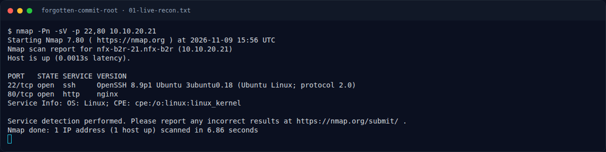
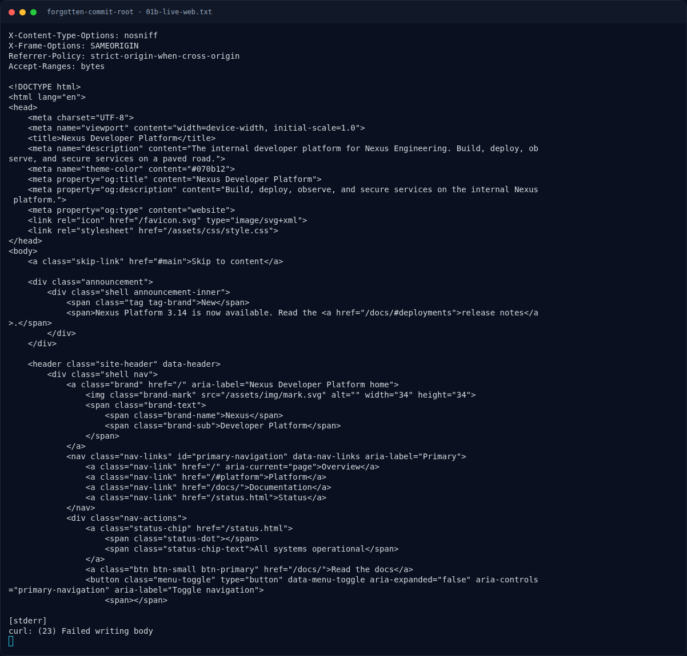
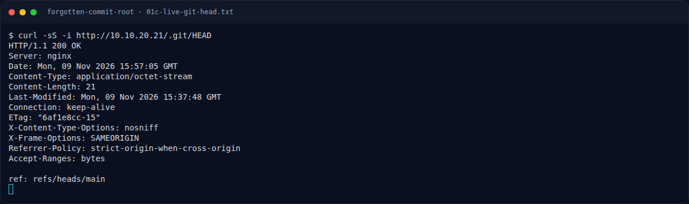
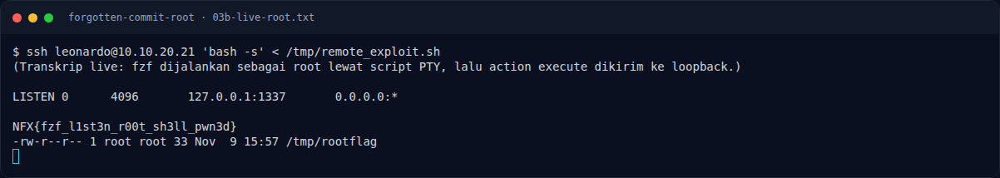

# Forgotten Commit (Root) — Recon

[← Overview](01-forgotten-commit-root.md) · [Index](index.md)

### 1.1 Deskripsi challenge

> Author: Ariaf
>
> Setelah mendapatkan akses user, lanjutkan enumerasi pada mesin target.
> Temukan jalur eskalasi yang tersisa, dapatkan akses root, lalu baca root.txt.
>
> Target: `10.10.20.21`

Challenge ini adalah tahap Root dari rangkaian **Forgotten Commit**. Flag root
berada di `/root/root.txt`; user flag di `/home/leonardo/user.txt` adalah
prasyarat yang harus dilewati lebih dulu.

### 1.2 File / service yang diberikan

| File/Service | Ukuran/Endpoint | Keterangan |
|---|---|---|
| `NFX/b2r/labs/bastion` | TCP, dari platform | Pintu masuk peserta |
| `NFX/b2r/labs/21` | `10.10.20.21` | Target: nginx :80, OpenSSH :22 |
| `umum/Boot To Root/forgotten-commit-root/BRIEF.md` | 26 baris | Deskripsi + service |
| `umum/Boot To Root/forgotten-commit-root/challenge.json` | 44 baris | Metadata platform |

Tidak ada attachment binary. Challenge sepenuhnya berupa live service.

### 1.3 Environment

- Bastion: `10.10.20.10` (SSH), dari situ target `10.10.20.21` diakses.
- Tools: `nmap`, `curl`, `git`, `git-dumper`, `ssh`, `fzf` (di target).
- Tidak ada kredensial awal. Kredensial didapat dari history Git.

### 1.4 Triage awal

Perintah live yang dijalankan dari bastion:

```bash
nmap -Pn -sV -p 22,80 10.10.20.21
curl -sS -i http://10.10.20.21/
curl -sS -i http://10.10.20.21/.git/HEAD
```

Output asli:

```text
PORT   STATE SERVICE VERSION
22/tcp open  ssh     OpenSSH 8.9p1 Ubuntu 3ubuntu0.18 (Ubuntu Linux; protocol 2.0)
80/tcp open  http    nginx
Service Info: OS: Linux; CPE: cpe:/o:linux:linux_kernel
```

`http://10.10.20.21/` menyajikan situs statis **"Nexus Developer Platform"**.
Direktori `/.git/` dapat diakses dari webroot dan mengembalikan ref HEAD.

**Catatan instance.** Instance `NFX/b2r/labs/21` di-deploy ulang lewat platform
pada 2026-11-09. Setelah status `ONLINE`, port 22 dan 80 stabil selama sesi
live rerun; seluruh perintah di bawah dijalankan pada instance tersebut.

### Evidence langkah ini



*Terminal evidence — live rerun 2026-11-09 (`01-live-recon.txt`).*



*Terminal evidence — live rerun 2026-11-09 (`01b-live-web.txt`).*



*Terminal evidence — live rerun 2026-11-09 (`01c-live-git-head.txt`).*



*Terminal evidence — live rerun 2026-11-09 (`03b-live-root.txt`).*

**Berkas mentah langkah ini:**

- [`01-live-recon.txt`](assets/forgotten-commit-root/01-live-recon.txt)
- [`01b-live-web.txt`](assets/forgotten-commit-root/01b-live-web.txt)
- [`01c-live-git-head.txt`](assets/forgotten-commit-root/01c-live-git-head.txt)
- [`03b-live-root.txt`](assets/forgotten-commit-root/03b-live-root.txt)
