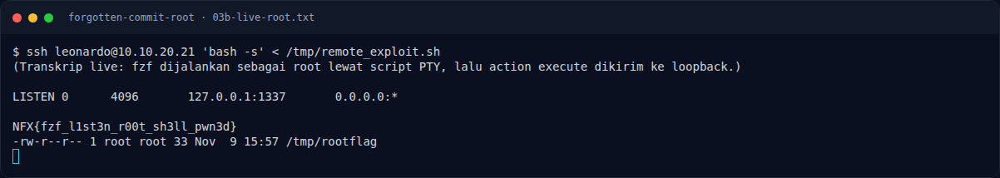

# Forgotten Commit (Root) — Kenapa fzf bisa menjadi privesc

[← Overview](01-forgotten-commit-root.md) · [Index](index.md)

## 3.4 Kenapa fzf bisa menjadi privesc

`fzf --listen 1337` membuka HTTP API untuk mengirim action. API ini tidak
memiliki autentikasi dan hanya mengandalkan posisi jaringan (loopback). Begitu
fzf dijalankan dengan `sudo`, seluruh action `execute(...)` dieksekusi dengan
UID 0. Jadi kombinasinya berbahaya:

- `sudo` memberikan ekuivalensi root kepada binary yang memang punya fitur
  menjalankan command.
- `--listen` membuka jalur kontrol dari proses lokal mana pun.
- Tidak ada pembatasan command, argumen, atau user yang boleh mengirim action.

Ini bukan bug memory corruption; ini penyalahgunaan fitur sah fzf yang diberikan
hak root tanpa pembatasan.

### Evidence langkah ini

*Terminal evidence — live rerun 2026-11-09 (`03b-live-root.txt`).*

**Berkas mentah langkah ini:**

- [`03b-live-root.txt`](assets/forgotten-commit-root/03b-live-root.txt)
