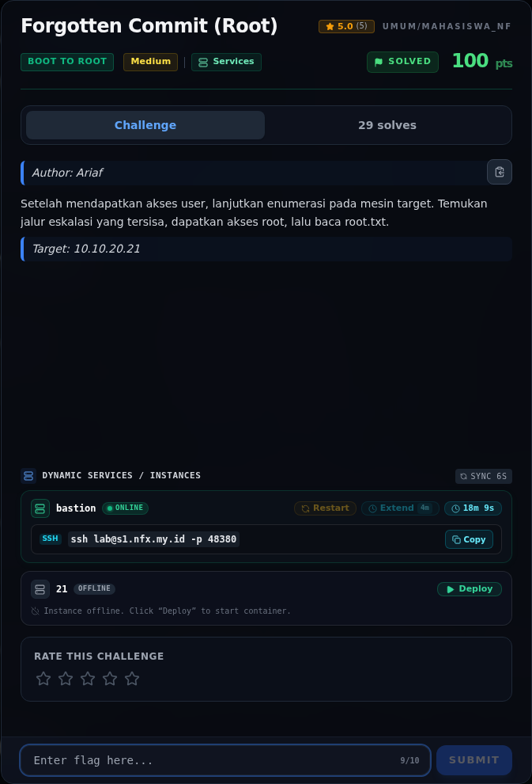

# Forgotten Commit (Root) — Referensi

[← Overview](01-forgotten-commit-root.md) · [Index](index.md)

> **Langkah 8/8 — Referensi.** Referensi
>
> **Titik penting:** —
>
> **Selesai.** Kembali ke [Overview](01-forgotten-commit-root.md).

- `git-dumper` — tool untuk mengambil repository dari `.git` yang terekspos.
- Git object model: `git show <commit>:<path>` untuk membaca file di commit lama.
- fzf man page: `--listen[=[ADDR:]PORT]` dan action `execute(...)`.
- Prinsip least privilege untuk `sudoers` (NOPASSWD + binary dengan fitur exec).
- OWASP: exposure of `.git` metadata dan secret management.

### Evidence langkah ini

*Challenge brief asli di platform NFX CTF 2026.*
