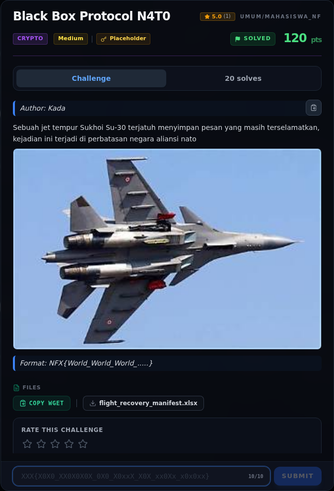

# Black Box Protocol N4T0 — Recon

[← Overview](02-black-box-protocol-n4t0.md) · [Index](index.md)

> **Langkah 1/7 — Recon.** Tidak ada hint tambahan.
>
> **Titik penting:** file flight_recovery_manifest.xlsx · mkdir -p /tmp/opencode/bb && cd /tmp/opencode/bb · cp <repo>/umum/Crypto/black-box-protocol-n4t0/flight_recovery_manifest.xlsx .
>
> **Berikutnya:** [Analisis](02-black-box-protocol-n4t0-02-analisis.md)

### 1.1 Deskripsi challenge

> Author: Kada
>
> Sebuah jet tempur Sukhoi Su-30 terjatuh menyimpan pesan yang masih
> terselamatkan, kejadian ini terjadi di perbatasan negara aliansi nato
>
> Format: `NFX{World_World_World_.....}`

Tidak ada hint tambahan. Judul memberi petunjuk ganda: **N4T0** (NATO) dan
**Black Box** (data mentah yang harus dibaca sebagai sekumpulan format).

### 1.2 File yang diberikan

| File | Ukuran | SHA-256 |
|---|---:|---|
| `flight_recovery_manifest.xlsx` | 5.823 byte | `afeb670e8f99e98968d8d1d14db12f267ac2b639ae47ce4602992bfe76518b3b` |

```bash
$ file flight_recovery_manifest.xlsx
flight_recovery_manifest.xlsx: Microsoft Excel 2007+
```

### 1.3 Environment

- Python 3.12
- `unzip`, `xmllint`/`cat`, Python `struct`
- Tidak perlu Excel/LibreOffice; seluruh isi XLSX adalah XML di dalam ZIP.

### 1.4 Triage awal

```bash
$ mkdir -p /tmp/opencode/bb && cd /tmp/opencode/bb
$ cp <repo>/umum/Crypto/black-box-protocol-n4t0/flight_recovery_manifest.xlsx .
$ unzip -o -q flight_recovery_manifest.xlsx -d x
$ find x -type f | sort
x/[Content_Types].xml
x/_rels/.rels
x/xl/_rels/workbook.xml.rels
x/xl/drawings/drawing1.xml
x/xl/persons/person.xml
x/xl/sharedStrings.xml
x/xl/styles.xml
x/xl/theme/theme1.xml
x/xl/workbook.xml
x/xl/worksheets/_rels/sheet1.xml.rels
x/xl/worksheets/sheet1.xml
```

**Temuan:** hanya 11 part, satu worksheet, satu drawing kosong, tidak ada
`docProps`, `customXml`, `vbaProject.bin`, `comments*.xml`, atau media.

### Evidence langkah ini



*Challenge brief asli di platform NFX CTF 2026.*
