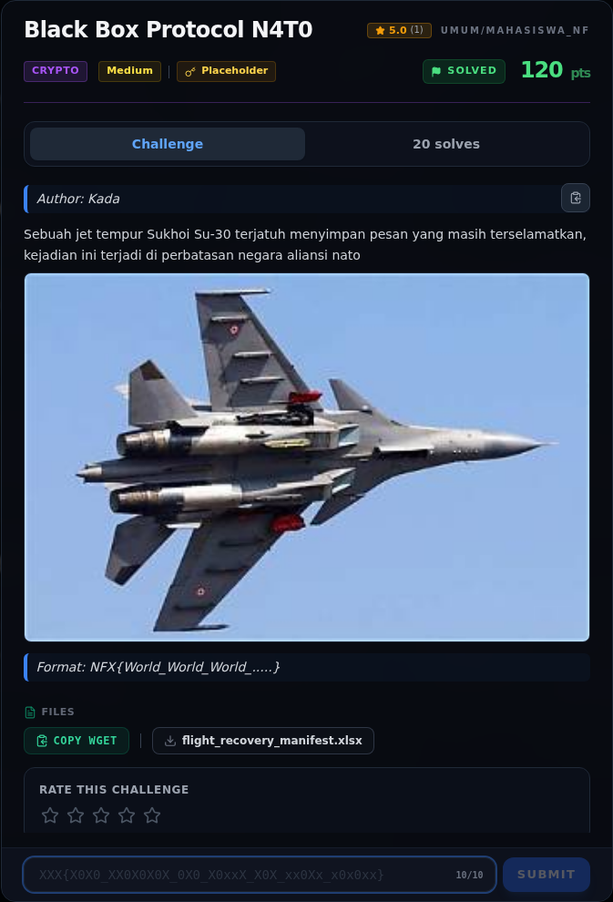

# Black Box Protocol N4T0 — Analisis

[← Overview](02-black-box-protocol-n4t0.md) · [Index](index.md)

> **Langkah 2/7 — Analisis.** xl/workbook.xml hanya mendefinisikan satu sheet:
>
> **Titik penting:** xl/workbook.xml hanya mendefinisikan satu sheet:
>
> **Berikutnya:** [Analisis](02-black-box-protocol-n4t0-03-analisis-2.md)

## 2.1 Struktur sheet

`xl/workbook.xml` hanya mendefinisikan satu sheet:

```xml
<sheets><sheet name="Mail_Black_Box" sheetId="1" r:id="rId1"/></sheets>
```

`sheet1.xml` berisi 17 baris dan 3 kolom:

| Baris | A (Kode Pesawat) | B (kusi Pesawat) | C (Jumlah Barang pesawat) |
|---:|---|---|---|
| 2 | November | `43` (numeric, style hex) | `2.78842154354096E23` |
| 3 | Four | `30` (numeric) | `7.07930905431442E31` |
| 4 | Tango | `6d` (string) | `3.57380928075183E30` |
| 5 | Zero | `62` (numeric) | `null` |
| 6 | Papa | `4f` (string) | `null` |
| 7 | Hotel | `5f` (string) | `null` |
| 8 | Zero | `48` (numeric) | `null` |
| 9 | November | `33` (numeric) | `null` |
| 10 | Three | `58` (numeric) | `null` |
| 11 | Tango | `5f` (string) | `null` |
| 12 | One | `null` | `null` |
| 13 | Charlie | `null` | `null` |
| 14 | One | `null` | `null` |
| 15 | November | `null` | `null` |
| 16 | One | `null` | `null` |

Penting: sel B yang bertipe numerik memakai `s="3"`. Di `styles.xml`,
`numFmtId` untuk style tersebut adalah format **hex**, sehingga `43` ditampilkan
sebagai `0x43` (`C`), bukan angka desimal 43. Sel B yang bertipe string sudah
berisi teks hex (`"6d"`, `"4f"`, `"5f"`).

## 2.2 Kolom A — NATO phonetic + kata angka

NATO memberi huruf, kata angka memberi digit:

| Kata | Output |
|---|---|
| November | `N` |
| Four | `4` |
| Tango | `T` |
| Zero | `0` |
| Papa | `P` |
| Hotel | `H` |
| Zero | `0` |
| November | `N` |
| Three | `3` |
| Tango | `T` |
| One | `1` |
| Charlie | `C` |
| One | `1` |
| November | `N` |
| One | `1` |

Hasil: `N4T0PH0N3T1C1N1`.

Karena encoding NATO membuang huruf besar/kecil dan underscore, pembacaan
semantiknya adalah `N4T0 PH0N3T1C 1N1` ("NATO phonetic ini").

## 2.3 Kolom B — hex byte

Byte yang terbentuk:

```text
43 30 6d 62 4f 5f 48 33 58 5f
 C  0  m  b  O  _  H  3  X  _
```

Hasil: `C0mbO_H3X_` ("combo hex"). Underscore terakhir adalah bagian data
(pemisah menuju kolom C), bukan padding.

### Evidence langkah ini



*Challenge brief asli di platform NFX CTF 2026.*
