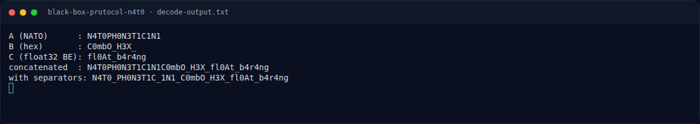

# Black Box Protocol N4T0 — Analisis

[← Overview](02-black-box-protocol-n4t0.md) · [Index](index.md)

> **Langkah 3/7 — Analisis.** Tiga nilai di kolom C, jika di-struct.pack(">f", v), menghasilkan byte ASCII:
>
> **Titik penting:** NFX{N4T0_PH0N3T1C_1N1_C0mbO_H3X_fl0At_b4r4ng}
>
> **Berikutnya:** [Solver](02-black-box-protocol-n4t0-04-solver.md)

## 2.4 Kolom C — float32 big-endian

Tiga nilai di kolom C, jika di-`struct.pack(">f", v)`, menghasilkan byte ASCII:

| Nilai | `struct.pack(">f")` | ASCII |
|---|---|---|
| `2.78842154354096E23` | `66 6c 30 41` | `fl0A` |
| `7.07930905431442E31` | `74 5f 62 34` | `t_b4` |
| `3.57380928075183E30` | `72 34 6e 67` | `r4ng` |

Hasil: `fl0At_b4r4ng` ("float barang").

Catatan: angka di Excel disimpan sebagai double dengan 15 digit signifikan;
bit mantissa terbawah adalah artefak pembulatan, bukan payload tambahan.
Little-endian menghasilkan `A0lf4b_tgn4r` yang bukan teks, sehingga big-endian
adalah satu-satunya pembacaan bermakna.

## 2.5 Pemeriksaan payload tambahan

Karena flag turunan ditolak, dilakukan audit menyeluruh terhadap workbook:

- Hanya 1 sheet, state `visible`; tidak ada `hidden`/`veryHidden`.
- `definedNames` kosong.
- `sharedStrings.xml`: 16 string unik, 39 referensi; semuanya terpakai
  (header, kata NATO, fragmen hex, dan literal `null`).
- Tidak ada cell comment / threaded comment (`persons/person.xml` kosong).
- `drawing1.xml` kosong (tidak ada shape, image, atau teks).
- Tidak ada `docProps/core.xml` atau `docProps/app.xml`.
- Tidak ada VBA/macro, external link, hyperlink, formula, custom XML.
- Tidak ada baris/kolom tersembunyi.
- ZIP bersih: 11 part, CRC normal, tidak ada trailing bytes/comment ZIP.

Kesimpulan: satu-satunya payload adalah hasil decode A/B/C.

## 2.6 Model penyusunan flag

Pola yang paling masuk akal: satu body flag dipecah menjadi tiga bagian, lalu
masing-masing di-encode dengan metode yang berbeda:

```text
body = N4T0_PH0N3T1C_1N1_C0mbO_H3X_fl0At_b4r4ng
         \_____ A ______/ \___ B ____/ \____ C _____/
```

- A kehilangan underscore karena NATO tidak punya kata untuk `_`.
- B mempertahankan underscore, termasuk underscore pemisah terakhir.
- C di-encode sebagai float32 big-endian dan mempertahankan underscore.

Maka kandidat terkuat:

```text
NFX{N4T0_PH0N3T1C_1N1_C0mbO_H3X_fl0At_b4r4ng}
```

### Evidence langkah ini



*Terminal evidence — transkrip langkah — `term-decode-output.png`.*

**Berkas mentah terkait:**

- [`decode-output.txt`](assets/black-box-protocol-n4t0/decode-output.txt)
- [`sha256.txt`](assets/black-box-protocol-n4t0/sha256.txt)
