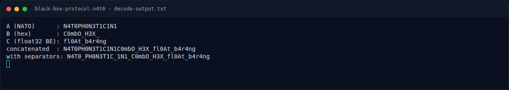
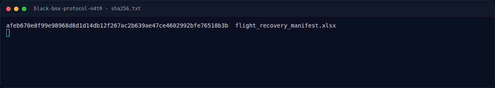

# Black Box Protocol N4T0 — Solver

[← Overview](02-black-box-protocol-n4t0.md) · [Index](index.md)

> **Langkah 4/7 — Solver.** Tersimpan di writeups/assets/black-box-protocol-n4t0/decodexlsx.py:
>
> **Titik penting:** python3 writeups/assets/black-box-protocol-n4t0/decode_xlsx.py
>
> **Berikutnya:** [Flag](02-black-box-protocol-n4t0-05-flag.md)

### 3.1 Strategi

1. Baca `sheet1.xml` dan `sharedStrings.xml` untuk mendapatkan nilai sel apa
   adanya.
2. Terjemahkan kolom A memakai tabel NATO + kata angka.
3. Terjemahkan kolom B: sel numerik → byte hex; sel string → byte hex.
4. Terjemahkan kolom C: `struct.pack(">f", value)`.
5. Gabungkan dan bandingkan dengan format flag.

### 3.2 Script

Tersimpan di `writeups/assets/black-box-protocol-n4t0/decode_xlsx.py`:

```python
import struct

NATO = {
    "November": "N", "Four": "4", "Tango": "T", "Zero": "0", "Papa": "P",
    "Hotel": "H", "Three": "3", "One": "1", "Charlie": "C",
}

a_words = ["November", "Four", "Tango", "Zero", "Papa", "Hotel", "Zero",
           "November", "Three", "Tango", "One", "Charlie", "One",
           "November", "One"]
A = "".join(NATO[w] for w in a_words)
print("A (NATO)      :", A)

b_cells = [0x43, 0x30, "6d", 0x62, "4f", "5f", 0x48, 0x33, 0x58, "5f"]
B = bytes(int(x, 16) if isinstance(x, str) else x for x in b_cells).decode()
print("B (hex)       :", B)

c_floats = [2.78842154354096E23, 7.07930905431442E31, 3.57380928075183E30]
C = b"".join(struct.pack(">f", v) for v in c_floats).decode()
print("C (float32 BE):", C)

print("concatenated  :", A + B + C)
print("with separators:", "N4T0_PH0N3T1C_1N1_C0mbO_H3X_fl0At_b4r4ng")
```

### 3.3 Output asli

```text
$ python3 writeups/assets/black-box-protocol-n4t0/decode_xlsx.py
A (NATO)      : N4T0PH0N3T1C1N1
B (hex)       : C0mbO_H3X_
C (float32 BE): fl0At_b4r4ng
concatenated  : N4T0PH0N3T1C1N1C0mbO_H3X_fl0At_b4r4ng
with separators: N4T0_PH0N3T1C_1N1_C0mbO_H3X_fl0At_b4r4ng
```

### Evidence langkah ini



*Terminal evidence — `decode-output.txt` (arsip transkrip sesi solve).*



*Terminal evidence — `sha256.txt` (arsip transkrip sesi solve).*

**Berkas mentah langkah ini:**

- [`decode-output.txt`](assets/black-box-protocol-n4t0/decode-output.txt)
- [`sha256.txt`](assets/black-box-protocol-n4t0/sha256.txt)
