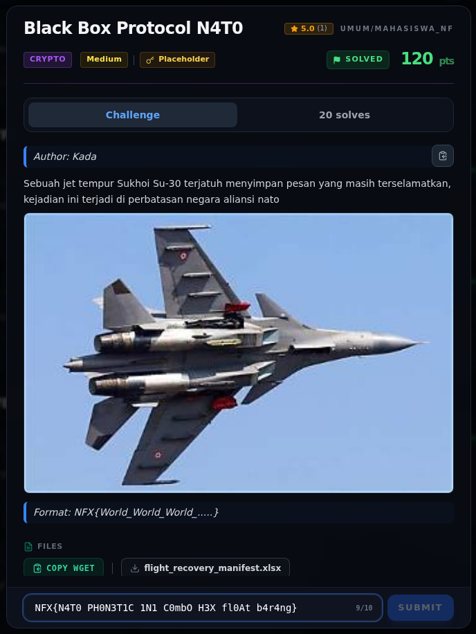
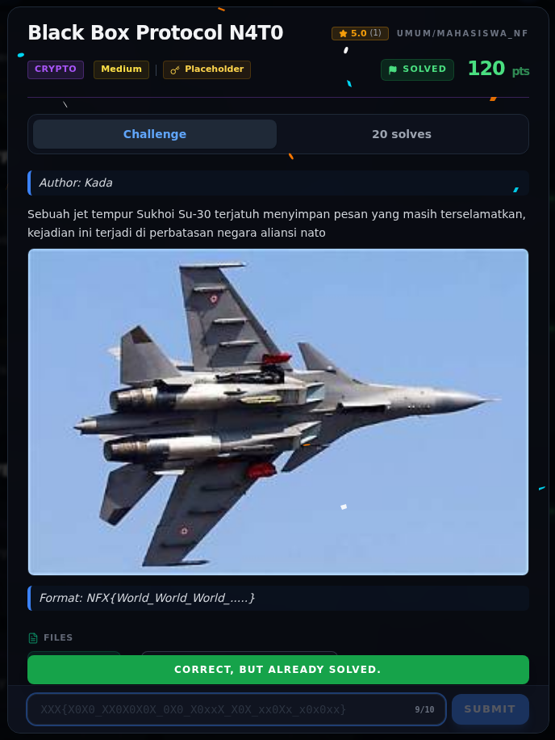
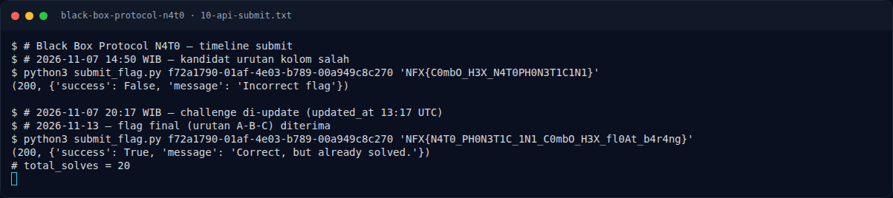

# Black Box Protocol N4T0 — Flag

[← Overview](02-black-box-protocol-n4t0.md) · [Index](index.md)

> **Langkah 5/7 — Flag.**
>
> **Asal flag.** Decode tiga kolom XLSX dengan urutan **A-B-C**, lalu
> disubmit lewat form web platform.
> **Tingkat bukti metode.** Terdokumentasi.
> [Buka Evidence](02-black-box-protocol-n4t0-06-bukti-evidence.md)

> **Status metode:** **FULL** — metode utama berhasil direproduksi.  
> **Flag:** `NFX{N4T0_PH0N3T1C_1N1_C0mbO_H3X_fl0At_b4r4ng}`
> **Status:** `VERIFIED`

## Flag

```text
NFX{N4T0_PH0N3T1C_1N1_C0mbO_H3X_fl0At_b4r4ng}
```

## Timeline verifikasi

Challenge ini sempat di-update di platform pada **2026-11-07 20:17 WIB**
(`updated_at 13:17 UTC`). Sebelum update, kandidat dengan urutan kolom salah
(`NFX{C0mbO_H3X_N4T0PH0N3T1C1N1}`) ditolak. Setelah urutan dibetulkan menjadi
A-B-C, flag final diterima.

| Waktu | Yang dicoba | Respons |
|---|---|---|
| 2026-11-07 14:50 WIB | urutan kolom salah `NFX{C0mbO_H3X_N4T0PH0N3T1C1N1}` | `Incorrect flag` |
| 2026-11-07 20:17 WIB | challenge di-update platform | — |
| 2026-11-13 | flag final `NFX{N4T0...}` | `Correct, but already solved.` |

## Validasi platform (real)

**1. Flag yang dikirim (sebelum submit).** Input berisi flag final, bukan
placeholder:



*Screenshot asli: `NFX{N4T0_PH0N3T1C_1N1_C0mbO_H3X_fl0At_b4r4ng}` diketik di
input form challenge.*

**2. Respons platform setelah submit.** Input otomatis dikosongkan dan
menampilkan placeholder `XXX{...}`; banner hijau adalah respons platform:



*Screenshot asli: platform menjawab `CORRECT, BUT ALREADY SOLVED.` untuk flag
final. Placeholder `XXX{...}` hanya teks bantuan input setelah input
dikosongkan, bukan flag yang dikirim.*

## Terminal evidence (timeline submit)



*Arsip transkrip: kandidat urutan kolom salah ditolak, lalu flag final
diterima setelah challenge di-update. Transkrip mentah:
[`10-api-submit.txt`](assets/black-box-protocol-n4t0/10-api-submit.txt).*
