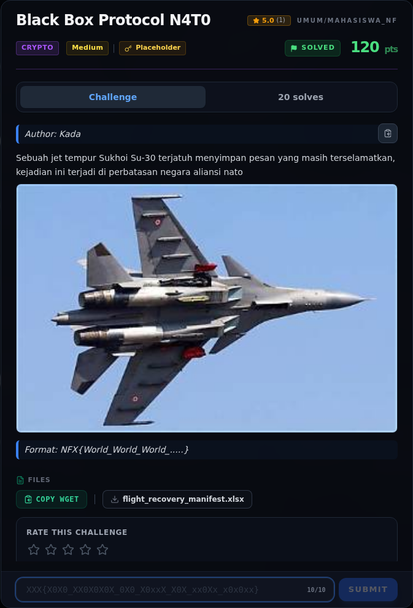
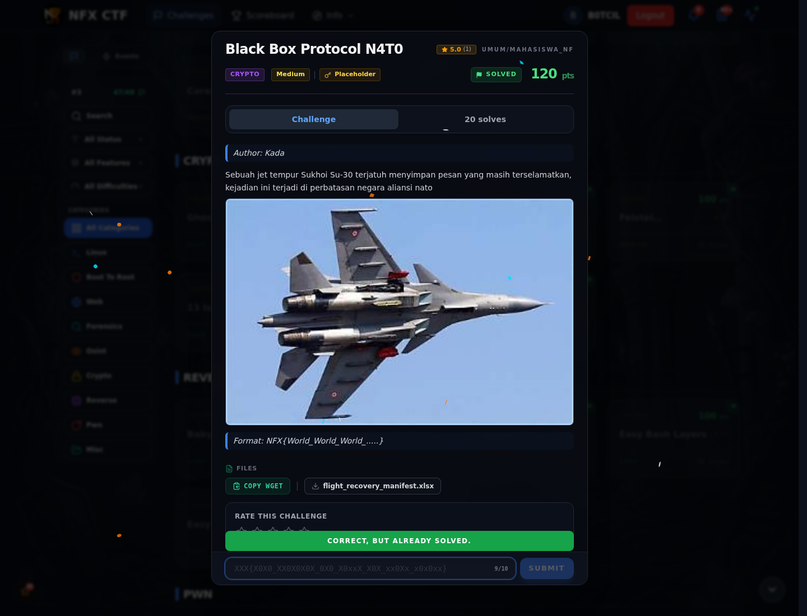
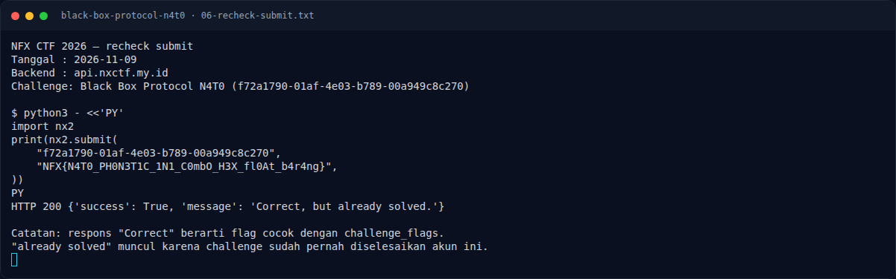
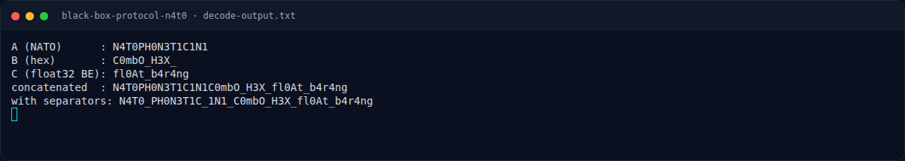
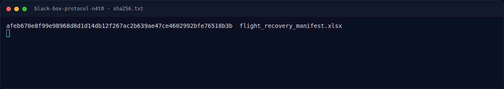

# Black Box Protocol N4T0 — Evidence / Bukti

5 screenshot4 transkrip / script

[← Overview](02-black-box-protocol-n4t0.md) · [Index](index.md)

## Arsip Evidence

> Semua file berasal dari `assets/black-box-protocol-n4t0/`. Screenshot platform dan terminal adalah bukti asli dari sesi solve; transkrip mentah tetap ditautkan di bagian bawah.

### Platform

<figure><figcaption>00-challenge-platform.png</figcaption></figure>

*Challenge brief asli di platform NFX CTF 2026.*

<figure><figcaption>00b-submit-platform.png</figcaption></figure>

*Submit flag di platform: `CORRECT, BUT ALREADY SOLVED.`*

### Terminal (arsip sesi)

<figure><figcaption>term-06-recheck-submit.png</figcaption></figure>

*Terminal evidence — `06-recheck-submit.txt` (arsip transkrip sesi solve).*

<figure><figcaption>term-decode-output.png</figcaption></figure>

*Terminal evidence — `decode-output.txt` (arsip transkrip sesi solve).*

<figure><figcaption>term-sha256.png</figcaption></figure>

*Terminal evidence — `sha256.txt` (arsip transkrip sesi solve).*

### Transkrip mentah & script

- [`06-recheck-submit.txt`](assets/black-box-protocol-n4t0/06-recheck-submit.txt)
- [`decode-output.txt`](assets/black-box-protocol-n4t0/decode-output.txt)
- [`decode_xlsx.py`](assets/black-box-protocol-n4t0/decode_xlsx.py)
- [`sha256.txt`](assets/black-box-protocol-n4t0/sha256.txt)

## Tabel Evidence

| Bukti | File | Keterangan |
|---|---|---|
| Hash attachment | `assets/black-box-protocol-n4t0/sha256.txt` | SHA-256 XLSX |
| Decoder | `assets/black-box-protocol-n4t0/decode_xlsx.py` | Script decode tiga kolom |
| Output decoder | `assets/black-box-protocol-n4t0/decode-output.txt` | Output asli |
| Log submit lama | `work/bb_submit_agent.jsonl` | 53 percobaan di backend lama |
| Recheck submit | `assets/black-box-protocol-n4t0/06-recheck-submit.txt` | `Correct, but already solved.` |
| Release map | `work/release_map.json` | Kandidat alternatif |