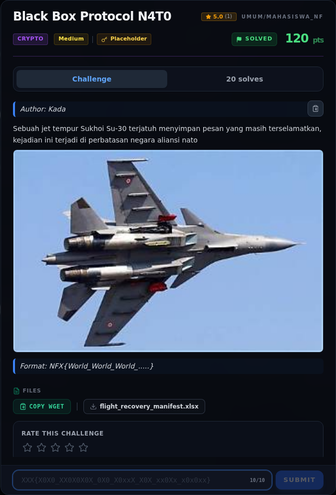
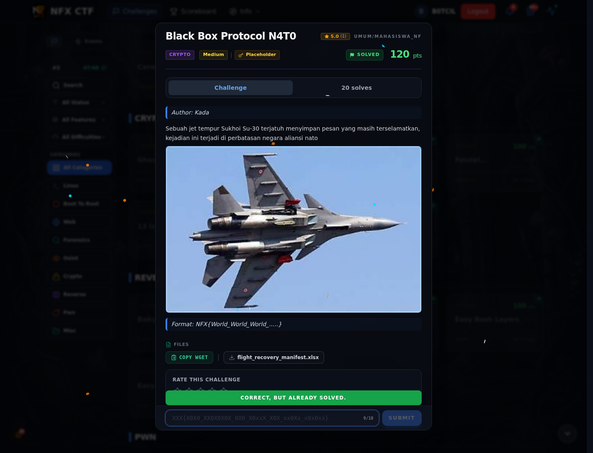

# Black Box Protocol N4T0

Track Mahasiswa NF · CryptoMedium280 poinVERIFIED

| Field | Nilai |
|---|---|
| Event | `umum/mahasiswa_nf` |
| Kategori | `Crypto` |
| Difficulty | `Medium` |
| Poin | `280` |
| Author | `Kada` |
| Tools | python3, strings, git |
| Flag | `NFX{N4T0_PH0N3T1C_1N1_C0mbO_H3X_fl0At_b4r4ng}` |
| Status | `VERIFIED` |

[← Kembali ke Index](index.md)

## Challenge Brief (platform)

*Challenge brief asli di platform NFX CTF 2026.*

## Cerita singkat

Jadi ceritanya gini. attachment hanya satu file: `flight_recovery_manifest.xlsx` dengan satu sheet `Mail_Black_Box`. Terus, tiga kolom memakai tiga encoding berbeda:. Lalu, **A – Kode Pesawat**: kata NATO + kata angka → `N4T0PH0N3T1C1N1` (dibaca `N4T0 PH0N3T1C 1N1`, "NATO phonetic ini"). Nah, dari situ kita bisa sampai ke flag dan bukti submit-nya.

## Alur & Titik Penting

| # | Langkah | Titik penting | Buka |
|---:|---|---|---|
| 1 | Recon | file flight_recovery_manifest.xlsx | [Buka](02-black-box-protocol-n4t0-01-recon.md) |
| 2 | Analisis | xl/workbook.xml hanya mendefinisikan satu sheet: | [Buka](02-black-box-protocol-n4t0-02-analisis.md) |
| 3 | Analisis | NFX{N4T0_PH0N3T1C_1N1_C0mbO_H3X_fl0At_b4r4ng} | [Buka](02-black-box-protocol-n4t0-03-analisis-2.md) |
| 4 | Solver | python3 writeups/assets/black-box-protocol-n4t0/decode_xlsx.py | [Buka](02-black-box-protocol-n4t0-04-solver.md) |
| 5 | Flag | NFX{N4T0_PH0N3T1C_1N1_C0mbO_H3X_fl0At_b4r4ng} | [Buka](02-black-box-protocol-n4t0-05-flag.md) |
| 6 | Bukti / Evidence | arsip screenshot dan transkrip | [Buka](02-black-box-protocol-n4t0-06-bukti-evidence.md) |
| 7 | Referensi | sebelumnya, kesimpulan sama: payload habis, flag platform tidak cocok). | [Buka](02-black-box-protocol-n4t0-07-referensi.md) |

## Ringkasan

> **Catatan verifikasi:** seluruh isi workbook berhasil didekode dan hasilnya
> konsisten secara byte. Flag dari payload workbook sudah **diterima platform**
> lewat form submit web; screenshot-nya ada di halaman Flag.
## TL;DR

- Attachment hanya satu file: `flight_recovery_manifest.xlsx` dengan satu sheet
  `Mail_Black_Box`.
- Tiga kolom memakai tiga encoding berbeda:
  - **A – Kode Pesawat**: kata NATO + kata angka → `N4T0PH0N3T1C1N1`
    (dibaca `N4T0 PH0N3T1C 1N1`, "NATO phonetic ini").
  - **B – kusi Pesawat**: byte hex (campuran sel angka ber-format hex dan sel
    teks) → `C0mbO_H3X_`.
  - **C – Jumlah Barang pesawat**: bilangan yang, jika di-*pack* sebagai
    IEEE-754 float32 big-endian, menjadi ASCII → `fl0At_b4r4ng`.
- Konkatenasi natural: `N4T0_PH0N3T1C_1N1_C0mbO_H3X_fl0At_b4r4ng`.
- Tidak ada payload tambahan di XLSX (tidak ada hidden sheet, comment,
  drawing, macro, docProps, atau trailing zip data).
- Flag tersebut **diterima platform** lewat form submit web
  (`CORRECT, BUT ALREADY SOLVED.`). Status challenge ini adalah **VERIFIED**.

Pratinjau evidence. Buka halaman <a href="02-black-box-protocol-n4t0-06-bukti-evidence.html">Evidence / Bukti</a> untuk semua screenshot dan transkrip.

## Navigasi Halaman

<a class="nx-page-card" href="02-black-box-protocol-n4t0-01-recon.html"><b>Recon</b>Enumerasi target dan bukti awal</a>
<a class="nx-page-card" href="02-black-box-protocol-n4t0-02-analisis.html"><b>Analisis</b>Membaca alur dan akar masalah</a>
<a class="nx-page-card" href="02-black-box-protocol-n4t0-03-analisis-2.html"><b>Analisis</b>Membaca alur dan akar masalah</a>
<a class="nx-page-card" href="02-black-box-protocol-n4t0-04-solver.html"><b>Solver</b>Langkah exploit dan solver</a>
<a class="nx-page-card" href="02-black-box-protocol-n4t0-05-flag.html"><b>Flag</b>Flag dan verifikasi platform</a>
<a class="nx-page-card" href="02-black-box-protocol-n4t0-06-bukti-evidence.html"><b>Bukti / Evidence</b>Screenshot, transkrip, dan artefak</a>
<a class="nx-page-card" href="02-black-box-protocol-n4t0-07-referensi.html"><b>Referensi</b>Sumber dan bacaan lanjutan</a>

