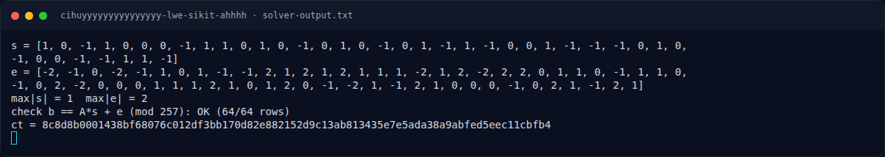

# Cihuyyyyyyyyyyyyyyy LWE sikit ahhhh — Solver

[← Overview](03-cihuyyyyyyyyyyyyyyy-lwe-sikit-ahhhh.md) · [Index](index.md)

> **Langkah 3/7 — Solver.** Tersimpan di docs/assets/cihuyyyyyyyyyyyyyyy-lwe-sikit-ahhhh/solvelwe.py:
>
> **Titik penting:** Tersimpan di docs/assets/cihuyyyyyyyyyyyyyyy-lwe-sikit-ahhhh/solvelwe.py:
>
> **Berikutnya:** [Solver](03-cihuyyyyyyyyyyyyyyy-lwe-sikit-ahhhh-04-solver-2.md)

## 3.1 Strategi

1. Load `A`, `b`, `q` dari `lwe.py`.
2. Bangun basis Kannan 105 dimensi.
3. LLL (`delta=0.99`) lalu BKZ (`block_size=20`, `max_loops=2`).
4. Cari baris dengan koordinat terakhir `±1`; ambil 40 koordinat secret.
5. Hitung ulang `e` dan validasi seluruh 64 persamaan.

## 3.2 Script lengkap

Tersimpan di
`docs/assets/cihuyyyyyyyyyyyyyyy-lwe-sikit-ahhhh/solve_lwe.py`:

```python
#!/usr/bin/env python3
"""Recover the ternary LWE secret from lwe.py with a Kannan embedding."""
from fpylll import IntegerMatrix, LLL, BKZ
import sys

ns = {}
exec(open(sys.argv[1] if len(sys.argv) > 1 else "lwe.py").read(), ns)
A, b, q = ns["A"], ns["b"], ns["q"]
m, n = len(A), len(A[0])

d = m + n + 1
B = IntegerMatrix(d, d)
for i in range(m):
    B[i, i] = q
for j in range(n):
    for i in range(m):
        B[m + j, i] = A[i][j]
    B[m + j, m + j] = 1
for i in range(m):
    B[d - 1, i] = b[i]
B[d - 1, d - 1] = 1

LLL.reduction(B, delta=0.99)
BKZ.reduction(B, BKZ.Param(block_size=20, max_loops=2))

for r in range(d):
    row = [int(B[r, j]) for j in range(d)]
    if abs(row[-1]) != 1:
        continue
    s = [row[m + j] for j in range(n)]
    if max(map(abs, s)) > 1:
        continue
    e = [(b[i] - sum(A[i][j] * s[j] for j in range(n))) % q for i in range(m)]
    e = [x if x <= q // 2 else x - q for x in e]
    if max(map(abs, e)) <= 3:
        assert all((sum(A[i][j] * s[j] for j in range(n)) + e[i]) % q == b[i] % q
                   for i in range(m))
        print("s =", s)
        print("e =", e)
        print("max|s| =", max(map(abs, s)), " max|e| =", max(map(abs, e)))
        print("check b == A*s + e (mod %d): OK (64/64 rows)" % q)
        print("ct =", ns["ct"])
        break
else:
    print("no short vector found")
```

## 3.3 Apakah `ct` bisa didekripsi?

`ct` yang diberikan berukuran **41 byte**, sama dengan panjang flag yang
diterima platform:

```text
ct  = 8c8d8b0001438bf68076c012df3bb170d82e882152d9c13ab813435e7e5ada38a9abfed5eec11cbfb4
len = 41 byte
```

Dengan flag yang diketahui, keystream-nya bisa dihitung:

```text
ks = ct XOR flag
   = c2cbd3435505f09ab402b423bc08ee03b51ae44d0daaf259ca203701320d9f679ececcb4def0258ac9
```

Tetapi **tidak ada kode KDF, nonce, atau fungsi enkripsi** di `lwe.py`.
Yang tersedia hanya `A`, `b`, `q`, dan `ct`. Artinya hubungan `ct` dengan
`secret s`/`error e` tidak bisa dibuktikan dari lampiran.

Kandidat KDF yang sudah diuji dan **tidak cocok**:

- `s`/`e` sebagai byte mentah, string, JSON, atau join desimal;
- SHA-256, SHA-1, MD5 dari `s`/`e` (byte, string, JSON);
- XOR/repeat stream dari hash tersebut;
- AES-CTR dan RC4 dengan key turunan SHA-256 dari `s`/`e`.

Kesimpulan teknis:

- `s` dan `e` berhasil dipulihkan 100% (64/64 persamaan).
- `ct` 41 byte, flag 41 byte.
- KDF/encryption tidak ada di lampiran; kandidat umum sudah diuji dan gagal.
- Flag final adalah plaintext yang **diverifikasi platform**, bukan tebakan dari
  keystream yang tidak diketahui.

Karena tidak ada yang cocok, status metode challenge ini tetap **PARTIAL**:
secret LWE berhasil dipulihkan, tetapi dekripsi `ct` tidak bisa direproduksi
byte-exact. Flag diverifikasi lewat platform, bukan diklaim dari solver.

### Evidence langkah ini



*Terminal evidence — `solver-output.txt` (arsip transkrip sesi solve).*

**Berkas mentah langkah ini:**

- [`solver-output.txt`](assets/cihuyyyyyyyyyyyyyyy-lwe-sikit-ahhhh/solver-output.txt)
