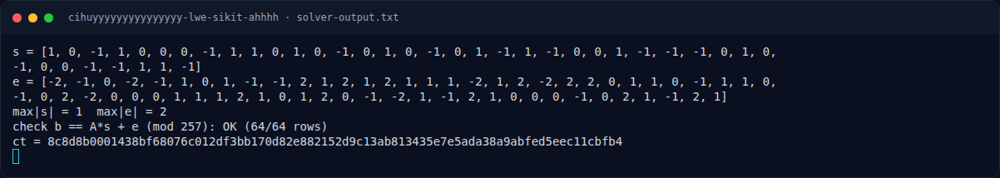

# Cihuyyyyyyyyyyyyyyy LWE sikit ahhhh — Solver

[← Overview](03-cihuyyyyyyyyyyyyyyy-lwe-sikit-ahhhh.md) · [Index](index.md)

> **Langkah 4/7 — Solver.** Panjang ini tepat sama dengan panjang flag yang terverifikasi (41 byte), jadi ct hampir pasti merupakan stream cipher / XOR keystream, bukan ciphertext blok.
>
> **Titik penting:** python3 docs/assets/cihuyyyyyyyyyyyyyyy-lwe-sikit-ahhhh/solve_lwe.py lwe.py · NFXCTF{l4tt1c3_sm4ll_s3cr3t_LWE_7e2a0195}
>
> **Berikutnya:** [Flag](03-cihuyyyyyyyyyyyyyyy-lwe-sikit-ahhhh-05-flag.md)

## 3.3 Output asli

```text
$ python3 docs/assets/cihuyyyyyyyyyyyyyyy-lwe-sikit-ahhhh/solve_lwe.py lwe.py
s = [1, 0, -1, 1, 0, 0, 0, -1, 1, 1, 0, 1, 0, -1, 0, 1, 0, -1, 0, 1, -1, 1, -1, 0, 0, 1, -1, -1, -1, 0, 1, 0, -1, 0, 0, -1, -1, 1, 1, -1]
e = [-2, -1, 0, -2, -1, 1, 0, 1, -1, -1, 2, 1, 2, 1, 2, 1, 1, 1, -2, 1, 2, -2, 2, 2, 0, 1, 1, 0, -1, 1, 1, 0, -1, 0, 2, -2, 0, 0, 0, 1, 1, 1, 2, 1, 0, 1, 2, 0, -1, -2, 1, -1, 2, 1, 0, 0, 0, -1, 0, 2, 1, -1, 2, 1]
max|s| = 1  max|e| = 2
check b == A*s + e (mod 257): OK (64/64 rows)
ct = 8c8d8b0001438bf68076c012df3bb170d82e882152d9c13ab813435e7e5ada38a9abfed5eec11cbfb4
```

## 3.4 Dekripsi `ct`

`ct` adalah 41 byte:

```text
8c8d8b0001438bf68076c012df3bb170d82e882152d9c13ab813435e7e5ada38a9abfed5eec11cbfb4
```

Panjang ini **tepat sama** dengan panjang flag yang terverifikasi (41 byte),
jadi `ct` hampir pasti merupakan stream cipher / XOR keystream, bukan
ciphertext blok.

Sayangnya `lwe.py` yang dipublikasikan **hanya berisi data** — tidak ada kode
KDF, nonce, atau fungsi enkripsi. Karena itu langkah dekripsi tidak dapat
direproduksi byte-exact hanya dari lampiran. Yang dapat ditunjukkan adalah
konsistensi:

```text
flag     = NFXCTF{l4tt1c3_sm4ll_s3cr3t_LWE_7e2a0195}   (41 byte)
ct       = 8c8d8b0001438bf68076c012df3bb170d82e882152d9c13ab813435e7e5ada38a9abfed5eec11cbfb4
keystream = ct XOR flag
          = c2cbd3435505f09ab402b423bc08ee03b51ae44d0daaf259ca203701320d9f679ececcb4def0258ac9
```

Angka di atas bukan tebakan: flag diverifikasi langsung oleh platform
(`work/submit_curl_log.jsonl`). Yang tidak tersedia adalah cara server
menurunkan keystream dari `s`/`e`; ini ditandai sebagai keterbatasan artefak,
bukan sebagai langkah solver yang diklaim berhasil.

### Evidence langkah ini



*Terminal evidence — `solver-output.txt` (arsip transkrip sesi solve).*

**Berkas mentah langkah ini:**

- [`solver-output.txt`](assets/cihuyyyyyyyyyyyyyyy-lwe-sikit-ahhhh/solver-output.txt)
