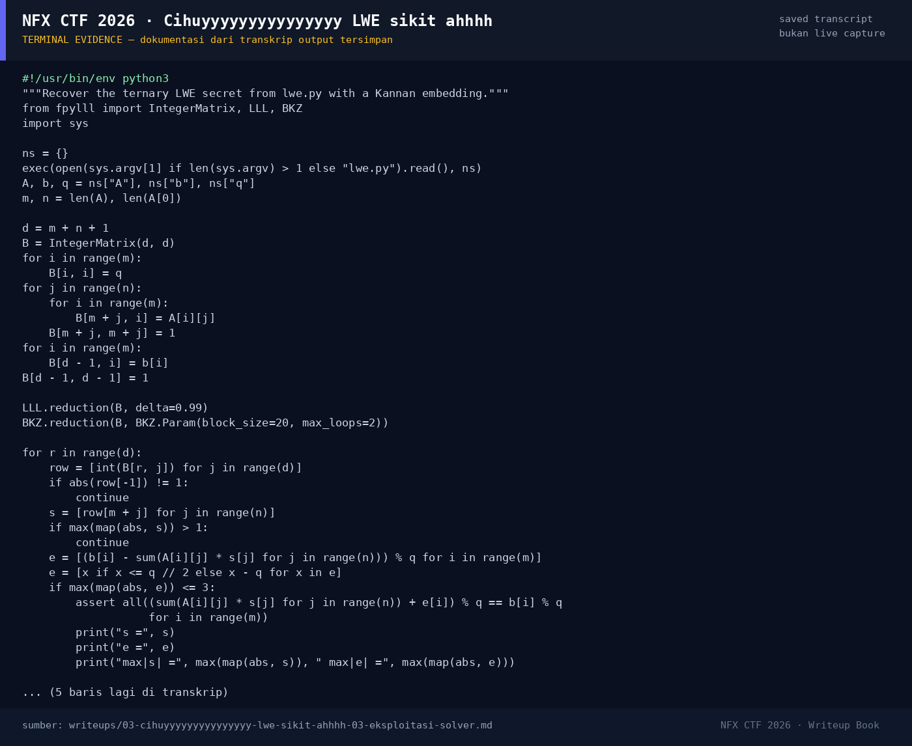

# Cihuyyyyyyyyyyyyyyy LWE sikit ahhhh — Evidence / Bukti

1 screenshot2 transkrip / script

[← Overview](03-cihuyyyyyyyyyyyyyyy-lwe-sikit-ahhhh.md) · [Index](index.md)

## Arsip Evidence

> Semua file di bawah berasal dari folder `assets/cihuyyyyyyyyyyyyyyy-lwe-sikit-ahhhh/`. Screenshot ditempel langsung; file teks/script ditautkan.

### Screenshot

<figure><figcaption>98-terminal-evidence.png</figcaption></figure>

### Transkrip / file pendukung

- [`solve_lwe.py`](assets/cihuyyyyyyyyyyyyyyy-lwe-sikit-ahhhh/solve_lwe.py)
- [`solver-output.txt`](assets/cihuyyyyyyyyyyyyyyy-lwe-sikit-ahhhh/solver-output.txt)

## Tabel Evidence

| Bukti | File | Keterangan |
|---|---|---|
| Hash input | `assets/checksums-all.txt` | SHA-256 `lwe.py` |
| Solver | `assets/cihuyyyyyyyyyyyyyyy-lwe-sikit-ahhhh/solve_lwe.py` | Kannan embedding + LLL/BKZ |
| Output solver | `assets/cihuyyyyyyyyyyyyyyy-lwe-sikit-ahhhh/solver-output.txt` | `s`, `e`, verifikasi 64/64 |
| Log submit | `work/submit_curl_log.jsonl` | Flag diterima platform |