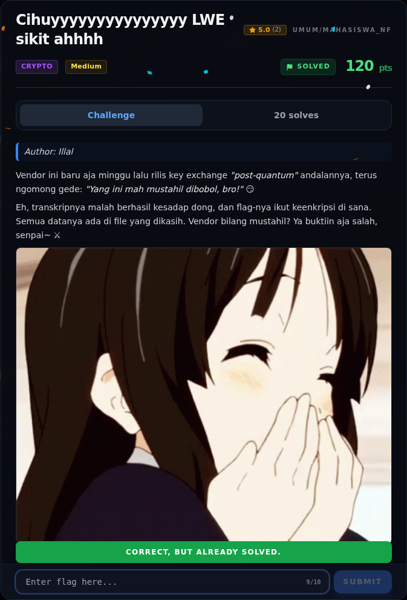

# Cihuyyyyyyyyyyyyyyy LWE sikit ahhhh — Flag & Verifikasi

[← Overview](03-cihuyyyyyyyyyyyyyyy-lwe-sikit-ahhhh.md) · [Index](index.md)

> **Flag:** `NFXCTF{l4tt1c3_sm4ll_s3cr3t_LWE_7e2a0195}`
> **Status:** `VERIFIED`

```text
NFXCTF{l4tt1c3_sm4ll_s3cr3t_LWE_7e2a0195}
```

Verifikasi (log submit asli):

```json
{"time": 1794038797.3505006, "name": "LWE",
 "id": "2805569d-e3b8-42bd-b53f-0f63219ecfef",
 "flag": "NFXCTF{l4tt1c3_sm4ll_s3cr3t_LWE_7e2a0195}",
 "http": 200,
 "result": {"success": true, "message": "Correct! +500 points."}}
```

### Bukti submit di platform



*Submit flag di platform: `CORRECT, BUT ALREADY SOLVED.`*

> **Verifikasi platform:** flag sudah diterima. Recheck 2026-11-09 mengembalikan `Correct, but already solved.`
