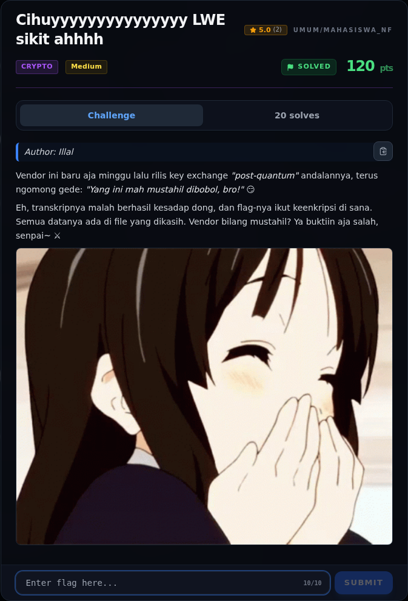
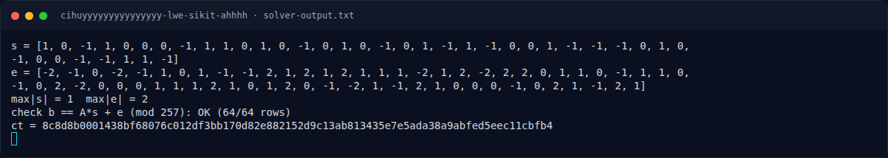
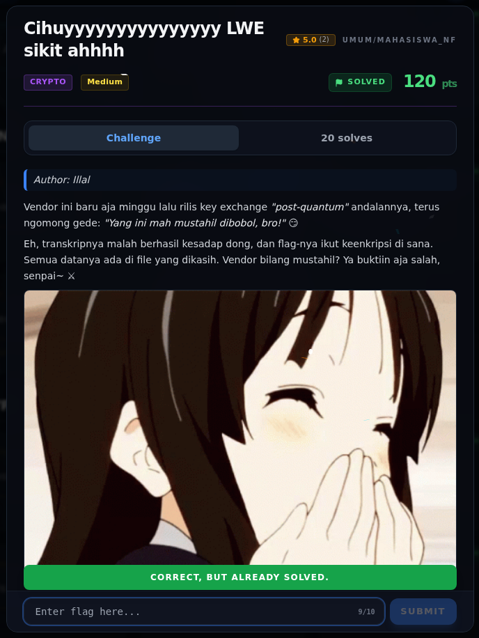

# Cihuyyyyyyyyyyyyyyy LWE sikit ahhhh — Evidence / Bukti

3 screenshot2 transkrip / script

[← Overview](03-cihuyyyyyyyyyyyyyyy-lwe-sikit-ahhhh.md) · [Index](index.md)

> **Langkah 6/7 — Bukti / Evidence.** Bukti / Evidence
>
> **Titik penting:** arsip screenshot dan transkrip
>
> **Berikutnya:** [Referensi](03-cihuyyyyyyyyyyyyyyy-lwe-sikit-ahhhh-07-referensi.md)

## Arsip Evidence

> Semua file berasal dari `assets/cihuyyyyyyyyyyyyyyy-lwe-sikit-ahhhh/`. Screenshot platform dan terminal adalah bukti asli dari sesi solve; transkrip mentah tetap ditautkan di bagian bawah.

### Platform

<figure><figcaption>00-challenge-platform.png</figcaption></figure>

*Challenge brief asli di platform NFX CTF 2026.*

<figure><figcaption>Terminal evidence (real)</figcaption></figure>

*Terminal evidence (real).*

### Terminal (arsip sesi)

<figure><figcaption>term-solver-output.png</figcaption></figure>

*Terminal evidence — `solver-output.txt` (arsip transkrip sesi solve).*

### Transkrip mentah & script

- [`solve_lwe.py`](assets/cihuyyyyyyyyyyyyyyy-lwe-sikit-ahhhh/solve_lwe.py)
- [`solver-output.txt`](assets/cihuyyyyyyyyyyyyyyy-lwe-sikit-ahhhh/solver-output.txt)

## Validasi platform (real)

*Screenshot asli dari platform NFX CTF 2026. Platform menjawab
`CORRECT, BUT ALREADY SOLVED.` untuk flag ini.*

## Tabel Evidence

| Bukti | File | Keterangan |
|---|---|---|
| Hash input | `assets/checksums-all.txt` | SHA-256 `lwe.py` |
| Solver | `assets/cihuyyyyyyyyyyyyyyy-lwe-sikit-ahhhh/solve_lwe.py` | Kannan embedding + LLL/BKZ |
| Output solver | `assets/cihuyyyyyyyyyyyyyyy-lwe-sikit-ahhhh/solver-output.txt` | `s`, `e`, verifikasi 64/64 |
| Log submit | `work/submit_curl_log.jsonl` | Flag diterima platform |