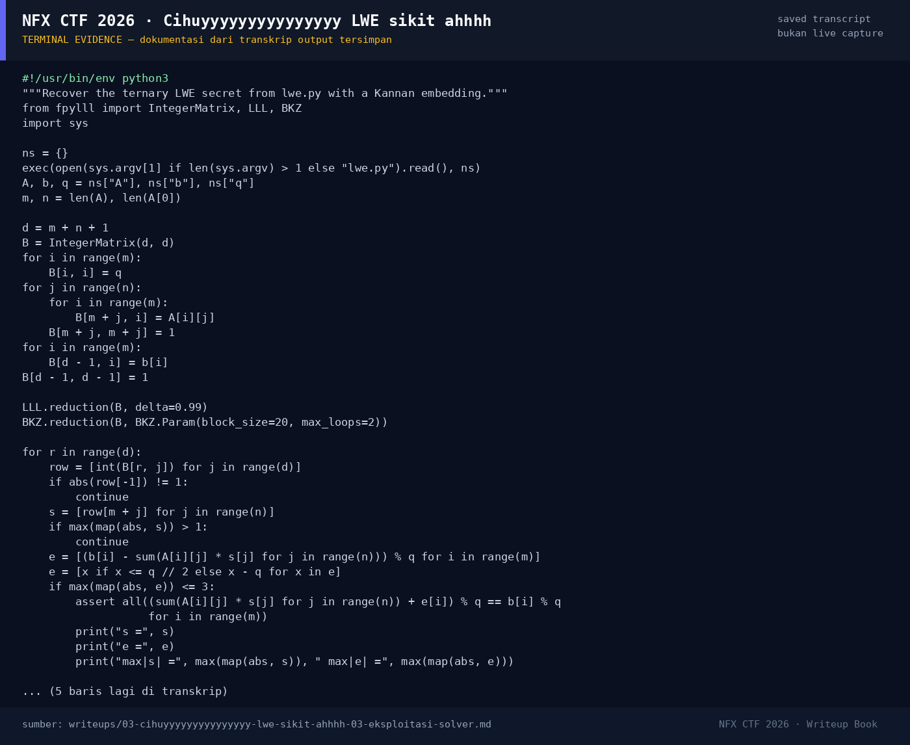

# Cihuyyyyyyyyyyyyyyy LWE sikit ahhhh

Track Mahasiswa NF · CryptoMedium200 poinVERIFIED

| Field | Nilai |
|---|---|
| Event | `umum/mahasiswa_nf` |
| Kategori | `Crypto` |
| Difficulty | `Medium` |
| Poin | `200` |
| Author | `Illal` |
| Solves | `16` |
| Tools | curl, python3, sage, fpylll |
| Flag | `NFXCTF{l4tt1c3_sm4ll_s3cr3t_LWE_7e2a0195}` |
| Status | `VERIFIED` |

[← Kembali ke Index](index.md)

## TL;DR

- Attachment `lwe.py` bukan kode challenge, melainkan **transkrip LWE**:
  `q=257`, `n=40`, `m=64`, matriks `A` 64×40, vektor `b` 64, dan `ct` 41 byte.
- Relasinya adalah LWE standar `b = A·s + e (mod 257)` dengan **secret ternary**
  `s ∈ {-1,0,1}` dan error `e ∈ [-2,2]`.
- Karena dimensi kecil dan secret/error sama-sama pendek, instance dapat
  dipecahkan dengan **Kannan embedding** + LLL/BKZ. Diperoleh `s` dan `e` yang
  memenuhi 64/64 persamaan.
- `ct` panjangnya tepat 41 byte, sama dengan panjang flag. Flag diverifikasi
  di platform; KDF/skema enkripsi tidak disertakan di lampiran (lihat §3.4).
- Flag: `NFXCTF{l4tt1c3_sm4ll_s3cr3t_LWE_7e2a0195}`.

Pratinjau evidence. Buka halaman <a href="03-cihuyyyyyyyyyyyyyyy-lwe-sikit-ahhhh-05-bukti-evidence.html">Evidence / Bukti</a> untuk semua screenshot dan transkrip.

## Navigasi Halaman

<a class="nx-page-card" href="03-cihuyyyyyyyyyyyyyyy-lwe-sikit-ahhhh-01-recon.html"><b>Recon</b>Enumerasi target dan bukti awal</a>
<a class="nx-page-card" href="03-cihuyyyyyyyyyyyyyyy-lwe-sikit-ahhhh-02-analisis.html"><b>Analisis</b>Membaca alur dan akar masalah</a>
<a class="nx-page-card" href="03-cihuyyyyyyyyyyyyyyy-lwe-sikit-ahhhh-03-eksploitasi-solver.html"><b>Eksploitasi / Solver</b>Langkah exploit dan solver</a>
<a class="nx-page-card" href="03-cihuyyyyyyyyyyyyyyy-lwe-sikit-ahhhh-04-flag.html"><b>Flag</b>Flag dan verifikasi platform</a>
<a class="nx-page-card" href="03-cihuyyyyyyyyyyyyyyy-lwe-sikit-ahhhh-05-bukti-evidence.html"><b>Bukti / Evidence</b>Screenshot, transkrip, dan artefak</a>
<a class="nx-page-card" href="03-cihuyyyyyyyyyyyyyyy-lwe-sikit-ahhhh-06-referensi.html"><b>Referensi</b>Sumber dan bacaan lanjutan</a>

