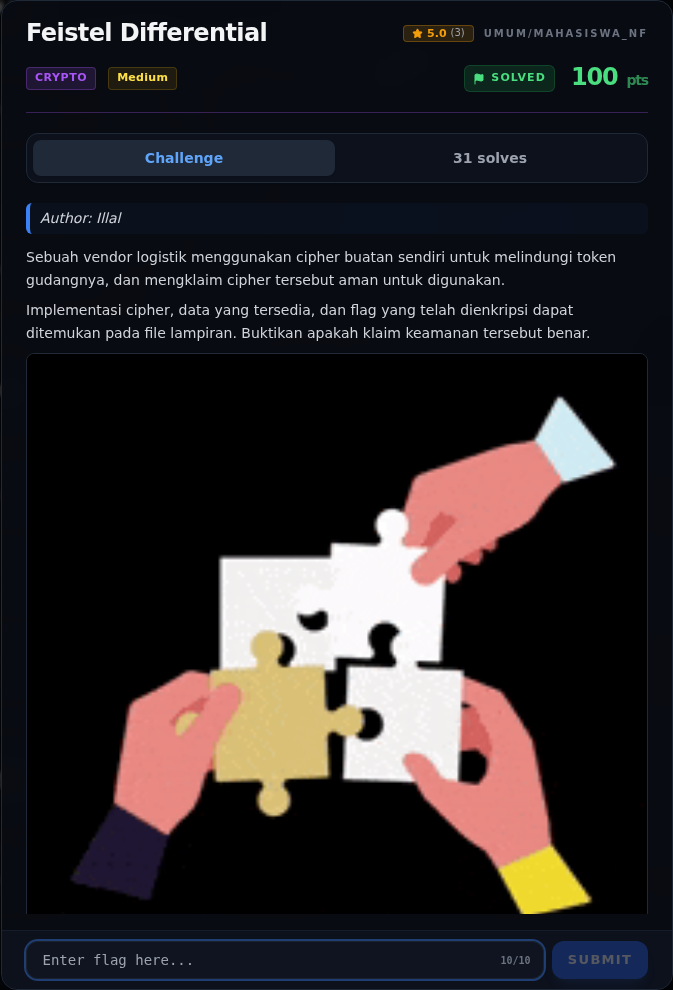

# Feistel Differential — Analisis

[← Overview](04-feistel-differential.md) · [Index](index.md)

> **Langkah 2/9 — Analisis.** File berisi 14 blok, masing-masing 20.000 baris, dengan header:
>
> **Titik penting:** File berisi 14 blok, masing-masing 20.000 baris, dengan header:
>
> **Berikutnya:** [Analisis](04-feistel-differential-03-analisis-2.md)

## 2.1 Cipher

`cipher.py`:

```python
ROUNDS = 7
MASK16 = 0xFFFF
SBOX = [1,8,14,12,2,0,3,4,11,9,15,13,6,10,7,5]

def permute(m):
    n0 = m & 0xF
    n1 = (m >> 4) & 0xF
    n2 = (m >> 8) & 0xF
    n3 = (m >> 12) & 0xF
    return n1 | (n0 << 4) | (n3 << 8) | (n2 << 12)

def round_f(x, k):
    y = x ^ k
    m = (SBOX[y & 0xF]
         | (SBOX[(y >> 4) & 0xF] << 4)
         | (SBOX[(y >> 8) & 0xF] << 8)
         | (SBOX[(y >> 12) & 0xF] << 12))
    return permute(m)

def key_schedule(master):
    return [(master >> (16 * i)) & MASK16 for i in range(ROUNDS)]

def encrypt_block(block, subkeys):
    L = (block >> 16) & MASK16
    R = block & MASK16
    for k in subkeys:
        L, R = R, L ^ round_f(R, k)
    return (L << 16) | R
```

Karakteristik:

- Blok 32-bit, dua half 16-bit.
- 7 ronde → 7 subkey 16-bit = **112 bit master key**.
- `F` bekerja per nibble: XOR subkey → 4×SBOX → swap nibble pairs.
- Feistel invertible; dekripsi memakai `F` yang sama dengan urutan subkey
  terbalik.

## 2.2 Struktur `pairs.txt`

File berisi 14 blok, masing-masing 20.000 baris, dengan header:

```text
# input difference: 0000000a
# input difference: 00000005
# input difference: 000000a0
# input difference: 00000050
...
# input difference: 0000550000
```

Setiap baris:

```text
p  c1  c2    ->   c1 = E(p),  c2 = E(p XOR Δ)
```

Jadi ada 280.000 known plaintext/ciphertext pairs (dua per baris) di bawah
**satu master key**.

### Evidence langkah ini



*Challenge brief asli di platform NFX CTF 2026.*
