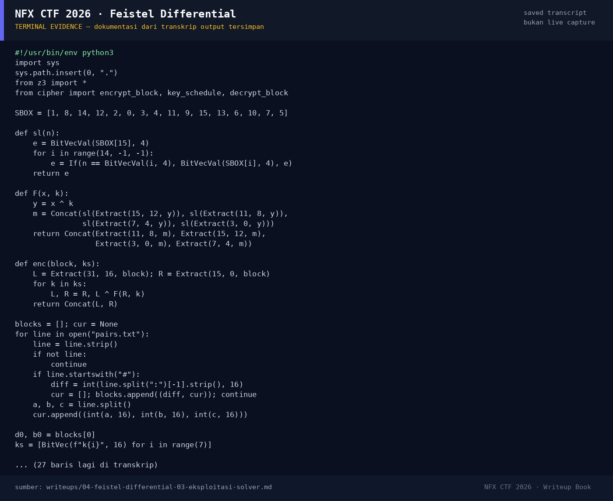

# Feistel Differential — Evidence / Bukti

1 screenshot3 transkrip / script

[← Overview](04-feistel-differential.md) · [Index](index.md)

## Arsip Evidence

> Semua file di bawah berasal dari folder `assets/feistel-differential/`. Screenshot ditempel langsung; file teks/script ditautkan.

### Screenshot

<figure><figcaption>98-terminal-evidence.png</figcaption></figure>

### Transkrip / file pendukung

- [`solve.py`](assets/feistel-differential/solve.py)
- [`solve_original_firstmodel.py`](assets/feistel-differential/solve_original_firstmodel.py)
- [`solver-output.txt`](assets/feistel-differential/solver-output.txt)

## Tabel Evidence

| Bukti | File | Keterangan |
|---|---|---|
| Hash input | `assets/checksums-all.txt` | SHA-256 ketiga file |
| Solver | `assets/feistel-differential/solve.py` | z3 + verifikasi penuh |
| Output solver | `assets/feistel-differential/solver-output.txt` | Key, 280000/280000, flag |
| Log submit | `work/verify_extra.jsonl` | Flag diterima platform |