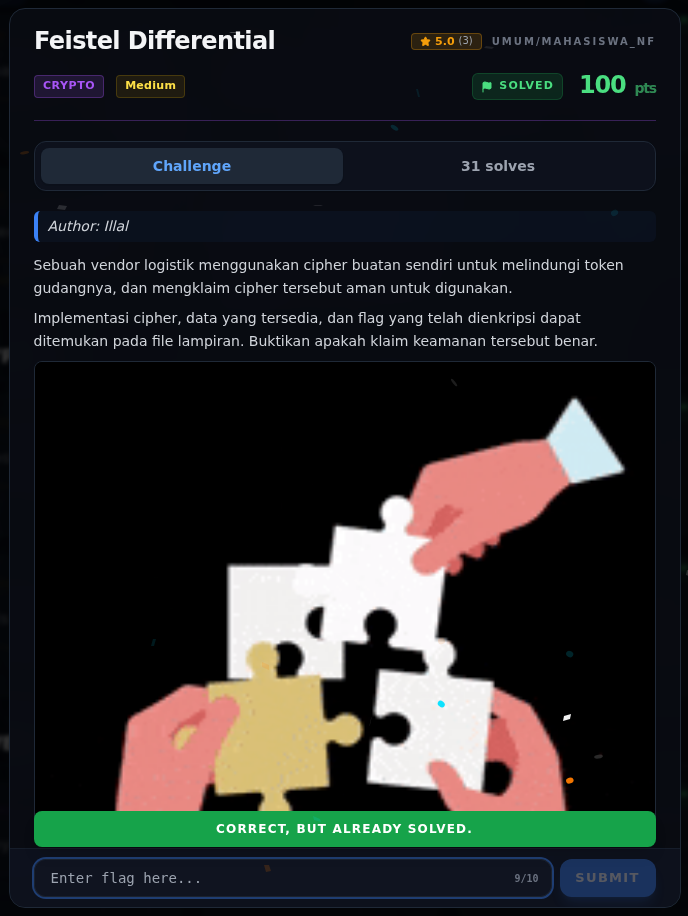

# Feistel Differential — Flag & Verifikasi

[← Overview](04-feistel-differential.md) · [Index](index.md)

> **Langkah 7/9 — Flag.** Verifikasi via API platform tercatat di halaman Flag (00b-terminal-evidence.png).
>
> **Titik penting:** NFXCTF{d1ff3r3nt14l_crypt0_pwn5_f31st3l_45322835}
>
> **Berikutnya:** [Bukti / Evidence](04-feistel-differential-08-bukti-evidence.md)

> **Asal flag.** Flag diperoleh dari langkah exploit/solver yang terdokumentasi, lalu disubmit ke platform.  

> **Flag:** `NFXCTF{d1ff3r3nt14l_crypt0_pwn5_f31st3l_45322835}`
> **Status:** `VERIFIED`

```text
NFXCTF{d1ff3r3nt14l_crypt0_pwn5_f31st3l_45322835}
```

Verifikasi via API platform tercatat di halaman Flag
(`00b-terminal-evidence.png`).

> **Bukti:** terminal evidence (real).

### Evidence langkah ini


*Terminal evidence (arsip/log asli) — `00b-terminal-evidence.png`.*

**Berkas mentah terkait:**

- [`solver-output.txt`](assets/feistel-differential/solver-output.txt)

## Validasi platform (real)



*Screenshot asli dari platform NFX CTF 2026. Platform menjawab
`CORRECT, BUT ALREADY SOLVED.` untuk flag ini.*
