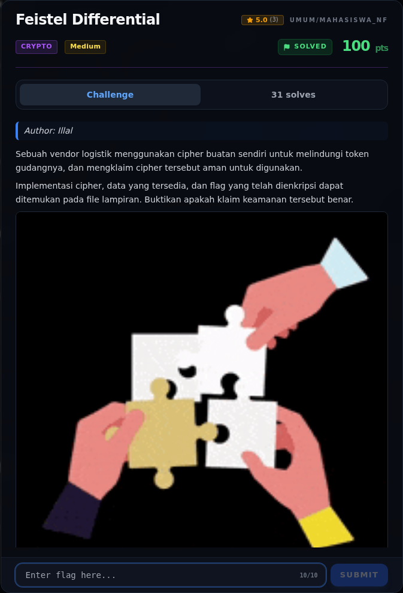
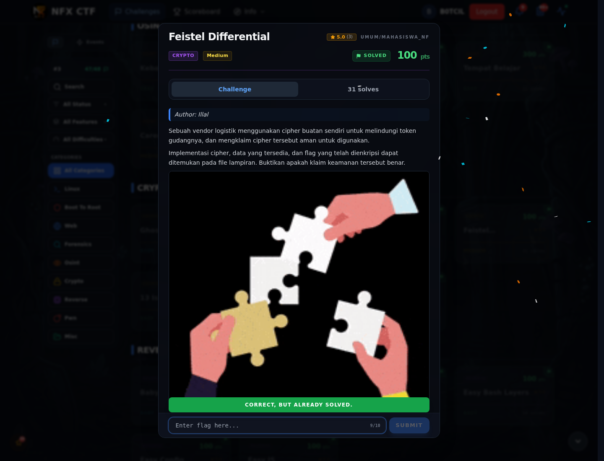

# Feistel Differential — Evidence / Bukti

3 screenshot3 transkrip / script

[← Overview](04-feistel-differential.md) · [Index](index.md)

## Arsip Evidence

> Semua file berasal dari `assets/feistel-differential/`. Screenshot platform dan terminal adalah bukti asli dari sesi solve; transkrip mentah tetap ditautkan di bagian bawah.

### Platform

<figure><figcaption>00-challenge-platform.png</figcaption></figure>

*Challenge brief asli di platform NFX CTF 2026.*

<figure><figcaption>00b-submit-platform.png</figcaption></figure>

*Submit flag di platform: `CORRECT, BUT ALREADY SOLVED.`*

### Terminal (arsip sesi)

<figure><figcaption>term-solver-output.png</figcaption></figure>

*Terminal evidence — `solver-output.txt` (arsip transkrip sesi solve).*

### Transkrip mentah & script

- [`solve.py`](assets/feistel-differential/solve.py)
- [`solve_original_firstmodel.py`](assets/feistel-differential/solve_original_firstmodel.py)
- [`solver-output.txt`](assets/feistel-differential/solver-output.txt)

## Tabel Evidence

| Bukti | File | Keterangan |
|---|---|---|
| Hash input | `assets/checksums-all.txt` | SHA-256 ketiga file |
| Solver | `assets/feistel-differential/solve.py` | z3 + verifikasi penuh |
| Output solver | `assets/feistel-differential/solver-output.txt` | Key, 280000/280000, flag |
| Log submit | `work/verify_extra.jsonl` | Flag diterima platform |