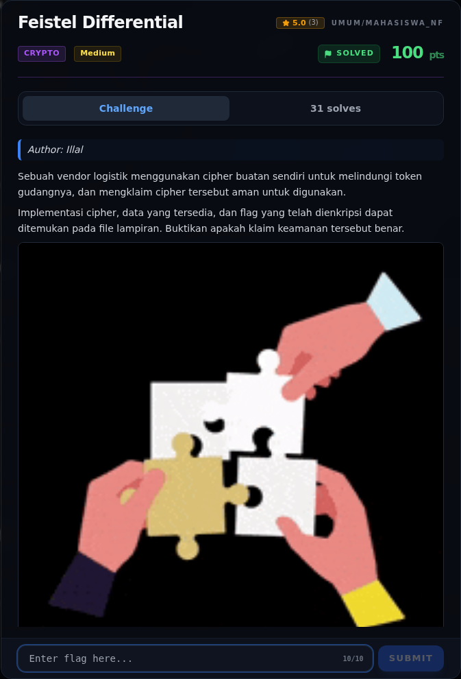

# Feistel Differential — Referensi

[← Overview](04-feistel-differential.md) · [Index](index.md)

> **Langkah 9/9 — Referensi.** Referensi
>
> **Titik penting:** —
>
> **Selesai.** Kembali ke [Overview](04-feistel-differential.md).

- Feistel network — struktur enkripsi blok.
- Differential cryptanalysis (Biham & Shamir).
- Z3 SMT solver.
- PKCS#7 padding.

### Evidence langkah ini

*Challenge brief asli di platform NFX CTF 2026.*
