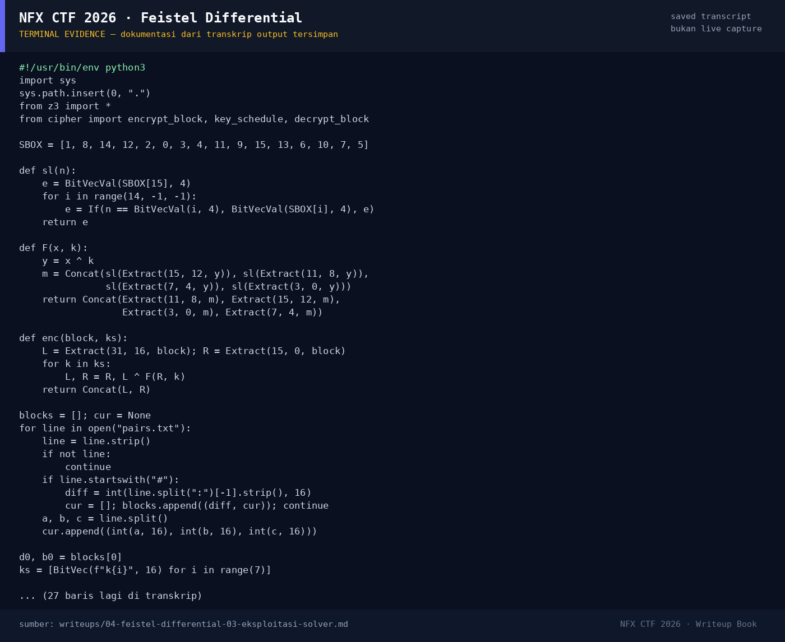

# Feistel Differential

Track Mahasiswa NF · CryptoMedium100 poinVERIFIED

| Field | Nilai |
|---|---|
| Event | `umum/mahasiswa_nf` |
| Kategori | `Crypto` |
| Difficulty | `Medium` |
| Poin | `100` |
| Author | `Illal` |
| Solves | `23` |
| Tools | python3, sage, z3 |
| Flag | `NFXCTF{d1ff3r3nt14l_crypt0_pwn5_f31st3l_45322835}` |
| Status | `VERIFIED` |

[← Kembali ke Index](index.md)

## TL;DR

- Cipher adalah Feistel 7 ronde pada blok 32-bit (dua half 16-bit), dengan
  round function `F(x,k) = permute(SBOX_4nibble(x XOR k))`.
- `pairs.txt` berisi **280.000 pasangan diferensial**: 14 nilai input
  difference × 20.000 baris, masing-masing `(p, E(p), E(p XOR Δ))`.
- Walaupun datanya "differential", serangan paling bersih adalah
  **known-plaintext key recovery**: modelkan cipher di z3, minta 7 pasangan
  pertama, dan seluruh 112 bit round key langsung terpaku.
- Diperoleh master key `0xfdec721297377222d7283ab5a383`, subkey
  `[a383, 3ab5, d728, 7222, 9737, 7212, fdec]`.
- Verifikasi: 280.000/280.000 baris cocok. Dekripsi `flag.enc` menghasilkan
  flag + padding PKCS#7 `03 03 03`.

Pratinjau evidence. Buka halaman <a href="04-feistel-differential-05-bukti-evidence.html">Evidence / Bukti</a> untuk semua screenshot dan transkrip.

## Navigasi Halaman

<a class="nx-page-card" href="04-feistel-differential-01-recon.html"><b>Recon</b>Enumerasi target dan bukti awal</a>
<a class="nx-page-card" href="04-feistel-differential-02-analisis.html"><b>Analisis</b>Membaca alur dan akar masalah</a>
<a class="nx-page-card" href="04-feistel-differential-03-eksploitasi-solver.html"><b>Eksploitasi / Solver</b>Langkah exploit dan solver</a>
<a class="nx-page-card" href="04-feistel-differential-04-flag.html"><b>Flag</b>Flag dan verifikasi platform</a>
<a class="nx-page-card" href="04-feistel-differential-05-bukti-evidence.html"><b>Bukti / Evidence</b>Screenshot, transkrip, dan artefak</a>
<a class="nx-page-card" href="04-feistel-differential-06-referensi.html"><b>Referensi</b>Sumber dan bacaan lanjutan</a>

