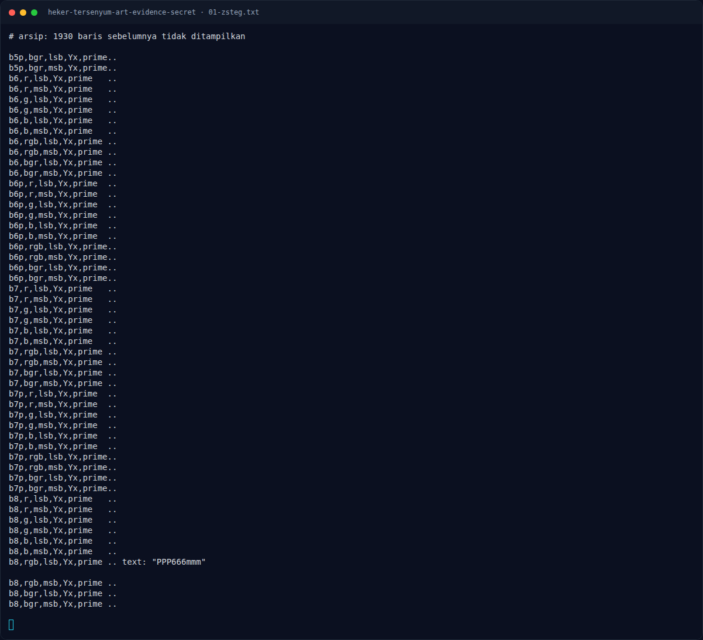
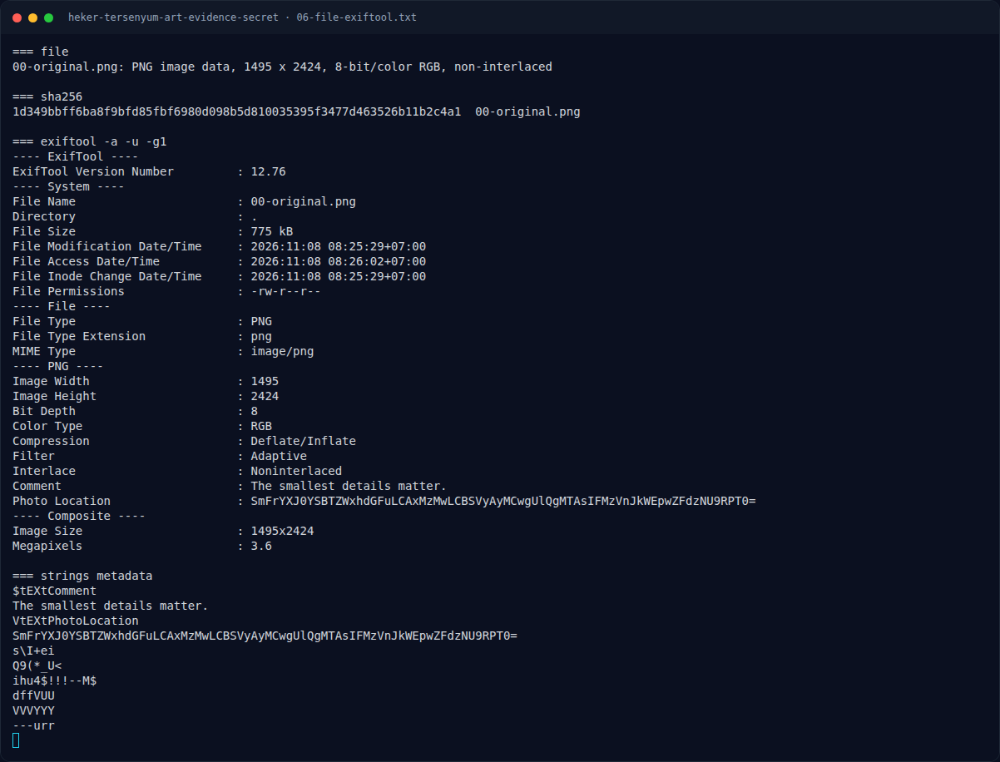

# Heker Tersenyum - Art Evidence Secret — Triage awal

[← Overview](05-heker-tersenyum-art-evidence-secret.md) · [Index](index.md)

> **Langkah 2/9 — Triage awal.** Tidak ada data setelah IEND; seluruh payload berada di dalam pixel.
>
> **Titik penting:** file file · exiftool -a -u -g1 file
>
> **Berikutnya:** [Analisis Artefak](05-heker-tersenyum-art-evidence-secret-03-analisis-artefak.md)

## 1.4 Triage awal

```bash
$ file file
PNG image data, 1495 x 2424, 8-bit/color RGB, non-interlaced

$ exiftool -a -u -g1 file
...
Comment                         : The smallest details matter.
Photo Location                  : SmFrYXJ0YSBTZWxhdGFuLCAxMzMwLCBSVyAyMCwgUlQgMTAsIFMzVnJkWEpwZFdzNU9RPT0=
Image Size                      : 1495x2424
```

Chunk PNG:

```text
IHDR 13
tEXt 36   Comment
tEXt 86   PhotoLocation
IDAT ... (12 chunk)
IEND 0
```

Tidak ada data setelah `IEND`; seluruh payload berada di dalam pixel.

**Temuan:** gambar bukan RGB berwarna. Semua pixel yang dominan bernilai `R=G=B` (grayscale), sehingga “baju merah” dan “celana biru” tidak merujuk warna visual, melainkan **kanal bit** yang dipakai untuk menyisipkan data.

### Evidence langkah ini



*Terminal evidence — `01-zsteg.txt` (arsip transkrip sesi solve).*



*Terminal evidence — `06-file-exiftool.txt` (arsip transkrip sesi solve).*

**Berkas mentah langkah ini:**

- [`01-zsteg.txt`](assets/heker-tersenyum-art-evidence-secret/01-zsteg.txt)
- [`06-file-exiftool.txt`](assets/heker-tersenyum-art-evidence-secret/06-file-exiftool.txt)
