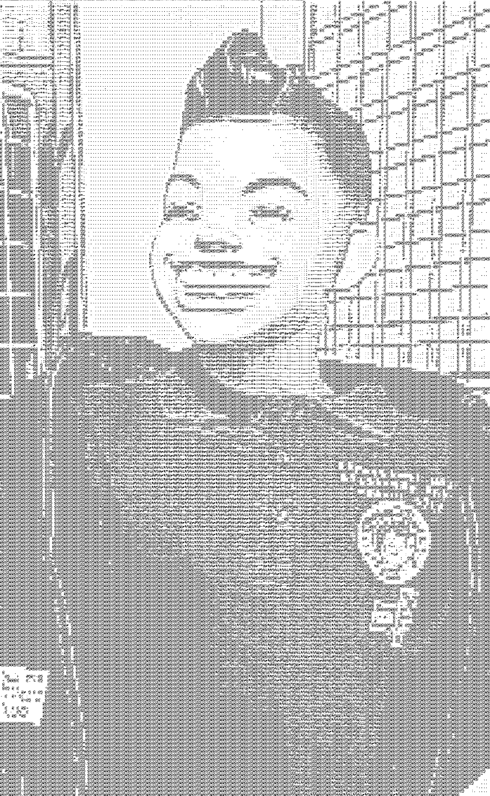
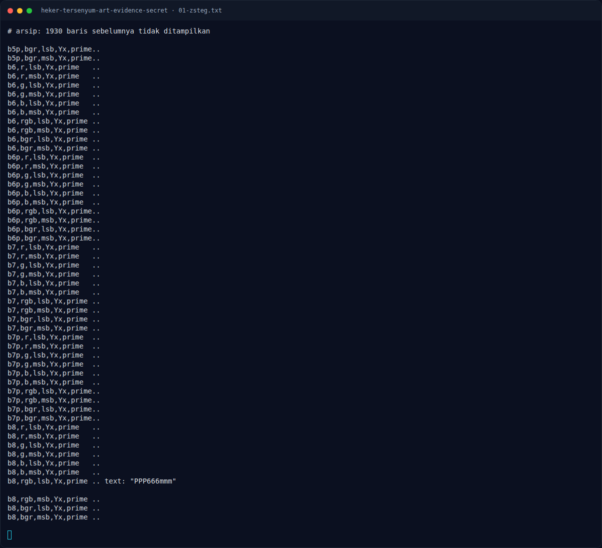

# Heker Tersenyum - Art Evidence Secret — Bitplane LSB

[← Overview](05-heker-tersenyum-art-evidence-secret.md) · [Index](index.md)

> **Langkah 5/9 — Bitplane LSB.** Visualisasi bitplane LSB R dan B (disimpan di assets) memperlihatkan pola titik yang mengikuti citra, bukan teks.
>
> **Titik penting:** Visualisasi bitplane LSB R dan B (disimpan di assets) memperlihatkan pola titik yang mengikuti citra, bukan teks.
>
> **Berikutnya:** [Pemulihan Artefak](05-heker-tersenyum-art-evidence-secret-06-pemulihan-artefak.md)

## 2.4 Bitplane LSB

Visualisasi bitplane LSB R dan B (disimpan di assets) memperlihatkan pola titik yang mengikuti citra, bukan teks. Tidak ada teks yang terbaca langsung dari bitplane.

### Evidence langkah ini

*Artefak challenge — `04-lsb-R.png`.*

*Artefak challenge — `05-lsb-B.png`.*

*Terminal evidence — transkrip langkah — `term-01-zsteg.png`.*

**Berkas mentah terkait:**

- [`06-file-exiftool.txt`](assets/heker-tersenyum-art-evidence-secret/06-file-exiftool.txt)
- [`01-zsteg.txt`](assets/heker-tersenyum-art-evidence-secret/01-zsteg.txt)
- [`08-payload-hexdump.txt`](assets/heker-tersenyum-art-evidence-secret/08-payload-hexdump.txt)
