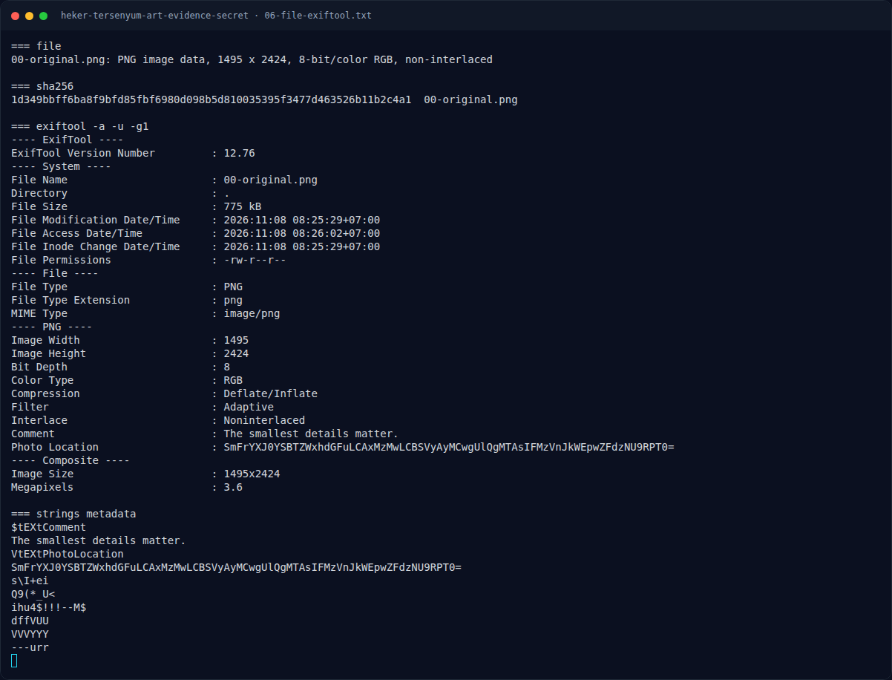
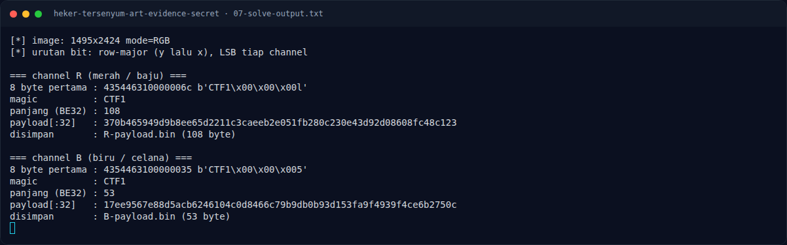
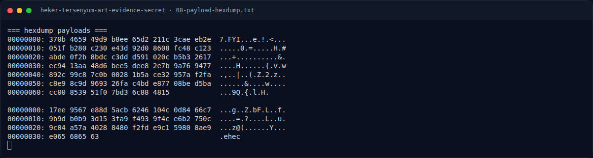
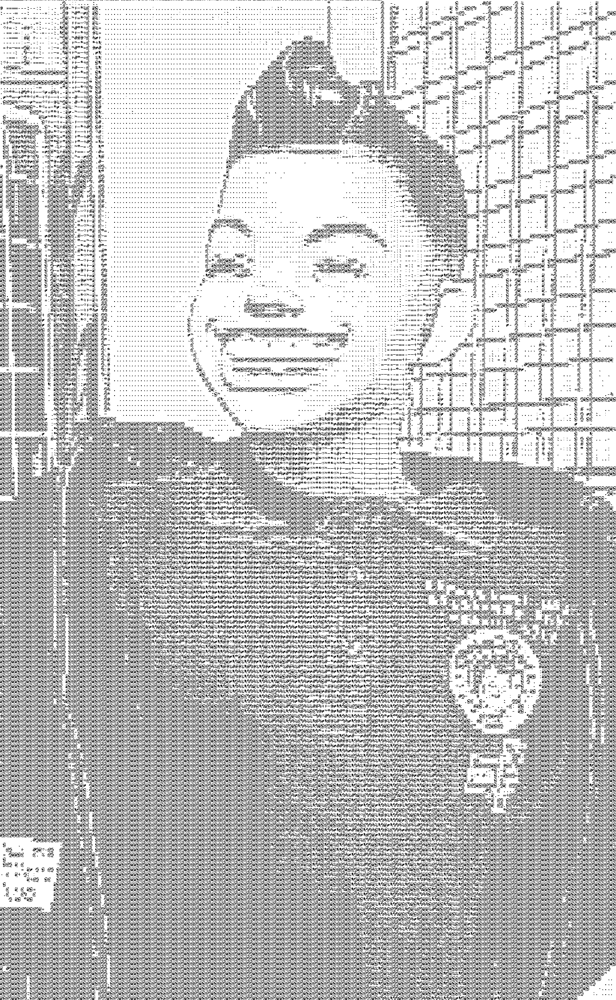

# Heker Tersenyum - Art Evidence Secret — Pemulihan Artefak

[← Overview](05-heker-tersenyum-art-evidence-secret.md) · [Index](index.md)

### 3.1 Strategi

1. Baca PNG sebagai RGB.
2. Ambil LSB kanal R dan B secara row-major.
3. Cek magic `CTF1` dan panjang BE32.
4. Simpan payload untuk analisis lanjutan.
5. Cocokkan temuan dengan tema challenge (`LSB`) dan flag yang tercatat.

### 3.2 Script

Script lengkap ada di `assets/heker-tersenyum-art-evidence-secret/solve_heker.py`:

```python
#!/usr/bin/env python3
import struct
from PIL import Image

im = Image.open("00-original.png").convert("RGB")
w, h = im.size
px = im.load()

def extract(channel):
    bits = [px[x, y][channel] & 1 for y in range(h) for x in range(w)]
    out = bytearray()
    for i in range(0, len(bits) - 7, 8):
        v = 0
        for b in bits[i:i + 8]:
            v = (v << 1) | b
        out.append(v)
    return bytes(out)

for channel, name in [(0, "R"), (2, "B")]:
    d = extract(channel)
    n = struct.unpack(">I", d[4:8])[0]
    print(name, d[:4], n, d[8:8 + n].hex())
```

### 3.3 Output

```text
[*] image: 1495x2424 mode=RGB
[*] urutan bit: row-major (y lalu x), LSB tiap channel

=== channel R (merah / baju) ===
8 byte pertama : 435446310000006c b'CTF1\x00\x00\x00l'
magic          : CTF1
panjang (BE32) : 108
payload[:32]   : 370b465949d9b8ee65d2211c3caeeb2e051fb280c230e43d92d08608fc48c123

=== channel B (biru / celana) ===
8 byte pertama : 4354463100000035 b'CTF1\x00\x00\x005'
magic          : CTF1
panjang (BE32) : 53
payload[:32]   : 17ee9567e88d5acb6246104c0d8466c79b9db0b93d153fa9f4939f4ce6b2750c
```

### Evidence langkah ini



*Terminal evidence — `06-file-exiftool.txt` (arsip transkrip sesi solve).*



*Terminal evidence — `07-solve-output.txt` (arsip transkrip sesi solve).*



*Terminal evidence — `08-payload-hexdump.txt` (arsip transkrip sesi solve).*



*Evidence — `04-lsb-R.png`.*


*Evidence — `05-lsb-B.png`.*
