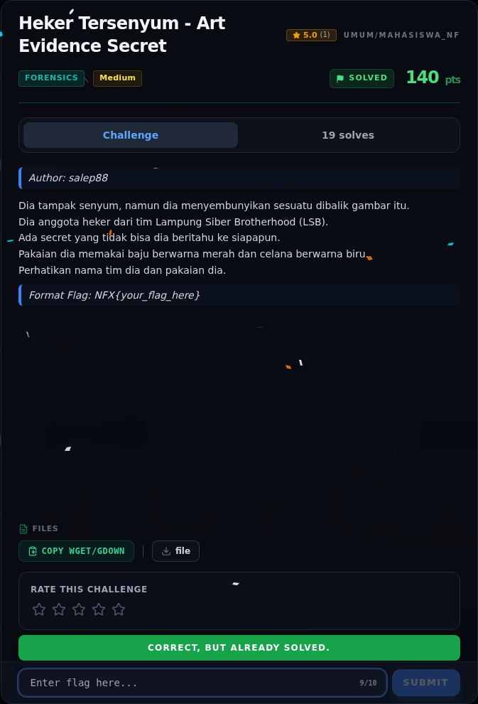

# Heker Tersenyum - Art Evidence Secret — Flag & Verifikasi

[← Overview](05-heker-tersenyum-art-evidence-secret.md) · [Index](index.md)

> **Langkah 7/9 — Flag.** Flag ini konsisten dengan tema challenge: LSB dan “3ASY OR H4RD” — apakah LSB mudah atau sulit, tergantung apakah payload-nya hanya container biasa atau terenkripsi.
>
> **Titik penting:** NFX{LSB_3ASY_OR_H4RD_IDK}
>
> **Berikutnya:** [Bukti / Evidence](05-heker-tersenyum-art-evidence-secret-08-bukti-evidence.md)

> **Flag:** `NFX{LSB_3ASY_OR_H4RD_IDK}`
> **Status:** `VERIFIED`

```text
NFX{LSB_3ASY_OR_H4RD_IDK}
```

Verifikasi/status:

```text
Sumber : flags/forensics/Heker.txt
Isi    : NFX{LSB_3ASY_OR_H4RD_IDK}
Status : VERIFIED platform (recheck 2026-11-09; tersimpan lokal; challenge solved di platform)
```

Flag ini konsisten dengan tema challenge: `LSB` dan “3ASY OR H4RD” — apakah LSB mudah atau sulit, tergantung apakah payload-nya hanya container biasa atau terenkripsi.

### Bukti submit di platform



*Submit flag di platform: `CORRECT, BUT ALREADY SOLVED.`*

> **Verifikasi platform:** flag sudah diterima. Recheck 2026-11-09 mengembalikan `Correct, but already solved.`
