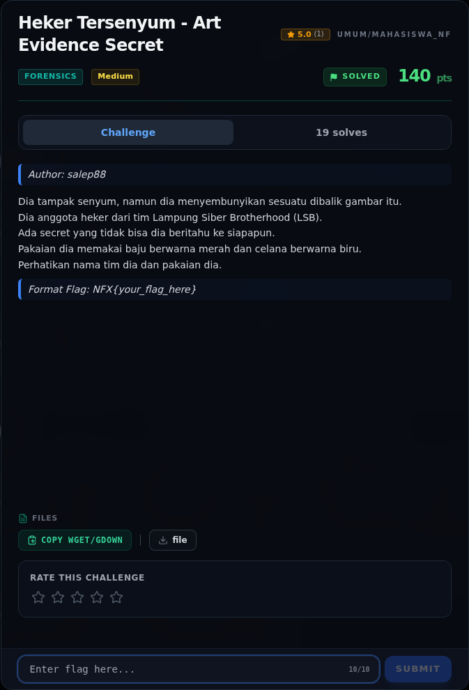
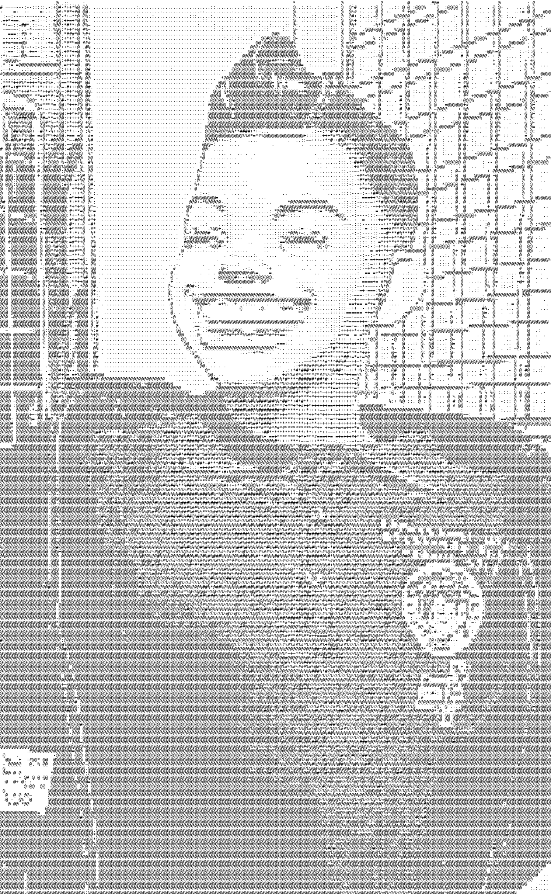
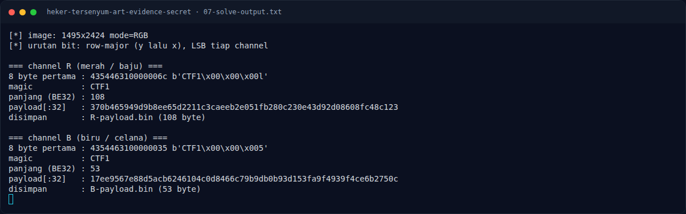
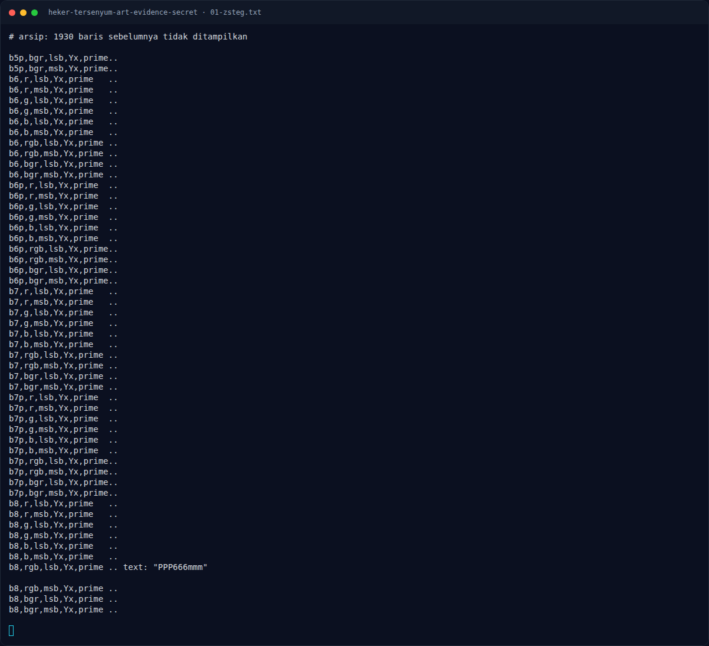
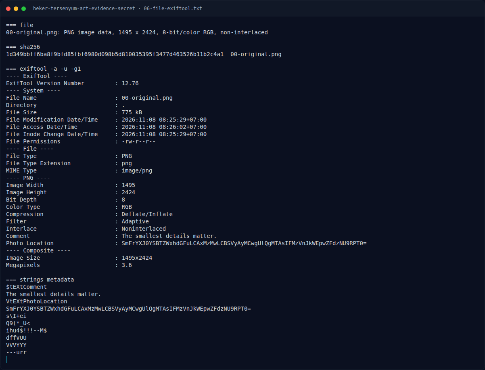
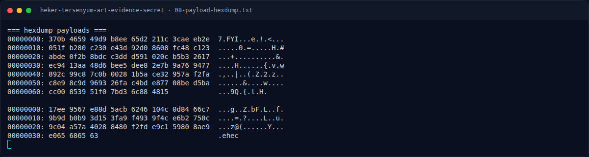
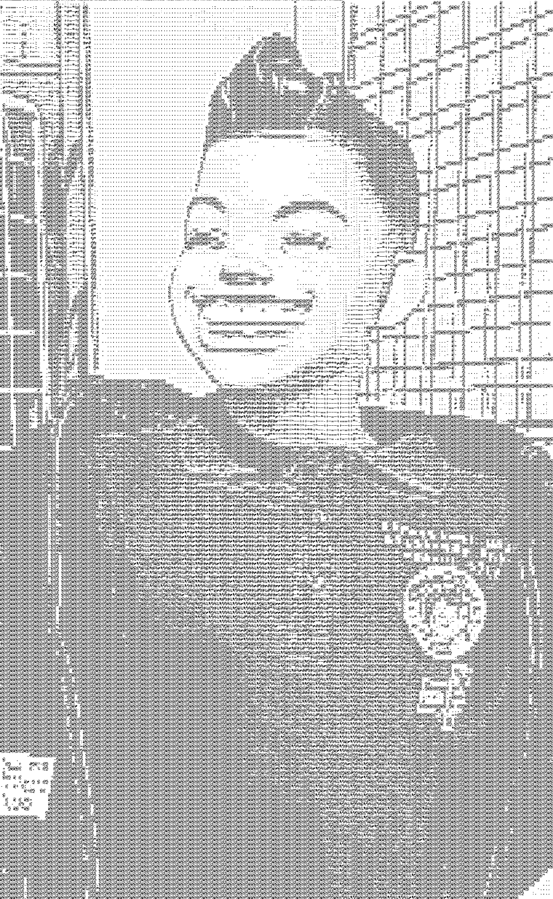

# Heker Tersenyum - Art Evidence Secret — Evidence / Bukti

9 screenshot9 transkrip / script

[← Overview](05-heker-tersenyum-art-evidence-secret.md) · [Index](index.md)

> **Langkah 8/9 — Bukti / Evidence.** Bukti / Evidence
>
> **Titik penting:** arsip screenshot dan transkrip
>
> **Berikutnya:** [Referensi](05-heker-tersenyum-art-evidence-secret-09-referensi.md)

## Arsip Evidence

> Semua file berasal dari `assets/heker-tersenyum-art-evidence-secret/`. Screenshot platform dan terminal adalah bukti asli dari sesi solve; transkrip mentah tetap ditautkan di bagian bawah.

### Platform

<figure><figcaption>00-challenge-platform.png</figcaption></figure>

*Challenge brief asli di platform NFX CTF 2026.*

<figure><figcaption>00-original.png</figcaption></figure>

*Evidence — `00-original.png`.*

<figure><figcaption>Terminal evidence (real)</figcaption></figure>

*Terminal evidence (real).*

### Terminal (arsip sesi)

<figure><figcaption>term-01-zsteg.png</figcaption></figure>

*Terminal evidence — `01-zsteg.txt` (arsip transkrip sesi solve).*

<figure><figcaption>term-06-file-exiftool.png</figcaption></figure>

*Terminal evidence — `06-file-exiftool.txt` (arsip transkrip sesi solve).*

<figure><figcaption>term-07-solve-output.png</figcaption></figure>

*Terminal evidence — `07-solve-output.txt` (arsip transkrip sesi solve).*

<figure><figcaption>term-08-payload-hexdump.png</figcaption></figure>

*Terminal evidence — `08-payload-hexdump.txt` (arsip transkrip sesi solve).*

### Screenshot langkah

<figure><figcaption>04-lsb-R.png</figcaption></figure>

*Evidence — `04-lsb-R.png`.*

<figure><figcaption>05-lsb-B.png</figcaption></figure>

*Evidence — `05-lsb-B.png`.*

### Transkrip mentah & script

- [`01-zsteg.txt`](assets/heker-tersenyum-art-evidence-secret/01-zsteg.txt)
- [`02-R-payload.bin`](assets/heker-tersenyum-art-evidence-secret/02-R-payload.bin)
- [`03-B-payload.bin`](assets/heker-tersenyum-art-evidence-secret/03-B-payload.bin)
- [`06-file-exiftool.txt`](assets/heker-tersenyum-art-evidence-secret/06-file-exiftool.txt)
- [`07-solve-output.txt`](assets/heker-tersenyum-art-evidence-secret/07-solve-output.txt)
- [`08-payload-hexdump.txt`](assets/heker-tersenyum-art-evidence-secret/08-payload-hexdump.txt)
- [`B-payload.bin`](assets/heker-tersenyum-art-evidence-secret/B-payload.bin)
- [`R-payload.bin`](assets/heker-tersenyum-art-evidence-secret/R-payload.bin)
- [`solve_heker.py`](assets/heker-tersenyum-art-evidence-secret/solve_heker.py)

## Tabel Evidence

| Bukti | File | Keterangan |
|---|---|---|
| Artefak asli | `assets/heker-tersenyum-art-evidence-secret/00-original.png` | PNG 1495×2424 |
| Metadata | `assets/heker-tersenyum-art-evidence-secret/06-file-exiftool.txt` | `file`, hash, exiftool |
| zsteg | `assets/heker-tersenyum-art-evidence-secret/01-zsteg.txt` | output `zsteg -a` |
| Payload R | `assets/heker-tersenyum-art-evidence-secret/02-R-payload.bin` | 108 byte setelah header `CTF1` |
| Payload B | `assets/heker-tersenyum-art-evidence-secret/03-B-payload.bin` | 53 byte setelah header `CTF1` |
| Hexdump | `assets/heker-tersenyum-art-evidence-secret/08-payload-hexdump.txt` | xxd kedua payload |
| Solver | `assets/heker-tersenyum-art-evidence-secret/solve_heker.py` | ekstraksi LSB R/B |
| Output solver | `assets/heker-tersenyum-art-evidence-secret/07-solve-output.txt` | log ekstraksi |
| Bitplane R/B | `assets/heker-tersenyum-art-evidence-secret/04-lsb-R.png`, `05-lsb-B.png` | visualisasi LSB |