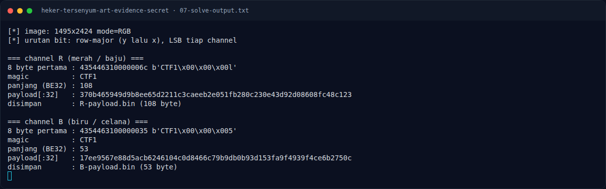

# Heker Tersenyum - Art Evidence Secret — Referensi

[← Overview](05-heker-tersenyum-art-evidence-secret.md) · [Index](index.md)

- Konsep LSB steganography pada PNG.
- `zsteg` documentation.
- Teknik base64 bertingkat pada metadata PNG.

### Evidence langkah ini

*Terminal evidence — `07-solve-output.txt` (arsip transkrip sesi solve).*
