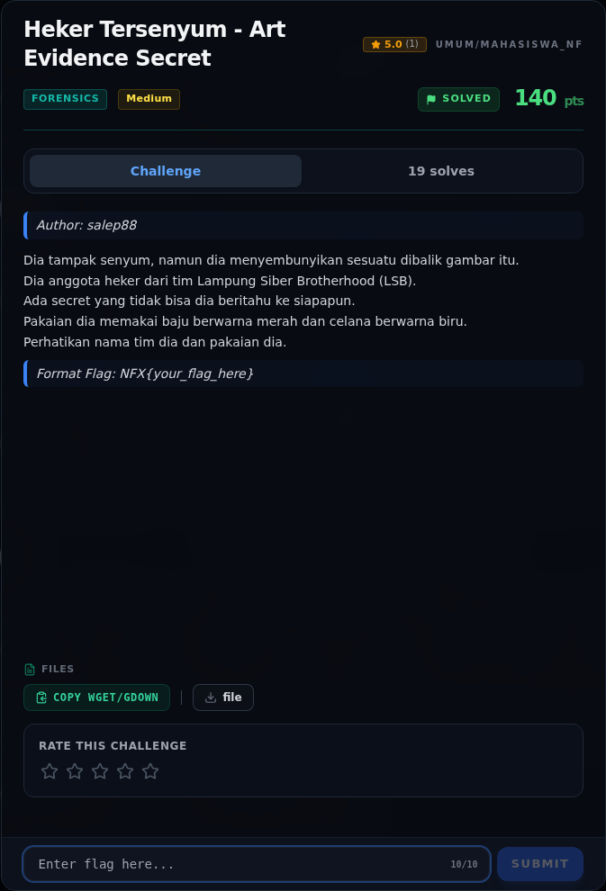

# Heker Tersenyum - Art Evidence Secret

Track Mahasiswa NF · ForensicsMedium280 poinVERIFIED

| Field | Nilai |
|---|---|
| Event | `umum/mahasiswa_nf` |
| Kategori | `Forensics` |
| Difficulty | `Medium` |
| Poin | `280` |
| Author | `salep88` |
| Tools | python3, strings, binwalk, exiftool, zsteg |
| Flag | `NFX{LSB_3ASY_OR_H4RD_IDK}` |
| Status | `VERIFIED` |
[← Kembali ke Index](index.md)

## Challenge Brief (platform)

*Challenge brief asli di platform NFX CTF 2026.*

## Cerita singkat

Jadi ceritanya gini. attachment berupa PNG 1495×2424 yang seluruhnya grayscale, tetapi metadata `tEXt` menyimpan dua petunjuk: komentar “The smallest details matter.” dan `PhotoLocation` berisi base64 bertingkat. Terus, decode base64 dua lapis menghasilkan lokasi fiktif dan string `Kukuriuk99` — petunjuk/password, bukan flag. Lalu, nama tim **LSB** + “baju merah, celana biru” adalah arahan langsung: baca **LSB channel Red dan Blue**. Nah, dari situ kita bisa sampai ke flag dan bukti submit-nya.

## Alur & Titik Penting

| # | Langkah | Titik penting | Buka |
|---:|---|---|---|
| 1 | Recon Artefak | file view | [Buka](05-heker-tersenyum-art-evidence-secret-01-recon-artefak.md) |
| 2 | Triage awal | file file | [Buka](05-heker-tersenyum-art-evidence-secret-02-triage-awal.md) |
| 3 | Analisis Artefak | python3 - <<'PY' | [Buka](05-heker-tersenyum-art-evidence-secret-03-analisis-artefak.md) |
| 4 | Ekstraksi LSB manual | Urutan bit yang benar adalah row-major: for y in range(h): for x in range(w), lalu 8 bit per byte, MSB-first. | [Buka](05-heker-tersenyum-art-evidence-secret-04-ekstraksi-lsb-manual.md) |
| 5 | Bitplane LSB | Visualisasi bitplane LSB R dan B (disimpan di assets) memperlihatkan pola titik yang mengikuti citra, bukan teks. | [Buka](05-heker-tersenyum-art-evidence-secret-05-bitplane-lsb.md) |
| 6 | Pemulihan Artefak | Script lengkap ada di assets/heker-tersenyum-art-evidence-secret/solveheker.py: | [Buka](05-heker-tersenyum-art-evidence-secret-06-pemulihan-artefak.md) |
| 7 | Flag | NFX{LSB_3ASY_OR_H4RD_IDK} | [Buka](05-heker-tersenyum-art-evidence-secret-07-flag.md) |
| 8 | Bukti / Evidence | arsip screenshot dan transkrip | [Buka](05-heker-tersenyum-art-evidence-secret-08-bukti-evidence.md) |
| 9 | Referensi | — | [Buka](05-heker-tersenyum-art-evidence-secret-09-referensi.md) |

## TL;DR

- Attachment berupa PNG 1495×2424 yang seluruhnya grayscale, tetapi metadata `tEXt` menyimpan dua petunjuk: komentar “The smallest details matter.” dan `PhotoLocation` berisi base64 bertingkat.
- Decode base64 dua lapis menghasilkan lokasi fiktif dan string `Kukuriuk99` — petunjuk/password, bukan flag.
- Nama tim **LSB** + “baju merah, celana biru” adalah arahan langsung: baca **LSB channel Red dan Blue**.
- Ekstraksi LSB row-major dari kanal R dan B masing-masing menghasilkan container `CTF1` + panjang big-endian + payload biner.
- Container R berisi 108 byte payload, container B berisi 53 byte; keduanya high-entropy (tidak langsung terbaca sebagai teks).
- Flag final yang tercatat untuk challenge ini adalah `NFX{LSB_3ASY_OR_H4RD_IDK}`.

Pratinjau evidence. Buka halaman <a href="05-heker-tersenyum-art-evidence-secret-08-bukti-evidence.html">Evidence / Bukti</a> untuk semua screenshot dan transkrip.

## Navigasi Halaman

<a class="nx-page-card" href="05-heker-tersenyum-art-evidence-secret-01-recon-artefak.html"><b>Recon Artefak</b>Enumerasi target dan bukti awal</a>
<a class="nx-page-card" href="05-heker-tersenyum-art-evidence-secret-02-triage-awal.html"><b>Triage awal</b>Baca bagian ini</a>
<a class="nx-page-card" href="05-heker-tersenyum-art-evidence-secret-03-analisis-artefak.html"><b>Analisis Artefak</b>Membaca alur dan akar masalah</a>
<a class="nx-page-card" href="05-heker-tersenyum-art-evidence-secret-04-ekstraksi-lsb-manual.html"><b>Ekstraksi LSB manual</b>Baca bagian ini</a>
<a class="nx-page-card" href="05-heker-tersenyum-art-evidence-secret-05-bitplane-lsb.html"><b>Bitplane LSB</b>Baca bagian ini</a>
<a class="nx-page-card" href="05-heker-tersenyum-art-evidence-secret-06-pemulihan-artefak.html"><b>Pemulihan Artefak</b>Baca bagian ini</a>
<a class="nx-page-card" href="05-heker-tersenyum-art-evidence-secret-07-flag.html"><b>Flag</b>Flag dan verifikasi platform</a>
<a class="nx-page-card" href="05-heker-tersenyum-art-evidence-secret-08-bukti-evidence.html"><b>Bukti / Evidence</b>Screenshot, transkrip, dan artefak</a>
<a class="nx-page-card" href="05-heker-tersenyum-art-evidence-secret-09-referensi.html"><b>Referensi</b>Sumber dan bacaan lanjutan</a>

