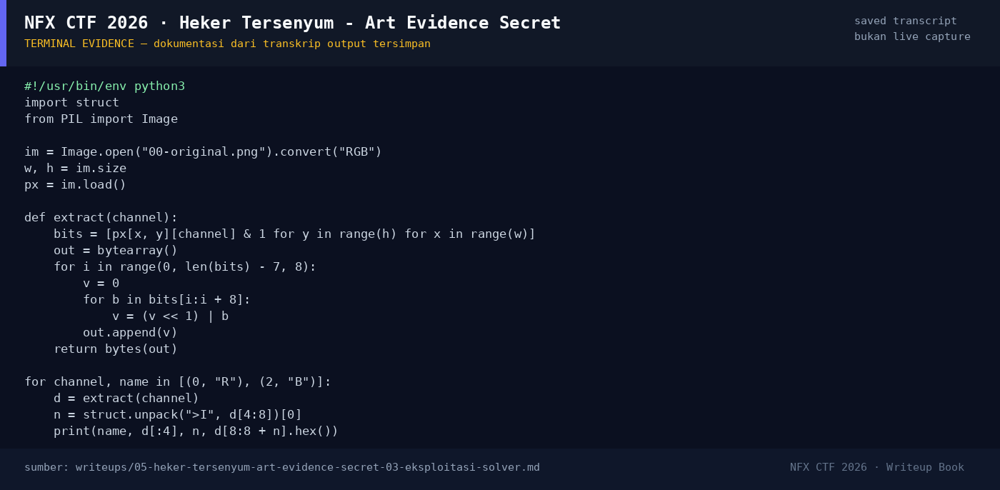

# Heker Tersenyum - Art Evidence Secret

Track Mahasiswa NF · ForensicsMedium280 poinVERIFIED

| Field | Nilai |
|---|---|
| Event | `umum/mahasiswa_nf` |
| Kategori | `Forensics` |
| Difficulty | `Medium` |
| Poin | `280` |
| Author | `salep88` |
| Tools | python3, strings, binwalk, exiftool, zsteg |
| Flag | `NFX{LSB_3ASY_OR_H4RD_IDK}` |
| Status | `VERIFIED` |

[← Kembali ke Index](index.md)

## TL;DR

- Attachment berupa PNG 1495×2424 yang seluruhnya grayscale, tetapi metadata `tEXt` menyimpan dua petunjuk: komentar “The smallest details matter.” dan `PhotoLocation` berisi base64 bertingkat.
- Decode base64 dua lapis menghasilkan lokasi fiktif dan string `Kukuriuk99` — petunjuk/password, bukan flag.
- Nama tim **LSB** + “baju merah, celana biru” adalah arahan langsung: baca **LSB channel Red dan Blue**.
- Ekstraksi LSB row-major dari kanal R dan B masing-masing menghasilkan container `CTF1` + panjang big-endian + payload biner.
- Container R berisi 108 byte payload, container B berisi 53 byte; keduanya high-entropy (tidak langsung terbaca sebagai teks).
- Flag final yang tercatat untuk challenge ini adalah `NFX{LSB_3ASY_OR_H4RD_IDK}`.

Pratinjau evidence. Buka halaman <a href="05-heker-tersenyum-art-evidence-secret-05-bukti-evidence.html">Evidence / Bukti</a> untuk semua screenshot dan transkrip.

## Navigasi Halaman

<a class="nx-page-card" href="05-heker-tersenyum-art-evidence-secret-01-recon.html"><b>Recon</b>Enumerasi target dan bukti awal</a>
<a class="nx-page-card" href="05-heker-tersenyum-art-evidence-secret-02-analisis.html"><b>Analisis</b>Membaca alur dan akar masalah</a>
<a class="nx-page-card" href="05-heker-tersenyum-art-evidence-secret-03-eksploitasi-solver.html"><b>Eksploitasi / Solver</b>Langkah exploit dan solver</a>
<a class="nx-page-card" href="05-heker-tersenyum-art-evidence-secret-04-flag.html"><b>Flag</b>Flag dan verifikasi platform</a>
<a class="nx-page-card" href="05-heker-tersenyum-art-evidence-secret-05-bukti-evidence.html"><b>Bukti / Evidence</b>Screenshot, transkrip, dan artefak</a>
<a class="nx-page-card" href="05-heker-tersenyum-art-evidence-secret-06-referensi.html"><b>Referensi</b>Sumber dan bacaan lanjutan</a>

