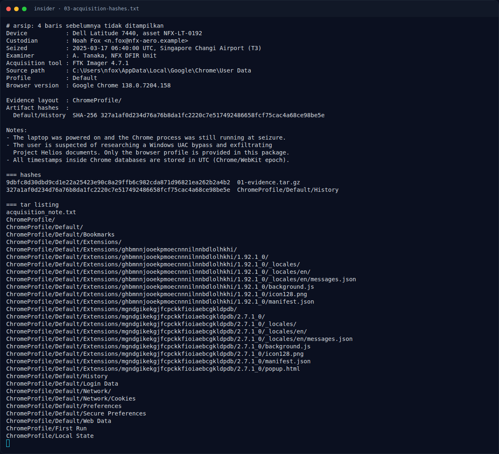

# insider — Recon Artefak

[← Overview](06-insider.md) · [Index](index.md)

## 1.1 Deskripsi challenge

> Author: Zer0
>
> Pada 17 Maret 2025, tim keamanan NFX Aerospace mendeteksi kebocoran dokumen rahasia proyek Helios. Sebuah laptop milik staf disita di Bandara Changi, Singapura. Laptop tersebut sudah dalam keadaan hidup ketika disita, dan proses Aplikasi Browser masih berjalan.
>
> Tim DFIR hanya sempat mengamankan satu artefak milik pengguna. Tidak ada log server, tidak ada disk image penuh, dan tidak ada catatan dari tersangka. Semua yang tersisa hanyalah jejak digital di dalam browser.
>
> Tugasmu adalah merekonstruksi aktivitas tersangka dari artefak tersebut, dan susun Flag nya.

## 1.2 File yang diberikan

Attachment: `evidence_nfx_phantom_insider.tar.gz` (14.130 byte).

```bash
$ file evidence_nfx_phantom_insider.tar.gz
gzip compressed data, was "evidence_nfx_phantom_insider.tar", last modified: Wed Nov  4 15:58:47 2026, max compression

$ tar tzvf evidence_nfx_phantom_insider.tar.gz
-rw-rw-rw- 0/0  1040 2026-11-04 22:58 acquisition_note.txt
drwxrwxrwx 0/0     0 2026-11-04 22:58 ChromeProfile/
...
-rw-rw-rw- 0/0 77824 2026-11-04 22:58 ChromeProfile/Default/History
-rw-rw-rw- 0/0 57344 2026-11-04 22:58 ChromeProfile/Default/Login Data
-rw-rw-rw- 0/0 20480 2026-11-04 22:58 ChromeProfile/Default/Network/Cookies
-rw-rw-rw- 0/0 40960 2026-11-04 22:58 ChromeProfile/Default/Web Data
```

Hash:

```bash
$ sha256sum evidence_nfx_phantom_insider.tar.gz
9dbfc8d30dbd9cd1e22a25423e90c8a29ffb6c982cda871d96821ea262b2a4b2  evidence_nfx_phantom_insider.tar.gz

$ sha256sum ChromeProfile/Default/History
327a1af0d234d76a76b8da1fc2220c7e517492486658fcf75cac4a68ce98be5e  ChromeProfile/Default/History
```

Hash `History` cocok dengan yang tercatat di `acquisition_note.txt`, jadi artefak tidak berubah.

### Evidence langkah ini



*Terminal evidence — `03-acquisition-hashes.txt` (arsip transkrip sesi solve).*

**Berkas mentah langkah ini:**

- [`03-acquisition-hashes.txt`](assets/insider/03-acquisition-hashes.txt)
