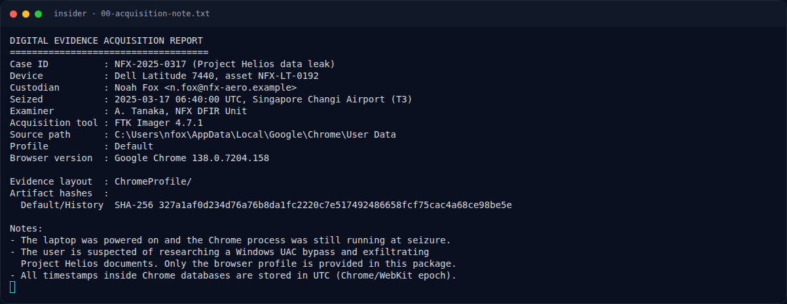

# insider — Recon Artefak

[← Overview](06-insider.md) · [Index](index.md)

> **Langkah 2/10 — Recon Artefak.** Petunjuk penting: timestamp Chrome/WebKit = microseconds sejak 1601-01-01 UTC.
>
> **Titik penting:** Petunjuk penting: timestamp Chrome/WebKit = microseconds sejak 1601-01-01 UTC.
>
> **Berikutnya:** [Struktur profil](06-insider-03-struktur-profil.md)

## 1.3 Acquisition note

```text
DIGITAL EVIDENCE ACQUISITION REPORT
====================================
Case ID          : NFX-2025-0317 (Project Helios data leak)
Device           : Dell Latitude 7440, asset NFX-LT-0192
Custodian        : Noah Fox <n.fox@nfx-aero.example>
Seized           : 2025-03-17 06:40:00 UTC, Singapore Changi Airport (T3)
Examiner         : A. Tanaka, NFX DFIR Unit
Acquisition tool : FTK Imager 4.7.1
...
- The laptop was powered on and the Chrome process was still running at seizure.
- The user is suspected of researching a Windows UAC bypass and exfiltrating
  Project Helios documents. Only the browser profile is provided in this package.
- All timestamps inside Chrome databases are stored in UTC (Chrome/WebKit epoch).
```

Petunjuk penting: timestamp Chrome/WebKit = **microseconds sejak 1601-01-01 UTC**.

## 1.4 Environment

- SQLite (via Python `sqlite3`, karena binary `sqlite3` tidak tersedia)
- `file`, `sha256sum`, `exiftool`, Python 3

### Evidence langkah ini



*Terminal evidence — `00-acquisition-note.txt` (arsip transkrip sesi solve).*

**Berkas mentah langkah ini:**

- [`00-acquisition-note.txt`](assets/insider/00-acquisition-note.txt)
