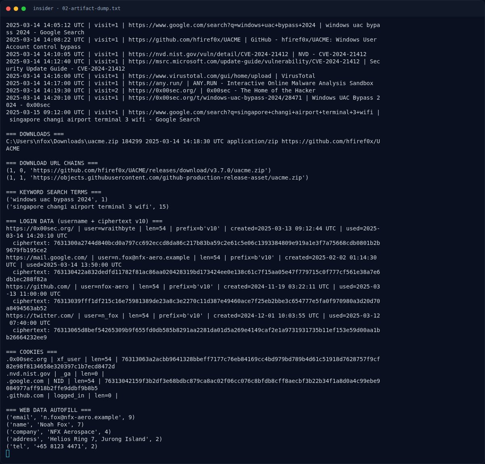

# insider — Analisis Artefak

[← Overview](06-insider.md) · [Index](index.md)

> **Langkah 5/10 — Analisis Artefak.** Format v10 Chrome (Windows) = v10 + 12-byte nonce + ciphertext + 16-byte GCM tag, dengan key yang dibungkus DPAPI di Local State:
>
> **Titik penting:** https://github.com/ · https://0x00sec.org/ · https://mail.google.com/
>
> **Berikutnya:** [Analisis Artefak](06-insider-06-analisis-artefak-2.md)

## 2.3 Login Data: username dan password `v10`

```sql
select origin_url, username_value, password_value, date_created, date_last_used from logins;
```

Output:

```text
https://0x00sec.org/ | user=wraithbyte | len=54 | prefix=b'v10' | created=2025-03-13 09:12:44 UTC
  ciphertext: 7631300a2744d840bcd0a797cc692eccd8da86c217b83ba59c2e61c5e06c1393384809e919a1e3f7a75668cdb0801b2b9679fb195ce2
https://mail.google.com/ | user=n.fox@nfx-aero.example | len=54 | prefix=b'v10'
https://github.com/ | user=nfox-aero | len=54 | prefix=b'v10'
https://twitter.com/ | user=n_fox | len=54 | prefix=b'v10'
```

Format `v10` Chrome (Windows) = `v10` + 12-byte nonce + ciphertext + 16-byte GCM tag, dengan key yang dibungkus DPAPI di `Local State`:

```json
"os_crypt": {
  "encrypted_key": "RFBBUEmk5kiTGCMtGDuTQyNxMvzl99cr96fIpe02niGuCDlcG5fO7YxzDYoiP8rG4IfTDCj9hyWsaCa3LX878rBtByUqJ7rISg6AtDl/Zhu4TRdWdA=="
}
```

Base64-decode menghasilkan prefix `DPAPI` + blob. Karena paket evidence **tidak menyertakan master key DPAPI user/SID**, password `v10` tidak dapat didekripsi dari artefak ini. Uji kunci Linux Chrome (`peanuts`, PBKDF2) juga gagal:

```text
peanuts / saltysalt / 1 iter      -> decrypt_and_verify gagal
peanuts / saltysalt / 1003 iter   -> decrypt_and_verify gagal
```

Yang penting untuk flag bukan password, melainkan **username** `wraithbyte`.

## 2.4 Cookies dan Web Data

Cookies menyimpan `xf_user` untuk `.0x00sec.org` (login forum), `NID` Google, dan `logged_in` GitHub. Web Data autofill memberi identitas:

```text
email   n.fox@nfx-aero.example
name    Noah Fox
company NFX Aerospace
address Helios Ring 7, Jurong Island
tel     +65 8123 4471
```

Alamat “Helios Ring 7, Jurong Island” konsisten dengan narasi Project Helios.

### Evidence langkah ini



*Terminal evidence — `02-artifact-dump.txt` (arsip transkrip sesi solve).*

**Berkas mentah langkah ini:**

- [`02-artifact-dump.txt`](assets/insider/02-artifact-dump.txt)
