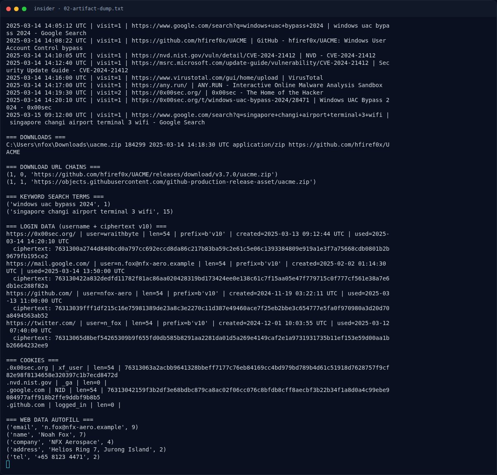
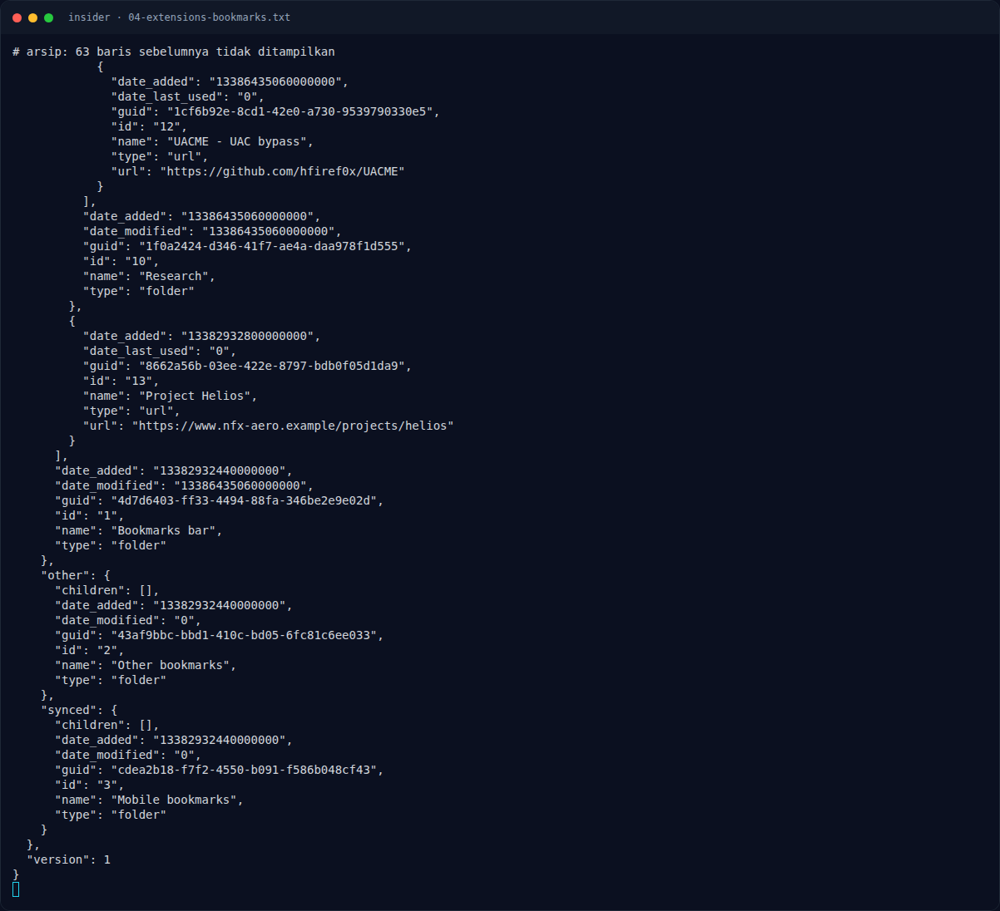

# insider — Analisis Artefak

[← Overview](06-insider.md) · [Index](index.md)

## 2.5 Extension ZenVPN 2.7.1

`Preferences` dan `Secure Preferences` mencatat extension non-webstore:

```json
"name": "ZenVPN",
"version": "2.7.1",
"description": "Lightweight VPN proxy. Routes browser traffic through a remote exit node.",
"permissions": ["proxy", "storage", "tabs", "webRequest", "webRequestAuthProvider"],
"host_permissions": ["<all_urls>"],
"from_webstore": false
```

`background.js`:

```js
const PROXY_CONFIG = {
  mode: "fixed_servers",
  rules: {
    singleProxy: { scheme: "http", host: "sg1.zenvpn.example", port: 8899 },
    bypassList: ["localhost", "127.0.0.1"]
  }
};

chrome.runtime.onInstalled.addListener(() => {
  chrome.proxy.settings.set({ value: PROXY_CONFIG, scope: "regular" });
});
```

Extension ini menjadi komponen `zenvpn271` pada flag. Keberadaannya juga menjelaskan bagaimana trafik browser diarahkan ke exit node Singapura.

## 2.6 Menyusun flag

Timestamp `13386435060000000` (bookmark/search tanggal 14 Mar 2025) dikonversi:

```python
from datetime import datetime, timezone, timedelta
dt = datetime(1601,1,1,tzinfo=timezone.utc) + timedelta(microseconds=13386435060000000)
print(dt.strftime('%Y%m%d'))   # 20250314
```

Komponen:

| Komponen | Nilai | Sumber |
|---|---|---|
| Username forum | `wraithbyte` | `Login Data` → `0x00sec.org` |
| CVE | `cve202421412` | History: CVE-2024-21412 |
| Tanggal | `20250314` | Timestamp bookmark/search 14 Mar 2025 |
| Extension | `zenvpn271` | ZenVPN versi 2.7.1 |

Urutan pada flag:

```text
wraithbyte_cve202421412_20250314_zenvpn271
```

### Evidence langkah ini



*Terminal evidence — `02-artifact-dump.txt` (arsip transkrip sesi solve).*



*Terminal evidence — `04-extensions-bookmarks.txt` (arsip transkrip sesi solve).*

**Berkas mentah langkah ini:**

- [`02-artifact-dump.txt`](assets/insider/02-artifact-dump.txt)
- [`04-extensions-bookmarks.txt`](assets/insider/04-extensions-bookmarks.txt)
