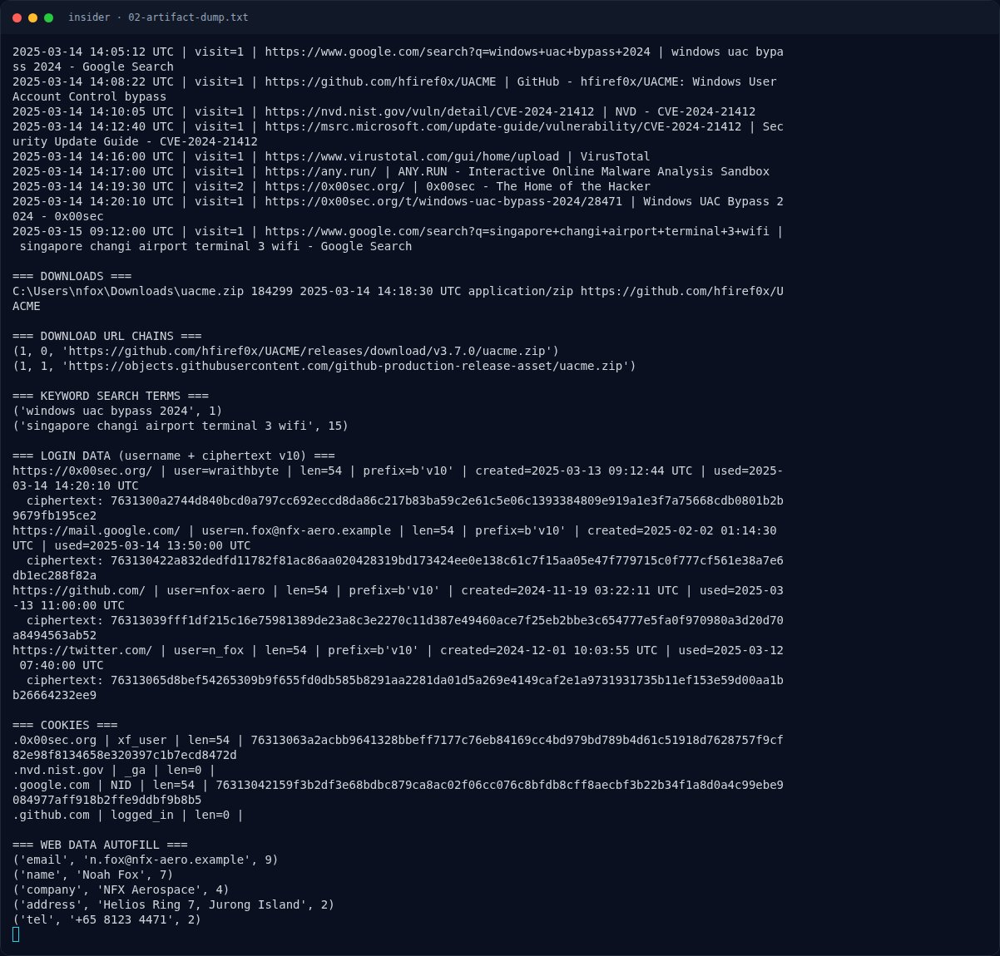
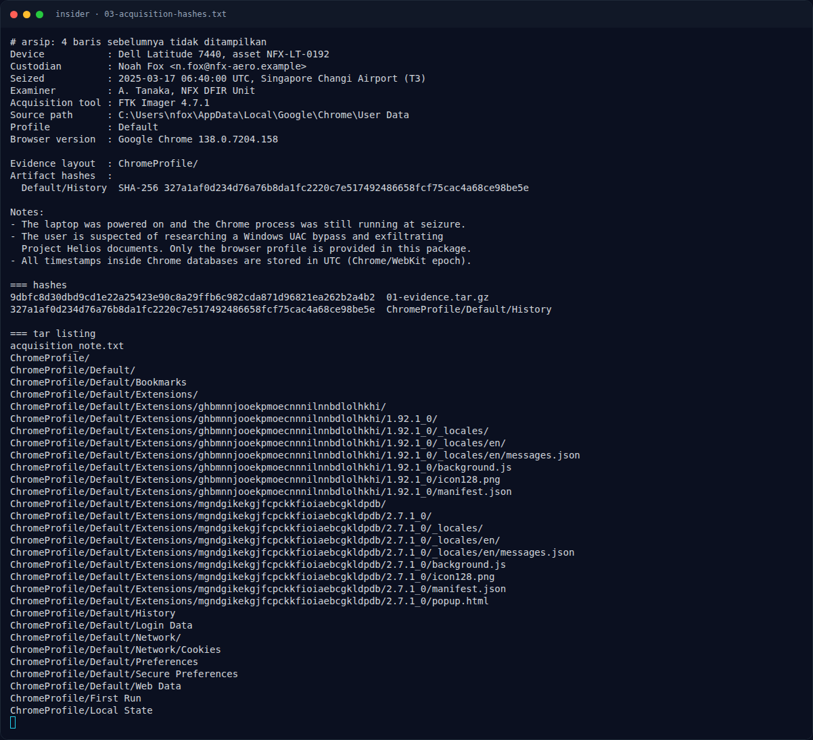

# insider — Pemulihan Artefak

[← Overview](06-insider.md) · [Index](index.md)

> **Langkah 7/10 — Pemulihan Artefak.** Script lengkap: assets/insider/dumpinsider.py.
>
> **Titik penting:** python3 dump_insider.py · https://github.com/hfiref0x/UACME · https://0x00sec.org/
>
> **Berikutnya:** [Flag](06-insider-08-flag.md)

### 3.1 Strategi

1. Ekstrak tar.gz.
2. Baca `acquisition_note.txt` untuk konteks dan verifikasi hash.
3. Query SQLite `History`, `Login Data`, `Web Data`, `Cookies`.
4. Identifikasi username forum, CVE, tanggal, dan extension.
5. Susun flag.

### 3.2 Langkah

```bash
mkdir -p insider_ev && cd insider_ev
tar xzf evidence_nfx_phantom_insider.tar.gz
python3 dump_insider.py
```

Script lengkap: `assets/insider/dump_insider.py`.

### 3.3 Output

```text
=== DOWNLOADS ===
C:\Users\nfox\Downloads\uacme.zip 184299 2025-03-14 14:18:30 UTC application/zip https://github.com/hfiref0x/UACME

=== LOGIN DATA (username + ciphertext v10) ===
https://0x00sec.org/ | user=wraithbyte | len=54 | prefix=b'v10' | created=2025-03-13 09:12:44 UTC
  ciphertext: 7631300a2744d840bcd0a797cc692eccd8da86c217b83ba59c2e61c5e06c1393384809e919a1e3f7a75668cdb0801b2b9679fb195ce2
...
=== WEB DATA AUTOFILL ===
('email', 'n.fox@nfx-aero.example', 9)
('name', 'Noah Fox', 7)
('company', 'NFX Aerospace', 4)
('address', 'Helios Ring 7, Jurong Island', 2)
```

### Evidence langkah ini



*Terminal evidence — `02-artifact-dump.txt` (arsip transkrip sesi solve).*



*Terminal evidence — `03-acquisition-hashes.txt` (arsip transkrip sesi solve).*

**Berkas mentah langkah ini:**

- [`02-artifact-dump.txt`](assets/insider/02-artifact-dump.txt)
- [`03-acquisition-hashes.txt`](assets/insider/03-acquisition-hashes.txt)
