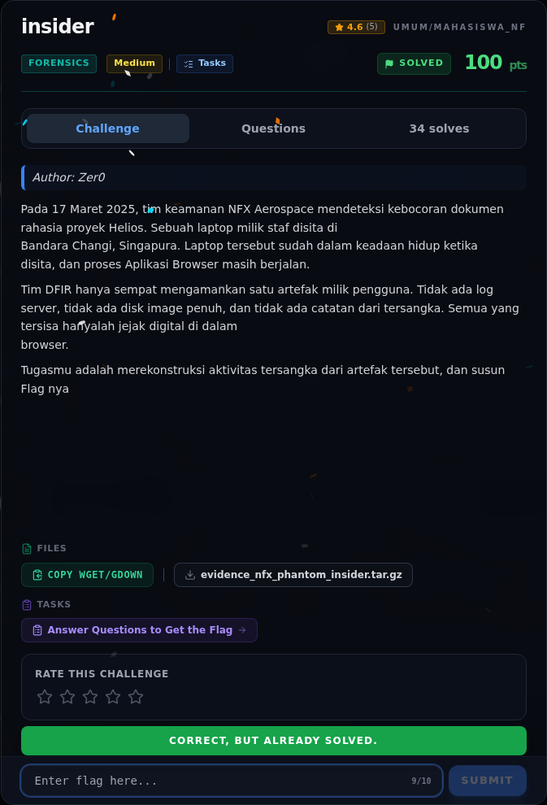
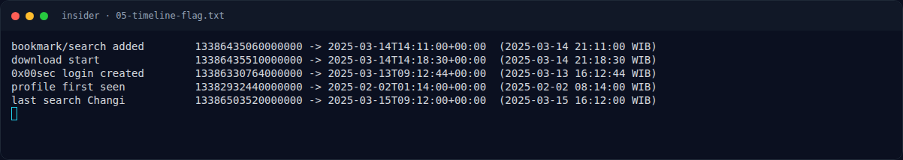

# insider — Flag & Verifikasi

[← Overview](06-insider.md) · [Index](index.md)

> **Flag:** `NFX{wraithbyte_cve202421412_20250314_zenvpn271}`
> **Status:** `VERIFIED`

```text
NFX{wraithbyte_cve202421412_20250314_zenvpn271}
```

Verifikasi/status:

```text
Sumber : flags/forensics/insider.txt
Isi    : NFX{wraithbyte_cve202421412_20250314_zenvpn271}
Status : VERIFIED platform (recheck 2026-11-09; flag lokal; challenge solved di platform)
```

### Bukti submit di platform



*Submit flag di platform: `CORRECT, BUT ALREADY SOLVED.`*

### Evidence langkah ini



*Terminal evidence — `05-timeline-flag.txt` (arsip transkrip sesi solve).*

**Berkas mentah langkah ini:**

- [`05-timeline-flag.txt`](assets/insider/05-timeline-flag.txt)

> **Verifikasi platform:** flag sudah diterima. Recheck 2026-11-09 mengembalikan `Correct, but already solved.`
