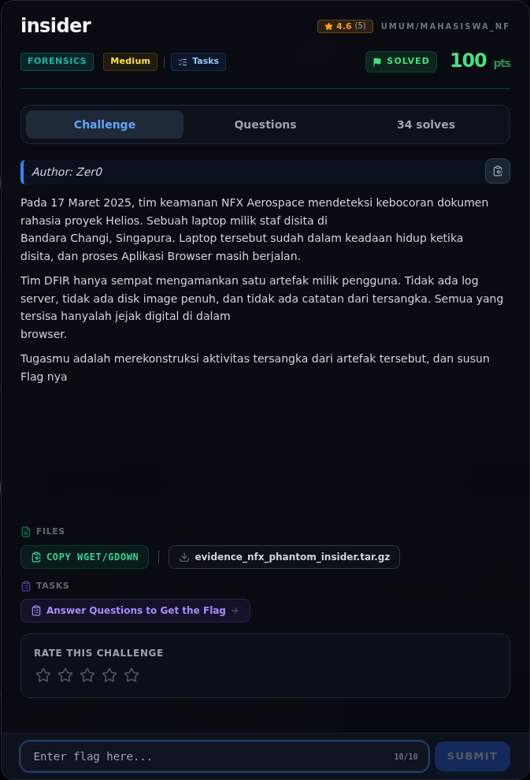
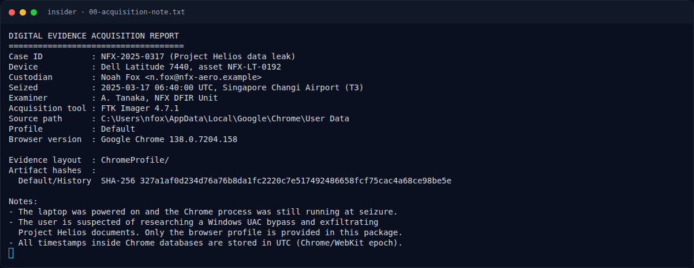
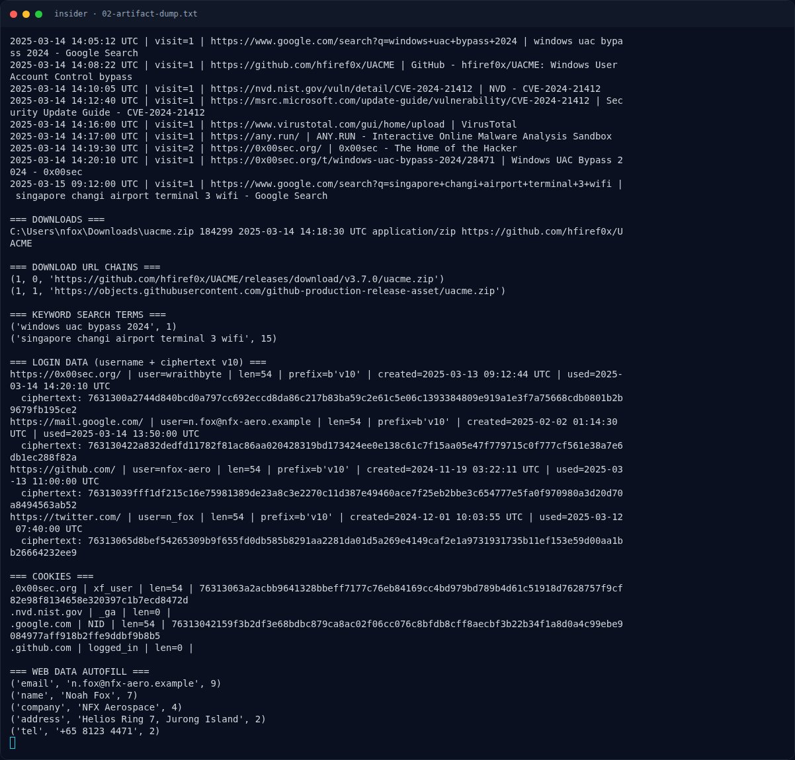
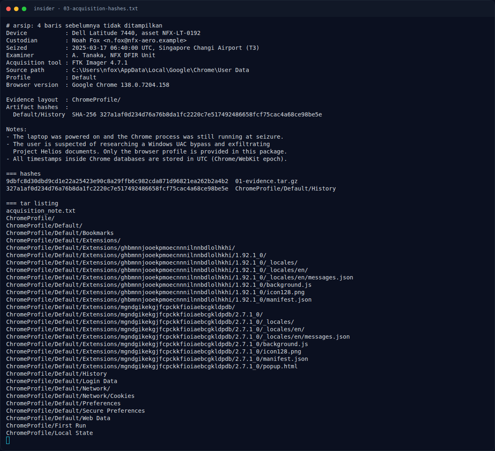
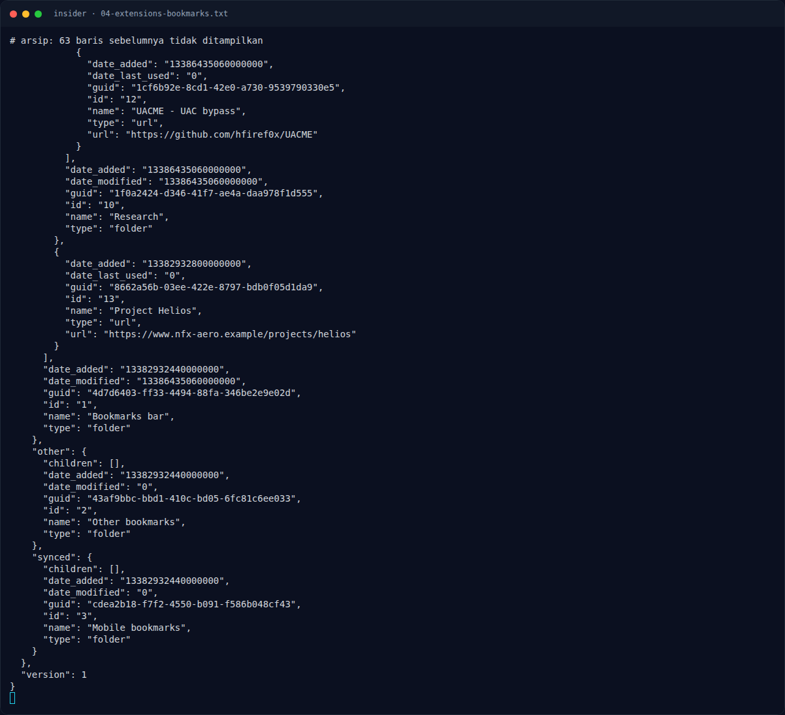
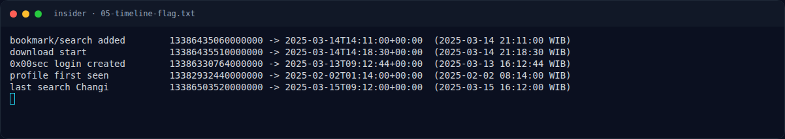
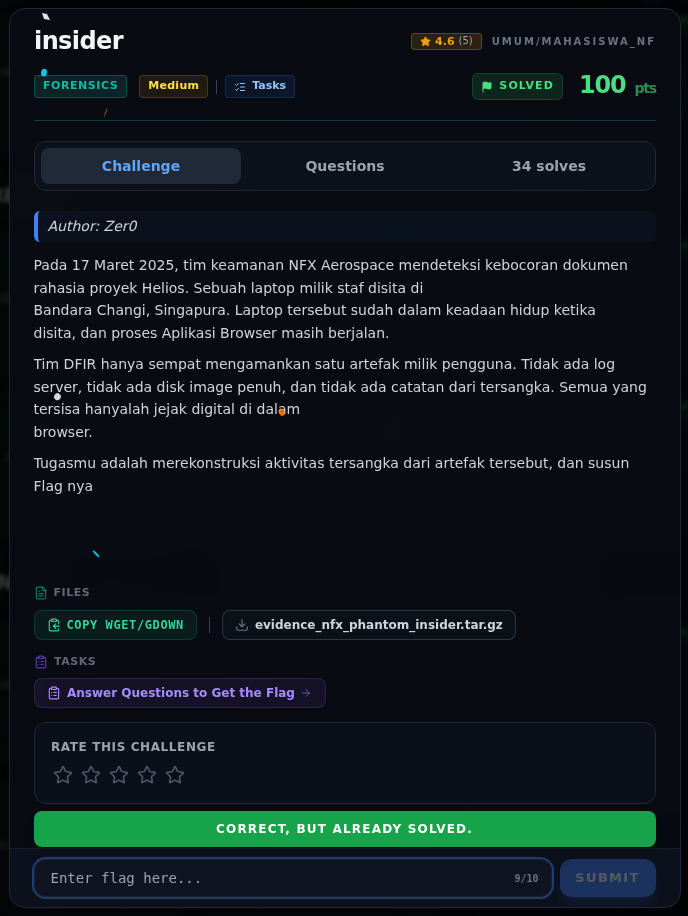

# insider — Evidence / Bukti

9 screenshot23 transkrip / script

[← Overview](06-insider.md) · [Index](index.md)

> **Langkah 9/10 — Bukti / Evidence.** Bukti / Evidence
>
> **Titik penting:** arsip screenshot dan transkrip
>
> **Berikutnya:** [Referensi](06-insider-10-referensi.md)

## Arsip Evidence

> Semua file berasal dari `assets/insider/`. Screenshot platform dan terminal adalah bukti asli dari sesi solve; transkrip mentah tetap ditautkan di bagian bawah.

### Platform

<figure><figcaption>00-challenge-platform.png</figcaption></figure>

*Challenge brief asli di platform NFX CTF 2026.*

<figure><figcaption>Terminal evidence (real)</figcaption></figure>

*Terminal evidence (real).*

### Terminal (arsip sesi)

<figure><figcaption>term-00-acquisition-note.png</figcaption></figure>

*Terminal evidence — `00-acquisition-note.txt` (arsip transkrip sesi solve).*

<figure><figcaption>term-02-artifact-dump.png</figcaption></figure>

*Terminal evidence — `02-artifact-dump.txt` (arsip transkrip sesi solve).*

<figure><figcaption>term-03-acquisition-hashes.png</figcaption></figure>

*Terminal evidence — `03-acquisition-hashes.txt` (arsip transkrip sesi solve).*

<figure><figcaption>term-04-extensions-bookmarks.png</figcaption></figure>

*Terminal evidence — `04-extensions-bookmarks.txt` (arsip transkrip sesi solve).*

<figure><figcaption>term-05-timeline-flag.png</figcaption></figure>

*Terminal evidence — `05-timeline-flag.txt` (arsip transkrip sesi solve).*

### Screenshot langkah

<figure><figcaption>icon128.png</figcaption></figure>

*Evidence — `icon128.png`.*

<figure><figcaption>icon128.png</figcaption></figure>

*Evidence — `icon128.png`.*

### Transkrip mentah & script

- [`00-acquisition-note.txt`](assets/insider/00-acquisition-note.txt)
- [`01-evidence.tar.gz`](assets/insider/01-evidence.tar.gz)
- [`02-artifact-dump.txt`](assets/insider/02-artifact-dump.txt)
- [`03-acquisition-hashes.txt`](assets/insider/03-acquisition-hashes.txt)
- [`04-extensions-bookmarks.txt`](assets/insider/04-extensions-bookmarks.txt)
- [`05-timeline-flag.txt`](assets/insider/05-timeline-flag.txt)
- [`Bookmarks`](assets/insider/ChromeProfile/Default/Bookmarks)
- [`messages.json`](assets/insider/ChromeProfile/Default/Extensions/ghbmnnjooekpmoecnnnilnnbdlolhkhi/1.92.1_0/_locales/en/messages.json)
- [`background.js`](assets/insider/ChromeProfile/Default/Extensions/ghbmnnjooekpmoecnnnilnnbdlolhkhi/1.92.1_0/background.js)
- [`manifest.json`](assets/insider/ChromeProfile/Default/Extensions/ghbmnnjooekpmoecnnnilnnbdlolhkhi/1.92.1_0/manifest.json)
- [`messages.json`](assets/insider/ChromeProfile/Default/Extensions/mgndgikekgjfcpckkfioiaebcgkldpdb/2.7.1_0/_locales/en/messages.json)
- [`background.js`](assets/insider/ChromeProfile/Default/Extensions/mgndgikekgjfcpckkfioiaebcgkldpdb/2.7.1_0/background.js)
- [`manifest.json`](assets/insider/ChromeProfile/Default/Extensions/mgndgikekgjfcpckkfioiaebcgkldpdb/2.7.1_0/manifest.json)
- [`popup.html`](assets/insider/ChromeProfile/Default/Extensions/mgndgikekgjfcpckkfioiaebcgkldpdb/2.7.1_0/popup.html)
- [`History`](assets/insider/ChromeProfile/Default/History)
- [`Login Data`](assets/insider/ChromeProfile/Default/Login Data)
- [`Cookies`](assets/insider/ChromeProfile/Default/Network/Cookies)
- [`Preferences`](assets/insider/ChromeProfile/Default/Preferences)
- [`Secure Preferences`](assets/insider/ChromeProfile/Default/Secure Preferences)
- [`Web Data`](assets/insider/ChromeProfile/Default/Web Data)
- [`First Run`](assets/insider/ChromeProfile/First Run)
- [`Local State`](assets/insider/ChromeProfile/Local State)
- [`dump_insider.py`](assets/insider/dump_insider.py)

## Validasi platform (real)

*Screenshot asli dari platform NFX CTF 2026. Platform menjawab
`CORRECT, BUT ALREADY SOLVED.` untuk flag ini.*

## Tabel Evidence

| Bukti | File | Keterangan |
|---|---|---|
| Attachment | `assets/insider/01-evidence.tar.gz` | tar.gz asli |
| Acquisition note | `assets/insider/00-acquisition-note.txt` | metadata penyitaan |
| Dump artefak | `assets/insider/02-artifact-dump.txt` | History, Login Data, Cookies, Web Data |
| Hash & listing | `assets/insider/03-acquisition-hashes.txt` | sha256 + tar listing |
| Extension | `assets/insider/04-extensions-bookmarks.txt` | ZenVPN + Bookmarks |
| Timeline | `assets/insider/05-timeline-flag.txt` | konversi timestamp |
| Profil Chrome | `assets/insider/ChromeProfile/` | artefak asli |
| Script | `assets/insider/dump_insider.py` | query SQLite |