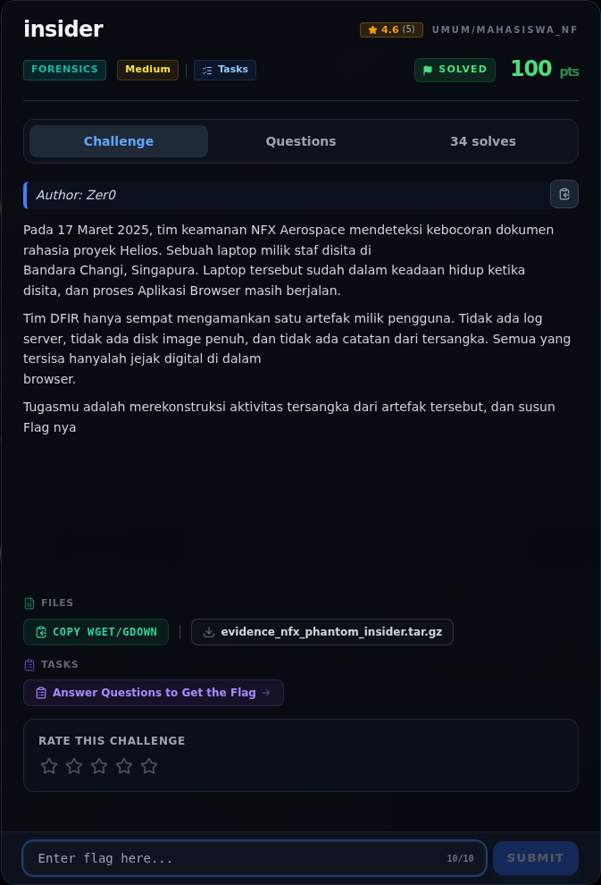

# insider — Referensi

[← Overview](06-insider.md) · [Index](index.md)

> **Langkah 10/10 — Referensi.** Referensi
>
> **Titik penting:** —
>
> **Selesai.** Kembali ke [Overview](06-insider.md).

- Chrome/WebKit timestamp: microseconds sejak 1601-01-01 UTC.
- Chrome `Login Data` `v10` + DPAPI `os_crypt.encrypted_key`.
- Ekstensi Chrome manifest v3 dan proxy API.

### Evidence langkah ini

*Challenge brief asli di platform NFX CTF 2026.*
