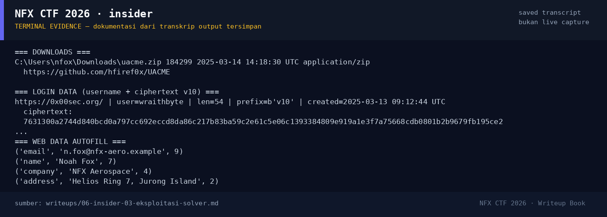

# insider

Track Mahasiswa NF · ForensicsMedium100 poinVERIFIED

| Field | Nilai |
|---|---|
| Event | `umum/mahasiswa_nf` |
| Kategori | `Forensics` |
| Difficulty | `Medium` |
| Poin | `100` |
| Author | `Zer0` |
| Tools | python3, exiftool, git |
| Flag | `NFX{wraithbyte_cve202421412_20250314_zenvpn271}` |
| Status | `VERIFIED` |

[← Kembali ke Index](index.md)

## TL;DR

- Artefak hanya berupa profil Chrome (`ChromeProfile/`), tanpa disk image dan tanpa log server.
- `History` menunjukkan riset UAC bypass, CVE-2024-21412, download `uacme.zip`, dan login ke `0x00sec.org` dengan username **wraithbyte**.
- `Login Data` menyimpan password `v10` (AES-GCM + DPAPI), tetapi **tidak ada master key DPAPI** di paket; password tidak perlu dipecahkan untuk mendapatkan flag.
- Extension non-webstore **ZenVPN 2.7.1** dan timestamp bookmark/search **20250314** melengkapi komponen flag.
- Flag disusun dari empat artefak: `wraithbyte` + `cve202421412` + `20250314` + `zenvpn271`.

Pratinjau evidence. Buka halaman <a href="06-insider-05-bukti-evidence.html">Evidence / Bukti</a> untuk semua screenshot dan transkrip.

## Navigasi Halaman

<a class="nx-page-card" href="06-insider-01-recon.html"><b>Recon</b>Enumerasi target dan bukti awal</a>
<a class="nx-page-card" href="06-insider-02-analisis.html"><b>Analisis</b>Membaca alur dan akar masalah</a>
<a class="nx-page-card" href="06-insider-03-eksploitasi-solver.html"><b>Eksploitasi / Solver</b>Langkah exploit dan solver</a>
<a class="nx-page-card" href="06-insider-04-flag.html"><b>Flag</b>Flag dan verifikasi platform</a>
<a class="nx-page-card" href="06-insider-05-bukti-evidence.html"><b>Bukti / Evidence</b>Screenshot, transkrip, dan artefak</a>
<a class="nx-page-card" href="06-insider-06-referensi.html"><b>Referensi</b>Sumber dan bacaan lanjutan</a>

