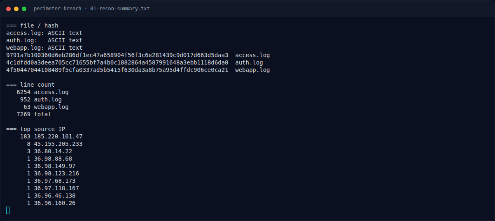

# Perimeter Breach — Recon Artefak

[← Overview](07-perimeter-breach.md) · [Index](index.md)

### 1.1 Deskripsi challenge

> Author: Ariaf
>
> Platform e-commerce retail **AromaCraft** (**web01**) dilaporkan mengalami insiden keamanan pada **10 Oktober 2026**.
>
> Tim Incident Response (IR) berhasil mengamankan tiga artefak log dari server: **access.log** (Nginx), **auth.log** (Syslog), dan **webapp.log** (Log Aplikasi).
> Semua zona waktu dalam WIB (+0700).
>
> Rekonstruksi seluruh aktivitas penyerang dari tahap reconnaissance, initial access, webshell execution, lateral movement, hingga persistence.
> Jawab kelima pertanyaan investigasi berikut pada platform untuk mendapatkan flag.

### 1.2 File yang diberikan

| File | Ukuran | Keterangan |
|---|---:|---|
| `access.log` | 1.263.326 byte | 6.254 baris Nginx |
| `auth.log` | 92.027 byte | 952 baris syslog |
| `webapp.log` | 6.256 byte | 63 baris log aplikasi |

Hash:

```bash
$ sha256sum access.log auth.log webapp.log
9791a7b100360d6eb286df1ec47a658904f56f3c6e281439c9d017d663d5daa3  access.log
4c1dfdd0a3deea705cc71655bf7a4b0c1882864a4587991648a3ebb1118d6da0  auth.log
4f50447044108489f5cfa0337ad5b5415f630da3a8b75a95d4ffdc906ce0ca21  webapp.log
```

### 1.3 Environment

- Linux, `awk`, `grep`, `sort`, `uniq`, Python
- Tidak ada `tshark`/`sqlite3`; analisis log murni text processing.

### 1.4 Triage awal

Distribusi source IP:

```bash
$ awk '{print $1}' access.log | sort | uniq -c | sort -rn | head
    183 185.220.101.47
      8 45.155.205.233
      3 36.80.14.22
      1 36.98.88.68
      ...
```

`185.220.101.47` mendominasi dengan 183 request, jauh di atas user normal. `45.155.205.233` adalah scanner Nikto lain (8 request, 11:47), bukan aktor utama.

### Evidence langkah ini



*Terminal evidence — `01-recon-summary.txt` (arsip transkrip sesi solve).*
