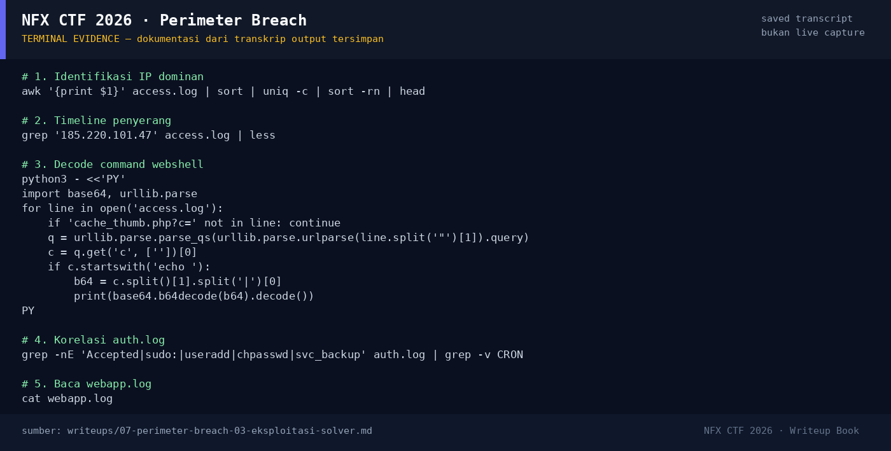

# Perimeter Breach — Evidence / Bukti

1 screenshot9 transkrip / script

[← Overview](07-perimeter-breach.md) · [Index](index.md)

## Arsip Evidence

> Semua file di bawah berasal dari folder `assets/perimeter-breach/`. Screenshot ditempel langsung; file teks/script ditautkan.

### Screenshot

<figure><figcaption>98-terminal-evidence.png</figcaption></figure>

### Transkrip / file pendukung

- [`01-recon-summary.txt`](assets/perimeter-breach/01-recon-summary.txt)
- [`02-attacker-requests.txt`](assets/perimeter-breach/02-attacker-requests.txt)
- [`03-webshell.txt`](assets/perimeter-breach/03-webshell.txt)
- [`03b-decoded-webshell.txt`](assets/perimeter-breach/03b-decoded-webshell.txt)
- [`04-auth-timeline.txt`](assets/perimeter-breach/04-auth-timeline.txt)
- [`05-webapp.txt`](assets/perimeter-breach/05-webapp.txt)
- [`access.log`](assets/perimeter-breach/access.log)
- [`auth.log`](assets/perimeter-breach/auth.log)
- [`webapp.log`](assets/perimeter-breach/webapp.log)

## Tabel Evidence

| Bukti | File | Keterangan |
|---|---|---|
| Log asli | `assets/perimeter-breach/access.log`, `auth.log`, `webapp.log` | artefak |
| Ringkasan | `assets/perimeter-breach/01-recon-summary.txt` | hash, line count, top IP |
| Request penyerang | `assets/perimeter-breach/02-attacker-requests.txt` | 183 request |
| Webshell | `assets/perimeter-breach/03-webshell.txt` | request + decoded command |
| Auth timeline | `assets/perimeter-breach/04-auth-timeline.txt` | SSH, sudo, useradd |
| Webapp log | `assets/perimeter-breach/05-webapp.txt` | brute force + upload |